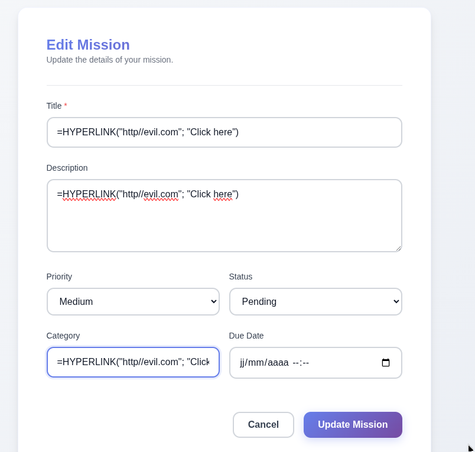
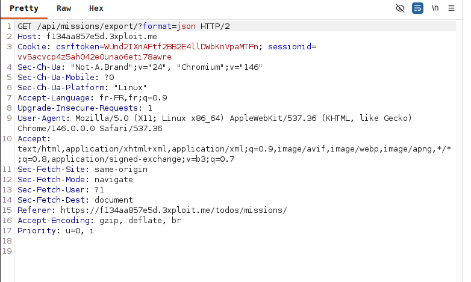
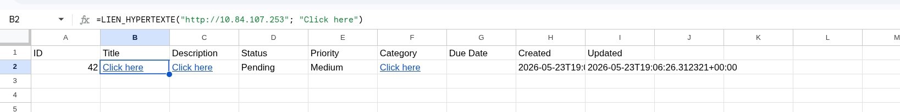

# Description

CSV / formula injection (CWE-1236) in the export functionality. User-controlled fields — Mission titles/descriptions, chatbot messages, and banking transaction notes — are written into generated CSV exports without neutralising leading formula characters (`=`, `+`, `-`, `@`). When the exported CSV is opened in a spreadsheet (Excel, LibreOffice Calc, Google Sheets), the strings are interpreted as live formulas, enabling data exfiltration, external network calls, and (with DDE/macros enabled) command execution in the victim's context.

# Exploitation

| Step | Action | Result |
|------|--------|--------|
| 1 | Create a Mission with a formula payload in the title/description. | Stored verbatim. |
| 2 | Export the missions as CSV (`?format=csv`). | Payload embedded as a live cell formula. |
| 3 | Victim opens the CSV in a spreadsheet. | Formula executes. |

# PoC

Payload stored in a Mission title:

```
=HYPERLINK("http://evil.com";"Click here")
```

Export and inspect:

```
GET /api/missions/export/?format=csv
```

The cell renders as an active hyperlink/formula when opened:








Other sinks confirmed: chatbot message export and banking transaction-note export.

# Risk

| Dimension | Impact |
|-----------|--------|
| Confidentiality | Formulas (`=HYPERLINK`, `=WEBSERVICE`) exfiltrate cell/sheet data to an attacker server. |
| Integrity | DDE/macro chains can execute commands in the victim's spreadsheet context. |
| Availability | None directly. |

Overall severity: **Medium** — impact depends on victim spreadsheet settings, but the platform attacks downstream consumers of its exports.

# Remediation

1. **Prefix any cell beginning with `= + - @` (or tab/CR)** with a single quote `'` or a leading space when generating CSV.
2. **Wrap fields in double quotes and escape** embedded quotes per RFC 4180.
3. **Validate/reject formula-leading input** at creation time where feasible.

# Author
TastyCrousteam
