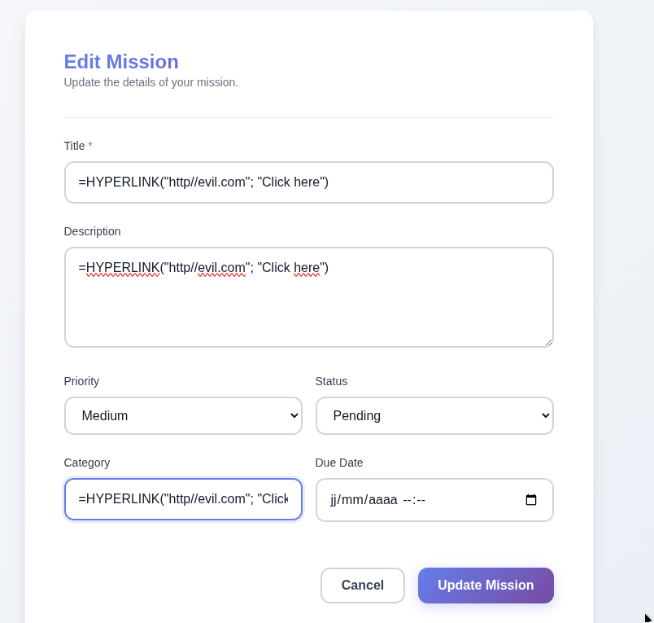
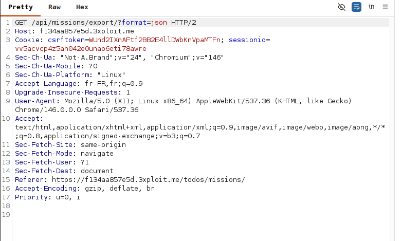
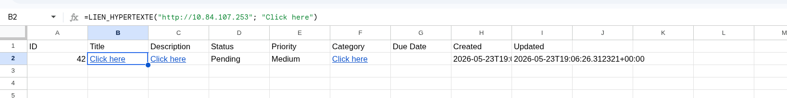

# Description

CSV / formula injection (CWE-1236) in the export functionality. User-controlled fields — Mission titles/descriptions, chatbot messages, and banking transaction notes — are written into generated CSV exports without formula neutralisation. When an exported CSV is opened in a spreadsheet application, these values may be interpreted as formulas, depending on the application and its configuration.

The reviewed export functions are restricted to the current user's or session's data. An impact on other users has not been demonstrated.

# Exploitation

| Step | Action | Result |
|------|--------|--------|
| 1 | Create a Mission with a formula payload in the title/description. | Stored verbatim. |
| 2 | Export the missions as CSV (`?format=csv`). | Payload embedded as a live cell formula. |
| 3 | Victim opens the CSV in a spreadsheet. | Formula executes. |

# PoC

Payload stored in a Mission title:

```
=HYPERLINK("http://evil.com";"Click here")
```

Export and inspect:

```
GET /api/missions/export/?format=csv
```

The cell renders as an active hyperlink/formula when opened:








The same lack of formula neutralisation was identified through source code review in chatbot message exports and banking transaction-note exports. These additional exports were not independently tested in a spreadsheet.

# Risk

| Dimension | Impact |
|-----------|--------|
| Confidentiality | Potential information disclosure, depending on the spreadsheet application and its configuration. |
| Integrity | Potential unintended spreadsheet behaviour resulting from formula interpretation. |
| Availability | None demonstrated. |

Overall severity: **Medium (provisional)** — impact depends on spreadsheet behaviour and configuration. The reviewed exports are restricted to the current user's or session's data, and cross-user impact has not been demonstrated.

# Remediation

1. **Neutralise formula-sensitive values** in user-controlled fields when generating CSV exports.
2. **Use proper CSV quoting and escaping** per RFC 4180, in addition to formula neutralisation.
3. **Validate the chosen protection against supported spreadsheet applications**, including when files are saved and reopened.
4. **Validate formula-leading input** at creation time where appropriate, as an additional safeguard.

# Author
TastyCrousteam
