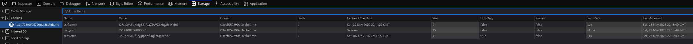

# Description

Cleartext storage of sensitive information in a cookie (CWE-315). During payment processing, the `payment()` view in `Shopping/views.py` stores the user's full card number (PAN) in a cookie named `last_card`, set **without `HttpOnly`** and **without `Secure`**. These missing attributes increase the exposure of sensitive information to client-side scripts and potentially unencrypted HTTP communications.

# Exploitation

| Step | Action | Result |
|------|--------|--------|
| 1 | Payment processing is initiated. | `last_card` cookie set before payment completion. |
| 2 | Inspect cookies (DevTools) or read `document.cookie`. | Full PAN in cleartext. |

# PoC

The PAN is visible in plain text in the cookie jar.

```http
GET /banking/verification/ HTTP/1.1
Host: <TARGET>
Cookie: csrftoken=…; sessionid=…; last_card=7219208256090561
```



The absence of the `HttpOnly` attribute increases the exposure of the cookie to client-side scripts.

# Risk

| Dimension | Impact |
|-----------|--------|
| Confidentiality | Full card number stored in a client-side cookie without appropriate security attributes. |
| Integrity | Potential financial misuse; no actual fraud demonstrated. |
| Availability | None directly. |

Overall severity: **Medium-High (provisional)** — exposure of sensitive card information through insecure client-side storage. Actual impact depends on the deployment configuration and the nature of the stored card data.

# Remediation

1. **Do not store the full PAN in client-side cookies.** If a "last card" hint is needed, use a masked card reference.
2. **Set `HttpOnly`, `Secure`, and an appropriate `SameSite` attribute** on cookies requiring protection.
3. **Serve the site over HTTPS only** and enforce HSTS.

# Author
CESI-ROUEN
