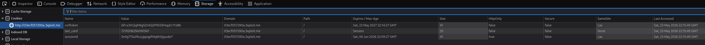

# Description

Cleartext storage of sensitive information (CWE-312). After a payment, the `payment()` view in `Shopping/views.py` stores the user's full card number (PAN) in a cookie named `last_card`, set **without `HttpOnly`** (readable by JavaScript) and **without `Secure`** (transmitted over plain HTTP). The 16-digit PAN is therefore exposed to any XSS on the origin and to network interception.

# Exploitation

| Step | Action | Result |
|------|--------|--------|
| 1 | Log in and complete a purchase with a card. | `last_card` cookie set. |
| 2 | Inspect cookies (DevTools) or read `document.cookie`. | Full PAN in cleartext. |

# PoC

The PAN is visible in plain text in the cookie jar and on every subsequent request:

```http
GET /banking/verification/ HTTP/1.1
Host: <TARGET>
Cookie: csrftoken=…; sessionid=…; last_card=7219208256090561
```



Because the cookie lacks `HttpOnly`, any stored/reflected XSS on the origin can exfiltrate it with `document.cookie`.

# Risk

| Dimension | Impact |
|-----------|--------|
| Confidentiality | Full card number disclosed to JavaScript and to anyone on the network path. |
| Integrity | Enables financial fraud with the stolen PAN. |
| Availability | None directly. |

Overall severity: **Medium-High** — a PCI-DSS violation; combines directly with the platform's XSS findings for card theft.

# Remediation

1. **Do not store the PAN client-side at all.** If a "last card" hint is needed, store only a masked suffix (`**** 0561`) server-side.
2. **Set `HttpOnly`, `Secure`, and `SameSite`** on any sensitive cookie.
3. **Serve the site over HTTPS only** (HSTS).

# Author
CESI-ROUEN
