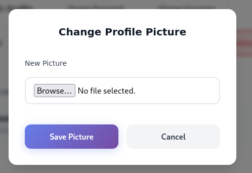
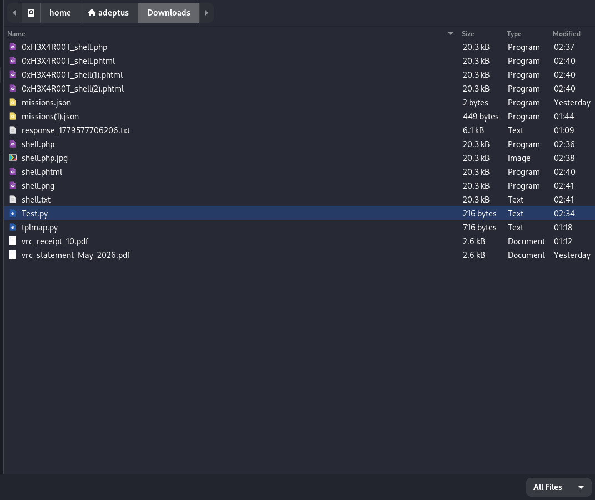
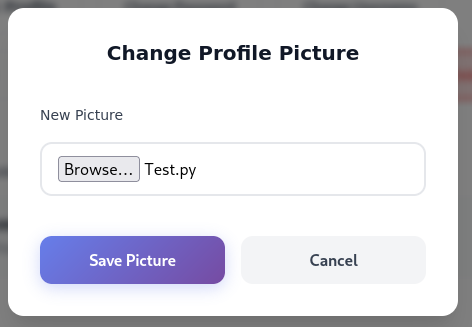
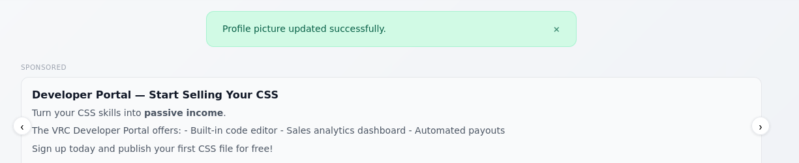
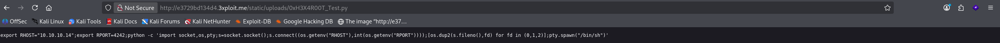

# Description

Unrestricted file upload (CWE-434) in the profile-picture feature at `POST /account/settings/`. The handler validates neither the file extension nor the content (magic bytes) of the uploaded file. An authenticated user can upload an arbitrary non-image file — a script, an HTML page, or an SVG — which is stored under the public, same-origin path `/static/uploads/<name>` and served back under its assigned storage filename.

Because the file is served from the trusted application origin, unrestricted file uploads introduce potential browser-side security risks, including stored XSS, as well as arbitrary-content hosting on a legitimate domain.

# Exploitation

| Step | Action | Result |
|------|--------|--------|
| 1 | Log in as any user. | Authenticated session. |
| 2 | Open the profile-picture editing modal on `/account/settings/`. | Upload form available. |
| 3 | Upload a non-image file (e.g. `Test.py`, `poc.html`, or a scripted `.svg`). | "Profile picture updated successfully." |
| 4 | Browse to `/static/uploads/<name>`. | File content is displayed in the browser. |

# PoC

**1. Open the upload modal:**



**2. Select a non-image payload file:**



**3. The upload is accepted with a success message:**





**4. The uploaded file is retrievable under the app origin:**

```
GET /static/uploads/0xh3x4r00t_Test.py  → HTTP 200, served verbatim
```



The reported PoC demonstrates unrestricted file upload and retrieval. Stored XSS and session-related impacts remain potential consequences that are not demonstrated by the provided screenshots.

# Risk

| Dimension | Impact |
|-----------|--------|
| Confidentiality | Potential exposure of user data through stored XSS; direct session cookie theft has not been demonstrated. |
| Integrity | Attacker-controlled content hosted on the trusted origin; potential browser-side impact. |
| Availability | No direct availability impact demonstrated. |

Overall severity: **High** — unrestricted file upload and arbitrary content hosting, with potential stored XSS impact. The application's deployment configuration uses `runserver --insecure`, and production settings specify `DEBUG=False`.

# Remediation

1. **Allow-list supported image types** (`.jpg`, `.jpeg`, `.png`, `.gif`) and validate uploaded files by decoding them with a trusted image-processing library. Do not rely solely on client-supplied extensions or MIME types.
2. **Re-encode images server-side** to strip embedded scripts/metadata.
3. **Rename uploads using a random UUID and a validated image extension**, and store user uploads outside the application web root or serve them from a separate isolated origin.
4. **Force safe response headers** for validated user content: an appropriate image `Content-Type` plus `X-Content-Type-Options: nosniff`. Ensure that untrusted active content cannot be served from the application origin.

# Author
CUSTODES SQUAD
