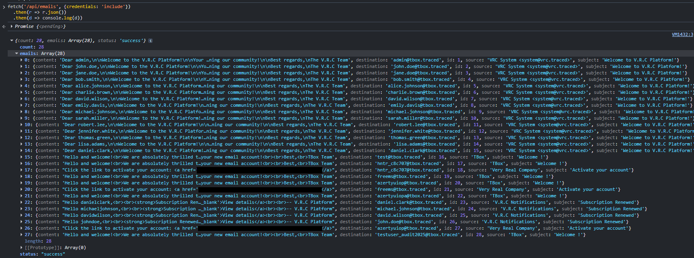
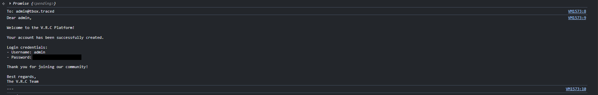
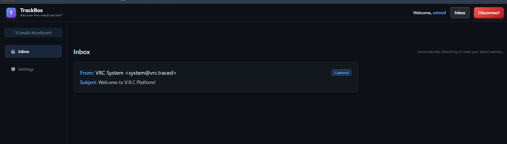
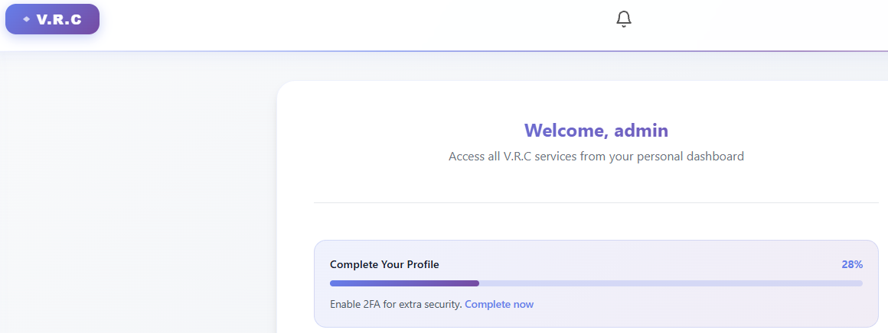

# Description

Missing Access Control (CWE-306 / CWE-639) on the TrackBox webmail endpoints `GET /api/emails` (`API.py:101-139`) and `GET /api/emails/<id>` (`API.py:140-163`).

The endpoints expose all stored mailboxes, and any single message by its sequential integer id, without enforcing authentication or mailbox-level authorisation. (The HTML route `/client/mail?email=<id>` does compare the `Username` cookie with the destination and does not disclose other users' mail — it returns `500` instead — so the flaw is in the API.) Unauthenticated access has been confirmed both directly and through BunkerWeb.

The V.R.C welcome system includes plaintext login credentials in welcome emails. These messages expose sensitive authentication information, including credentials associated with seeded accounts.

The exposed credentials of the seeded `admin` superuser were confirmed to be valid, resulting in demonstrated administrative account compromise on the main V.R.C application.

Account-activation tokens are also present in the exposed email contents.

# Exploitation

| Step | Action | Result |
|------|--------|--------|
| 1 | Call `GET /api/emails` directly — no signup or login needed. | All emails of all users returned (endpoint has no auth check). |
| 2 | (Optional) Sign up at `/signup` and log in at `/connect`. | Not required — the endpoint is fully unauthenticated. |
| 3 | Extract the admin welcome email's password; log in to the main app. | Credential harvest complete; Admin takeover. |

# PoC

**1. Unauthorised disclosure of mailbox contents:**

```javascript
fetch('/api/emails', {credentials:'include'}).then(r=>r.json()).then(console.log)
// {"count":28,"emails":[...all users...],"status":"success"}
```



The response contains 28 email messages belonging to multiple users in the tested instance. The number of returned messages depends on the stored mailbox contents.

Runtime testing confirmed that no authenticated session is required to access the stored mailbox contents.

**2. Exposure of sensitive authentication information:**

```http
GET /api/emails?user=admin HTTP/1.1
Host: webmail.<TARGET>

{"count":1,"emails":[{"content":"...Password: [REDACTED]...","destination":"admin@tbox.traced"}]}
```



No cookie is needed. The same message is also returned by id: `GET /api/emails/1` → `200 {"email":{"content":"Dear admin, ... Password: [REDACTED] ...","destination":"admin@tbox.traced","id":1,...}}`; ids are sequential, so every message can be enumerated.

The exposed welcome email contains plaintext login credentials associated with the seeded V.R.C superuser. The password value has been redacted from the evidence.

**3. Confirmed administrative account compromise:**





Administrative account compromise was confirmed on the main V.R.C application.
The exposed email contents also include account-activation tokens for pending registrations.

Runtime testing through BunkerWeb confirmed the same unauthenticated disclosure over HTTP and HTTPS.

ModSecurity with CRS 4.26 was operating in detection mode. No rules were triggered during the reported tests, including outbound data-leak detection, and the anomaly score remained at 0.

Blocking mode was not tested.

# Risk

| Dimension | Impact |
|-----------|--------|
| Confidentiality | Unauthenticated disclosure of all stored mailbox contents, including plaintext login credentials and account-activation tokens. |
| Integrity | Demonstrated compromise of the seeded V.R.C superuser account and exposure of other accounts to unauthorised access. |
| Availability | Administrative account compromise enables privileged actions that may affect service availability. No direct service disruption was demonstrated. |

Overall severity: **Critical** — unauthenticated disclosure of sensitive mailbox contents leading to demonstrated administrative account compromise on the main V.R.C application.

# Remediation

1. **Require authentication and enforce mailbox-level authorisation** for every email access operation.
2. **Stop emailing plaintext passwords** — use short-lived, single-use account setup links.
3. **Rotate all exposed credentials** and invalidate exposed activation tokens.
4. **Audit every webmail object endpoint** for missing authentication and ownership checks.
5. **Add regression tests** covering anonymous access and cross-account mailbox isolation.

# Author
CPE LYON
