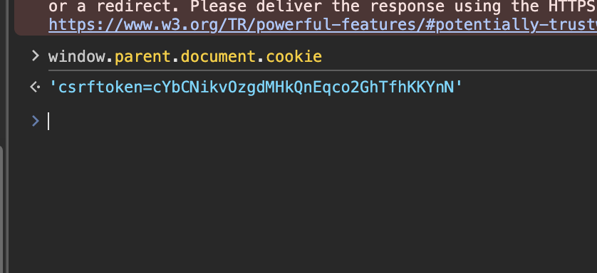
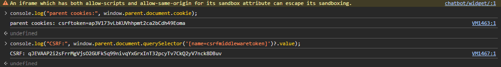

# Description

Unsafe iframe sandbox configuration (CWE-693 — Protection Mechanism Failure). The chatbot widget is embedded via the `chat_widget.html` partial (`shared/templates/chat-bubble/chat_widget.html:68`).

The current sandbox configuration weakens the intended isolation between the chatbot widget and its parent document. This represents a security hardening weakness that may increase the impact of a separate content-injection vulnerability.

The relationship with the Prompt Injection finding requires separate validation. Prompt injection alone does not demonstrate browser-side JavaScript execution.

# Exploitation

| Step | Action | Result |
|------|--------|--------|
| 1 | View source on any page; locate the chatbot iframe. | `sandbox="allow-scripts allow-forms allow-same-origin"`. |
| 2 | Run JS in the iframe context (e.g. via LLM-injected unescaped HTML, or any widget XSS). | `window.parent.document` accessible. |
| 3 | Read `window.parent.document.cookie` and DOM. | CSRF token exfiltrated; authenticated requests issued via same-origin `fetch()`. The `sessionid` cookie is `HttpOnly` and not readable by JS, but cookie-authenticated requests from the same origin succeed. |

# PoC

The dangerous iframe is present site-wide:

```html
<iframe src="/chatbot/widget/" title="Support Chat"
        sandbox="allow-scripts allow-forms allow-same-origin"></iframe>
```



From the iframe context, the parent is fully reachable:

```javascript
// executed inside /chatbot/widget/
console.log("parent cookies:", window.parent.document.cookie);
console.log("CSRF:", window.parent.document.querySelector('[name=csrfmiddlewaretoken]')?.value);
```


W3C HTML Living Standard (§ iframe sandbox): a page with both `allow-same-origin` and `allow-scripts` "could remove the sandbox attribute and then reload, running the original page's scripts again."

# Risk

| Dimension | Impact |
|-----------|--------|
| Confidentiality | Potential exposure of sensitive parent-document data if an independent injection vulnerability exists. |
| Integrity | Potential impact on authenticated user actions due to insufficient widget isolation. |
| Availability | No direct availability impact demonstrated. |

Overall severity: **Medium-High** — insufficient iframe isolation that may increase the impact of an independent content-injection vulnerability. Session theft has not been demonstrated.

# Remediation

1. **Enforce effective iframe isolation** by reviewing sandbox permissions and redesigning widget communication where necessary. Apply the principle of least privilege.
2. **Serve untrusted widget content from an isolated origin**, where appropriate.
3. **Apply a restrictive Content Security Policy** and sanitise all widget output. Use `frame-ancestors` separately to control authorised embedding.
4. **Add regression tests** verifying the intended isolation between the widget and its parent document.

# Author
CHILL HUNT
