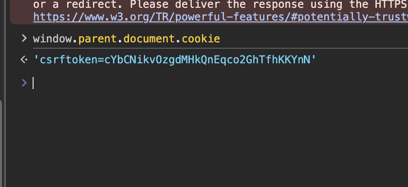

# Description

Unsafe iframe sandbox configuration (CWE-693 — Protection Mechanism Failure). The chatbot widget is embedded site-wide via the `chat_widget.html` partial (`shared/templates/chat-bubble/chat_widget.html`): `<iframe src="/chatbot/widget/" sandbox="allow-scripts allow-forms allow-same-origin">`. The combination of `allow-scripts` **and** `allow-same-origin` is explicitly documented by the W3C/MDN as nullifying the sandbox: any JavaScript inside the iframe can reach `window.parent.document`, read the CSRF token from the parent DOM, and issue authenticated requests as the victim.

The whole point of sandboxing the chatbot — whose output can be influenced by adversarial input (see the prompt-injection finding) — is defeated.

# Exploitation

| Step | Action | Result |
|------|--------|--------|
| 1 | View source on any page; locate the chatbot iframe. | `sandbox="allow-scripts allow-forms allow-same-origin"`. |
| 2 | Run JS in the iframe context (e.g. via LLM-injected unescaped HTML, or any widget XSS). | `window.parent.document` accessible. |
| 3 | Read `window.parent.document.cookie` and DOM. | CSRF token exfiltrated; authenticated requests issued via same-origin `fetch()`. The `sessionid` cookie is `HttpOnly` and not readable by JS, but cookie-authenticated requests from the same origin succeed. |

# PoC

The dangerous iframe is present site-wide:

```html
<iframe src="/chatbot/widget/" title="Support Chat"
        sandbox="allow-scripts allow-forms allow-same-origin"></iframe>
```



From the iframe context, the parent is fully reachable:

```javascript
// executed inside /chatbot/widget/
console.log("parent cookies:", window.parent.document.cookie);
console.log("CSRF:", window.parent.document.querySelector('[name=csrfmiddlewaretoken]')?.value);
```

W3C HTML Living Standard (§ iframe sandbox): a page with both `allow-same-origin` and `allow-scripts` "could remove the sandbox attribute and then reload, running the original page's scripts again."

# Risk

| Dimension | Impact |
|-----------|--------|
| Confidentiality | CSRF-token theft from the parent DOM and same-origin authenticated requests as the victim. The `sessionid` cookie is `HttpOnly` (not directly readable by JS), but the attacker can perform any action via `fetch()` from the trusted origin. |
| Integrity | Authenticated requests issued via `window.parent` in the victim's session. |
| Availability | None directly. |

Overall severity: **Medium-High** — site-wide latent escalation surface; any current/future content-injection in the widget (e.g. the confirmed prompt injection → unescaped HTML) inherits a full session-theft path.

# Remediation

1. **Remove `allow-same-origin`** from the sandbox — `sandbox="allow-scripts allow-forms"`. The iframe then runs as a null origin: `window.parent.document` raises `SecurityError`. Note: this breaks the widget's `fetch('/chatbot/api/chat/')` calls (they become cross-origin); switch to a `postMessage`-based or token-based API design.
2. **Add a Content-Security-Policy** with `frame-ancestors` controls and sanitise all widget output.

# Author
CHILL HUNT
