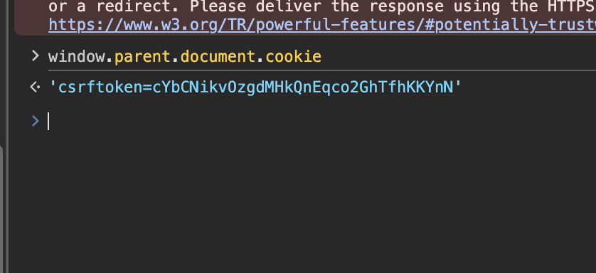
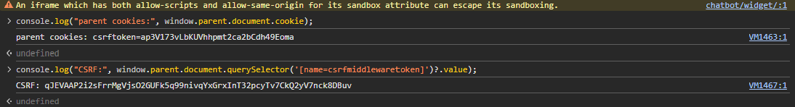

# Description

Unsafe iframe sandbox configuration (CWE-693 — Protection Mechanism Failure). The chatbot widget is embedded site-wide via the `chat_widget.html` partial (`shared/templates/chat-bubble/chat_widget.html:68`), included in the shared base template (`shared/templates/base/base.html:91`). The widget is rendered on `/`, `/account/`, `/forum/` and `/banking/`.

The combination of `allow-scripts` and `allow-same-origin` in the same-origin iframe defeats the intended document isolation provided by the sandbox.

Parent-document access is confirmed by browser testing. This configuration creates a site-wide escalation surface for independent script-injection vulnerabilities affecting the widget.

The chatbot message text is escaped before insertion into the DOM (`Chatbot/templates/chatbot/widget.html:109,125-128`). Prompt injection alone does not demonstrate browser-side JavaScript execution.

# Exploitation

| Step | Action | Result |
|------|--------|--------|
| 1 | View source on any page; locate the chatbot iframe. | `sandbox="allow-scripts allow-forms allow-same-origin"`. |
| 2 | Run JS in the iframe context (e.g. via any widget XSS). | `window.parent.document` accessible. |
| 3 | Read `window.parent.document.cookie` and DOM. | Parent-document access and visibility of the CSRF cookie and DOM token confirmed during browser testing. The `sessionid` cookie is protected by `HttpOnly`. |

# PoC

The dangerous iframe is present site-wide:

```html
<iframe src="/chatbot/widget/" title="Support Chat"
        sandbox="allow-scripts allow-forms allow-same-origin"></iframe>
```



From the iframe context, the parent is fully reachable:

```javascript
// executed inside /chatbot/widget/
console.log("parent cookies:", window.parent.document.cookie);
console.log("CSRF:", window.parent.document.querySelector('[name=csrfmiddlewaretoken]')?.value);
```



The `sessionid` cookie is protected by `HttpOnly`, whereas `csrftoken` is not (`CSRF_COOKIE_HTTPONLY=False` by default).

W3C HTML Living Standard (§ iframe sandbox): a page with both `allow-same-origin` and `allow-scripts` "could remove the sandbox attribute and then reload, running the original page's scripts again."

The same iframe configuration was confirmed through BunkerWeb over HTTP and HTTPS.

Django returns `X-Frame-Options: DENY` when accessed directly, except for the chatbot widget, which is exempt from this protection. Through BunkerWeb, the tested responses contain neither Content-Security-Policy nor X-Frame-Options headers.

BunkerWeb strips these headers through its `REMOVE_HEADERS` configuration (`docker-compose.yml:6`), while `CONTENT_SECURITY_POLICY` and `X_FRAME_OPTIONS` are explicitly set to empty strings (`docker-compose.yml:155-157`).

ModSecurity with CRS 4.26 was operating in detection mode. No rules were triggered during the page and widget requests, and the anomaly score remained at 0.

The browser-side isolation test was not repeated through BunkerWeb, but its preconditions were confirmed over both HTTP and HTTPS. Blocking mode was not tested.

# Risk

| Dimension | Impact |
|-----------|--------|
| Confidentiality | Parent-document isolation failure and confirmed visibility of CSRF-related data during browser testing. |
| Integrity | Insufficient widget isolation increases the impact of an independent script-injection vulnerability on authenticated user actions. |
| Availability | No direct availability impact demonstrated. |

Overall severity: **Medium-High** — confirmed site-wide iframe isolation failure, creating an escalation surface for independent script-injection vulnerabilities.

# Remediation

1. **Remove `allow-same-origin` from the iframe sandbox** — use `sandbox="allow-scripts allow-forms"` to enforce an opaque origin and prevent access to the parent document. This breaks the widget's existing same-origin `fetch('/chatbot/api/chat/')` calls; redesign widget communication using a restricted `postMessage` interface or a narrowly scoped token-based API.
2. **Serve the widget from a separate origin** as an alternative isolation strategy.
3. **Apply a restrictive Content Security Policy** and preserve safe output escaping. Use `frame-ancestors` to control authorised embedding. Configure the required security headers at the reverse proxy or remove them from BunkerWeb's `REMOVE_HEADERS` configuration to prevent them from being stripped.
4. **Add regression tests** verifying the intended isolation between the widget and its parent document, and the presence of the expected security headers in reverse-proxy responses.

# Author
CHILL HUNT
