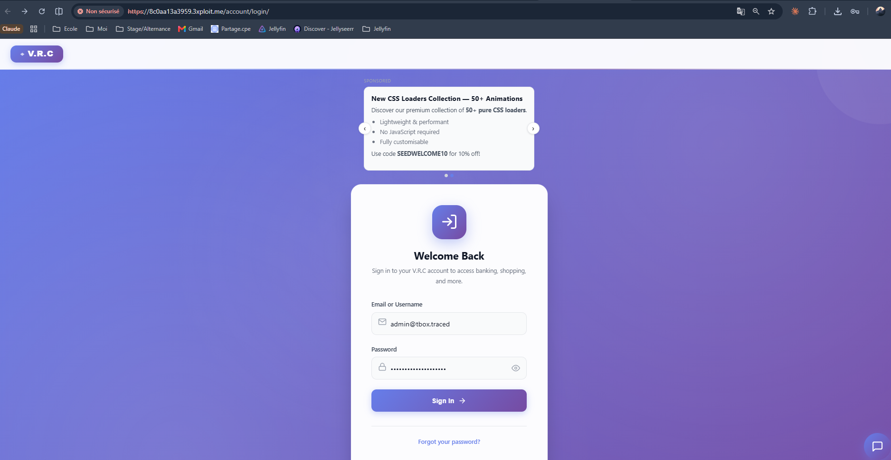
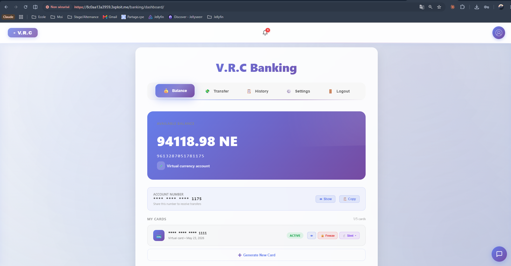

# Description

Banking PIN-gate bypass (CWE-287). The banking module implements secondary authentication through server-side PIN verification.

The normal PIN verification mechanism (`Bank/views_pin.py:26-96`) grants temporary banking authorization following successful validation. Session expiration is handled in `Bank/Utils/expiry.py:4-12`.

The affected banking view fails to enforce the same authentication requirements, compromising the secondary authentication boundary protecting sensitive banking data.

# Exploitation

| Step | Action | Result |
|------|--------|--------|
| 1 | Log in to the main app. | Valid `sessionid`. |
| 2 | `GET /banking/dashboard/`. | Redirect to `/banking/verification/` (PIN required). |
| 3 | `GET /banking/pin-skip/`. | Redirect to `/banking/dashboard/` (PIN **not** required). |

# PoC

**Comparison on the same session — one GET bypasses the gate:**

```bash
curl -sk -b cookies.txt -D - -o /dev/null "https://<TARGET>/banking/dashboard/"
# Location: /banking/verification/      ← PIN gate enforced

curl -sk -b cookies.txt -D - -o /dev/null "https://<TARGET>/banking/pin-skip/"
# Location: /banking/dashboard/         ← PIN gate skipped
```






The route is listed in `robots.txt`:

```bash
curl -sk "https://<TARGET>/robots.txt"   # contains: Disallow: /banking/pin-skip/
```

The screenshots illustrate the reported behavior but do not independently establish the complete authentication sequence.

# Risk

| Dimension | Impact |
|-----------|--------|
| Confidentiality | Exposure of sensitive banking dashboard data, including balances, cards and transaction history. |
| Integrity | Potential unauthorized banking operations, depending on their individual authorization controls. |
| Availability | None directly demonstrated. |

Overall severity: **High** — the vulnerability compromises the secondary authentication boundary protecting sensitive financial data.

# Remediation

1. **Remove authentication shortcuts** from production deployments.
2. **Require successful server-side PIN validation** before granting banking authorization.
3. **Centralise banking authorization** and enforce it consistently before accessing sensitive data or performing banking operations.
4. **Audit all `robots.txt`-disallowed routes** to ensure that access controls are properly enforced.
5. **Add regression tests** covering banking authentication, authorization and session expiration.

# Author
CPE LYON
