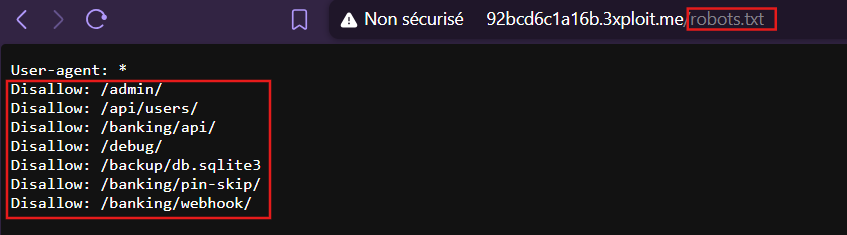

# Description

Sensitive path disclosure via `robots.txt` (CWE-200). The application serves a `robots.txt` (generated in `djangoWocshack_5/urls.py:25-36`) that hard-codes a list of internal/sensitive paths as `Disallow:` directives. Rather than hiding them, it broadcasts a roadmap of administrative and back-door routes to any reader — including direct pointers to the PIN-skip back-door (requires login), the unauthenticated user API, and the admin panel.

# Exploitation

A single unauthenticated request reveals the map:

```
GET /robots.txt
```

# PoC

```
User-agent: *
Disallow: /admin/
Disallow: /api/users/
Disallow: /banking/api/
Disallow: /debug/
Disallow: /backup/db.sqlite3
Disallow: /banking/pin-skip/
Disallow: /banking/webhook/
```



Actionable entries:
- `/admin/` — admin panel location (real route at `urls.py:41`).
- `/api/users/` — the unauthenticated user list (`Api/views.py:3850`, no auth decorator).
- `/banking/pin-skip/` — the PIN-gate bypass back-door (requires `@login_required`).
- `/banking/webhook/` — the SSRF-vulnerable webhook endpoint.
- `/backup/db.sqlite3` — listed but no URL pattern serves this path; it is a dead entry that still hints at the database engine.

# Risk

| Dimension | Impact |
|-----------|--------|
| Confidentiality | Hands attackers a precise recon map of hidden/privileged routes and the DB path. |
| Integrity | Accelerates exploitation of the linked back-doors. |
| Availability | None directly. |

Overall severity: **Medium** — low impact alone, but a force-multiplier that removes the reconnaissance phase for the higher-severity findings.

# Remediation

1. **Do not list sensitive paths in `robots.txt`.** `Disallow` is not access control.
2. **Protect the routes themselves** with authentication/authorization (they must be safe even if their URL is known).
3. **Remove the back-door/dev routes** (`/banking/pin-skip/`) from production.

# Author
DaVinciCode
