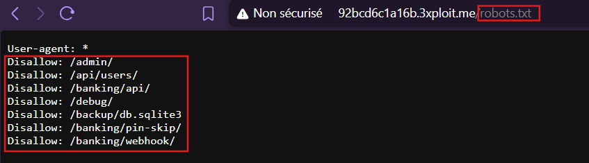

# Description

Sensitive path disclosure via `robots.txt` (CWE-200). The application serves a publicly accessible `robots.txt` file, generated in `djangoWocshack_5/urls.py`, containing a hard-coded list of internal and sensitive paths as `Disallow` directives.

The Robots Exclusion Protocol is intended to provide crawling instructions, not access control. The disclosure exposes information about the application's internal structure but does not, by itself, demonstrate unauthorised access to the listed resources.

# Exploitation

A single unauthenticated request reveals the map:

```
GET /robots.txt
```

# PoC

```
User-agent: *
Disallow: /admin/
Disallow: /api/users/
Disallow: /banking/api/
Disallow: /debug/
Disallow: /backup/db.sqlite3
Disallow: /banking/pin-skip/
Disallow: /banking/webhook/
```



Actionable entries:
- `/admin/` — admin panel location (real route at `urls.py:41`).
- `/api/users/` — the unauthenticated user list (`Api/views.py:3850`, no auth decorator).
- `/banking/pin-skip/` — the PIN-gate bypass back-door (requires `@login_required`).
- `/banking/webhook/` — the SSRF-vulnerable webhook endpoint.
- `/backup/db.sqlite3` — listed but no URL pattern serves this path; it is a dead entry that still hints at the database engine.

# Risk

| Dimension | Impact |
|-----------|--------|
| Confidentiality | Disclosure of internal application paths and architectural information. |
| Integrity | None directly demonstrated. |
| Availability | None directly demonstrated. |

Overall severity: **Low** — limited information disclosure concerning the application's internal structure, without demonstrated unauthorised access to sensitive resources.

# Remediation

1. **Remove unnecessary sensitive paths from `robots.txt`** — update the `robots.txt` generation in `djangoWocshack_5/urls.py` to retain only directives required for legitimate crawler management. `Disallow` directives must not be used as an access control mechanism.
2. **Enforce server-side access controls** — protect sensitive resources with appropriate authentication and authorisation checks, independently of their inclusion in `robots.txt`.
3. **Remove development-only and obsolete routes from production** — ensure that debugging, testing and administrative functionality is appropriately restricted according to deployment requirements.
4. **Add regression tests** — verify that the generated `robots.txt` does not disclose unnecessary sensitive paths and that access restrictions remain enforced independently of crawler directives.

# Author
DaVinciCode
