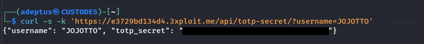
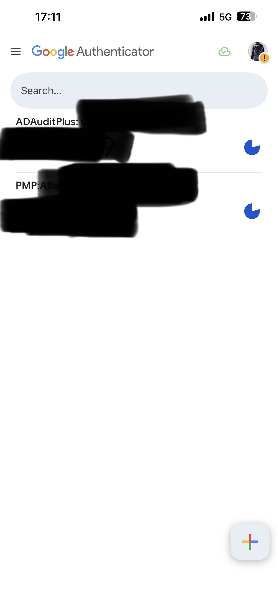
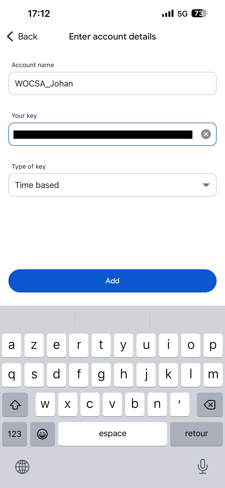

# Description

Unauthenticated TOTP-secret disclosure (CWE-200 / CWE-522) on `GET /api/totp-secret/?username=<user>`. The endpoint returns the raw TOTP shared secret of **any** user with no authentication. Since the username list is itself enumerable (see the unauthenticated user-list and enumeration findings), an attacker can retrieve any user's TOTP seed and generate valid one-time codes indefinitely — completely defeating two-factor authentication for every account.

# Exploitation

| Step | Action | Result |
|------|--------|--------|
| 1 | Request the endpoint with a target username, no auth. | TOTP secret returned in JSON. |
| 2 | Load the secret into any TOTP app (Google Authenticator, etc.). | Valid 2FA codes on demand. |
| 3 | Complete the 2FA challenge for the victim. | MFA bypassed. |

# PoC

**1. Retrieve a victim's TOTP secret, unauthenticated:**

```bash
curl -sk 'http://<TARGET>/api/totp-secret/?username=JOJOTTO'
# {"username":"JOJOTTO","totp_secret":"[REDACTED]"}
```



**2. Load the secret into an authenticator** (Type: *Time-based*, Key: the leaked secret) and read off valid codes:

<p align="center">
  
  
  
</p>

# Risk

| Dimension | Impact |
|-----------|--------|
| Confidentiality | Unauthorised disclosure of sensitive TOTP authentication secrets. |
| Integrity | Complete MFA bypass enables account takeover when combined with leaked/guessed passwords. |
| Availability | None directly. |

Overall severity: **High** — exposure of sensitive authentication material compromises the security guarantees provided by TOTP-based multi-factor authentication.

# Remediation

1. **Remove unauthorised TOTP secret disclosure** — remove the vulnerable secret retrieval functionality and ensure that existing TOTP secrets are never exposed through general-purpose API responses.
2. **Secure TOTP enrolment and replacement** — restrict provisioning to authenticated, ownership-verified users over HTTPS. Require appropriate reauthentication and authorisation before enrolling or replacing authentication factors. Limit secret disclosure to the protected enrolment process.
3. **Protect TOTP secrets at rest** — use encryption at rest with securely managed encryption keys. Restrict access to the authentication components that require the secrets for verification.
4. **Prevent secondary secret exposure** — exclude TOTP secrets from application logs, API serializers, diagnostic responses and administrative exports. Prevent caching of sensitive provisioning responses.
5. **Revoke and rotate exposed TOTP secrets** — invalidate potentially compromised secrets and require secure MFA re-enrolment for affected accounts. Review existing sessions and notify affected users as appropriate.
6. **Implement security monitoring** — audit authentication factor enrolment, replacement and revocation without recording secret values. Investigate potentially unauthorised access to authentication material.
7. **Add regression tests** — verify authentication and authorisation controls, secret confidentiality, secure enrolment, secret rotation and the invalidation of previously revoked authentication factors.

# Author
CUSTODES SQUAD
