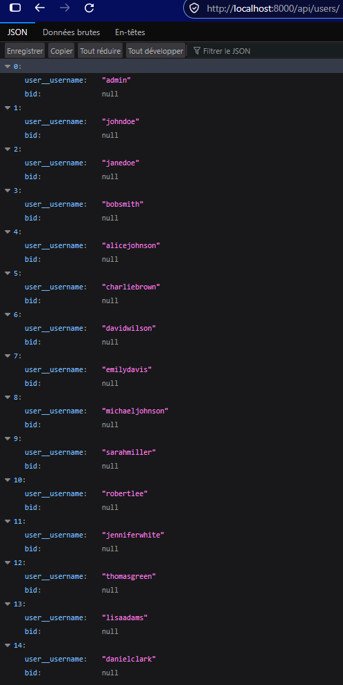

# Description

**CWE-306: Missing Authentication for Critical Function**

The `user_list` view returns every `UserProfile` record's username and bank ID (`bid`) to any caller. The view has no authentication check, and the project has no global authentication middleware that would enforce one (`djangoWocshack_5/settings/base.py` `MIDDLEWARE` contains only the stock Django security, session, CSRF, auth, messages and clickjacking middleware). The endpoint is reachable at `GET /api/users/` without a session or API key.

Vulnerable code:

- `Api/views.py:3850-3853`

```python
def user_list(request):
    from Account.models import UserProfile
    users = UserProfile.objects.all().values('user__username', 'bid')
    return JsonResponse(list(users), safe=False)
```

- Route: `Api/urls.py:220` — `path("users/", views.user_list, name="user_list"),`, included under `api/` by `djangoWocshack_5/urls.py:48`.

In the running platform no code path assigns `UserProfile.bid` (it is nullable and is only shown read-only in `Account/admin.py`), so every record currently returns `"bid": null`; the practical leak is the complete username roster, and any `bid` value populated later would be exposed in the same way.

The full dump has no pagination, filtering or rate limiting. The project's `robots.txt` template (`djangoWocshack_5/urls.py:29`) contains `Disallow: /api/users/`, but robots.txt is advisory and does not restrict access.

# Exploitation

| Step | Action | Result |
|------|--------|--------|
| 1 | Log out (or use a fresh client with no session cookie and no API key). | Caller is fully unauthenticated. |
| 2 | Send `GET /api/users/` to the application. | Server responds `200 OK` (`Content-Type: application/json`) with a JSON array. |
| 3 | Parse the response. Each element contains `user__username` and `bid`. | Complete list of registered usernames (15 accounts on the seeded instance, including `admin`) is obtained in one request; `bid` is `null` for every account. |
| 4 | Use the harvested usernames as input to follow-on attacks, such as login brute force or password spraying against `/account/login/`, or as targets for other broken-access-control or account-takeover issues in the platform. | Attack surface for account compromise is expanded without any prior knowledge of valid accounts. |

# PoC

```bash
curl -s http://localhost:8000/api/users/
```

Observed response on the seeded instance (truncated):

```json
[{"user__username": "admin", "bid": null},
 {"user__username": "johndoe", "bid": null},
 {"user__username": "janedoe", "bid": null},
 ...]
```

Confirm no authentication is required by checking the status code with no cookies:

```bash
curl -s -o /dev/null -w "%{http_code}\n" http://localhost:8000/api/users/
# 200
```

**Browser-side validation (local environment):**

The following screenshot shows the JSON response returned by the user-list API in the local test environment.

<p align="center">
  
</p>

# Risk

| Dimension | Impact |
|-----------|--------|
| Confidentiality | Every registered username is disclosed to anonymous callers, including privileged accounts such as `admin`. The `bid` (bank ID) field is also serialised; it is `null` for all accounts in the current deployment, but would be leaked as soon as it is populated. |
| Integrity | No direct modification of data. The disclosed usernames enable follow-on integrity attacks (credential stuffing, password spraying, account takeover via other flaws). |
| Availability | No direct impact. The unpaginated full-table dump is cheap to request repeatedly and is not rate-limited, but it does not by itself degrade service. |

Overall severity: **Medium** — the endpoint leaks the full user roster (and the `bid` field, currently `null`) to anyone with network access, with no preconditions (CVSS 3.1 `AV:N/AC:L/PR:N/UI:N/S:U/C:L/I:N/A:N`, score 5.3). Severity rises when chained with login brute force or other account-takeover flaws, since the attacker no longer has to guess valid usernames.

# Remediation

1. **Enforce authentication and authorisation** — protect the `user_list` view in `Api/views.py` using Django's `@login_required` and appropriate permission checks, such as `@permission_required` or `request.user.has_perm()`. Apply equivalent controls if the functionality uses API-based authentication.
2. **Apply the principle of least privilege** — restrict access to user information according to the caller's permissions and legitimate functional requirements. Deny access by default.
3. **Minimise exposed data** — remove `bid` from public responses and explicitly allow-list the fields required by each authorised consumer. If a public user directory is required, expose only information intended for public access.
4. **Remove unnecessary functionality** — remove the user-list endpoint if it has no legitimate consumer. Do not rely on `robots.txt` as an access control mechanism.
5. **Enforce pagination and rate limiting** — apply appropriate response size limits and request rate limits to remaining user-list functionality. These controls must complement authentication and authorisation.
6. **Add regression tests** — extend `Api/tests.py` to verify that anonymous and authenticated but unauthorised users cannot access protected data, that authorised users receive only permitted fields, and that pagination and rate limits are correctly enforced.

# Author
WOCSA
